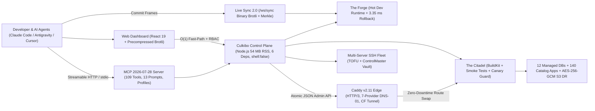

<div align="center">


# Culkibo

**The `<60 MB`, Zero-Shell, AI-Native Self-Hosted PaaS (Open-Source Coolify & Dokploy Alternative)**
Deploy **140+ 1-Click Apps**, **12 Managed Databases**, **Live Sync 2.0** (`2.03 ms` delta apply, `-96.1%` Brotli wire savings), **Multi-Server SSH Fleets**, and **109 MCP Tools** for **Claude Code, Antigravity, Cursor, Windsurf & Codex** — on a single `54 MB` Node.js control plane with **6 runtime dependencies** and **Caddy v2.11** atomic routing.

[](LICENSE)
[](package.json)
[](#benchmarks-and-reproducible-results)
[](package.json)
[-0F172A.svg)](tests/shell-safety.test.js)
[](#ai-agent-native-mcp-2026-07-28)

```bash
git clone https://github.com/macaqueboy/culkibo.git && cd culkibo
docker compose up -d --build
node bin/culkibo.js agent-init claude
```

[Why Culkibo](#why-culkibo-is-architecturally-different) ·
[Comparison Matrix](#honest-head-to-head-comparison) ·
[Benchmarks & Results](#benchmarks-and-reproducible-results) ·
[Architecture](#architecture) ·
[30-Second Quick Start](#30-second-quick-start) ·
[AI Agents & MCP](#ai-agent-native-mcp-2026-07-28) ·
[Coolify Migration](#1-click-coolify-v4-migration-and-portable-bundles) ·
[Open-Core & Roadmap](#ethical-open-core-and-community-roadmap) ·
[Contributing](#contributing-and-community)

</div>

---

Culkibo is an open-source **self-hosted PaaS** and **Coolify / Dokploy alternative** engineered for solo builders, teams, and AI coding agents. Instead of bolting a heavy PHP/Laravel or multi-container control stack on top of polling reverse proxies and shell scripts, Culkibo runs a single **54 MB RSS** daemon with **zero shell command construction**, atomic **Caddy v2.11** ingress, **Live Sync 2.0** binary hot-sync, and a native **Model Context Protocol (MCP `2026-07-28`)** control surface.

---

## Why Culkibo Is Architecturally Different

Traditional self-hosted PaaS platforms force a painful trade-off: burn 500 MB–1.5 GB of VPS RAM just to run the panel, wait 1–4 minutes per Docker rebuild while iterating with AI coding agents, debug Traefik reloads or stale labels, and live with recurring shell-injection CVEs. Culkibo fixes these problems at the architecture layer:

### 1. Zero-Shell Engine (`shell: false`, CI-Verified)
Every subprocess (`docker`, `git`, `caddy`, `ssh`, `cron`, `exec`, `npm`) is invoked through `spawn()` / `execFile()` with tokenized `argv` arrays validated by [`safeCommand.js`](server/services/safeCommand.js) and `shell: false`. Secrets are passed via ephemeral `0600` `--env-file` descriptors or `GIT_ASKPASS` — never interpolated into shell strings, CLI arguments, or `.git/config`. This invariant is statically verified on every commit by [`tests/shell-safety.test.js`](tests/shell-safety.test.js), eliminating an entire class of command-injection RCE CVEs that have repeatedly hit self-hosted PaaS tools.

### 2. `<60 MB` Idle RAM & 6 Runtime Dependencies
- **Measured live:** **54 MB RSS** idle daemon (~72 MB full stack including ~18 MB Caddy estimate), **0% idle CPU**, **170.8 ms** cold boot (`CULKIBO_SKIP_RECONCILE=1`). Fits comfortably on a **$4/mo 512 MB–1 GB VPS**.
- **Minimal supply-chain blast radius:** Just **6** root npm runtime dependencies ([`package.json`](package.json): `express`, `ws`, `chokidar`, `commander`, `cors`, `dotenv`) and **0** dependencies in [`telemetry-collector/`](telemetry-collector/README.md).
- **Sub-millisecond fast-paths:** O(1) pre-compiled route maps, HMAC-SHA256 LRU auth cache, WeakMap Brotli/Gzip zero-copy buffers, and live `Server-Timing: cp;dur=<ms>` headers visible directly in browser DevTools.

### 3. Live Sync 2.0 — Edit Locally, Live in Milliseconds (*The Forge*)
When coding with Claude Code, Antigravity, Cursor, or Windsurf, waiting 2–4 minutes per push destroys flow:

```text
Traditional PaaS:  save file -> git commit -> push -> webhook -> Docker rebuild (1-4 min) -> check
Culkibo Forge:     save file -> binary Commit Frame (/ws/sync, Brotli -96.1%) -> 2.03 ms server apply
Culkibo Citadel:   promote   -> Docker BuildKit + healthcheck + smoke test -> Caddy v2.11 atomic cutover
```

- **Adaptive binary framing (`0x02` Brotli / `0x03` Gzip):** `-96.1%` wire reduction on 100-file bursts, SHA-256 LRU deduplication, chunked transfers for large files (`<=100 MB` with SHA-256 verification), client/server **Merkle Tree** consistency checks, conflict detection, and **in-memory time-travel patch rollback (`3.35 ms p50`)**.
- **Honest scope:** Live Sync 2.0 accelerates incremental code/asset iteration (*Path B*). Dependency or `Dockerfile` changes run full immutable Docker BuildKit builds (*Path C*) with zero-downtime promotion and multi-release rollback.

### 4. AI-Agent Native (`MCP 2026-07-28`, 109 Tools, 13 Playbook Prompts)
- **Streamable HTTP (`POST /api/mcp`) + stdio (`culkibo mcp`)** with legacy SSE fallback.
- **5 Context-Saving Profiles (`?profile=core|deploy|ops|security|all` & `CULKIBO_MCP_PROFILE`):** `?profile=core` serves the 17 essential tools and cuts LLM tool-schema context by **`-80.7%`** (`~4,284` vs `~22,198` tokens, live-measured), while `culkibo_search_tools` discovers any of the remaining 109 tools on demand.
- **Autonomous Ops with Guardrails:** `culkibo_diagnose_incident`, two-phase HMAC `confirmToken` remediation (`culkibo_auto_remediate`), `culkibo_ship_and_verify` (secret scan + deploy + smoke check), **13 interactive MCP playbooks** (`prompts/list` & `prompts/get`), **7 live resources**, strict RBAC enforcement, and recursive secret redaction.
- **1-Click Agent Setup:** Run `culkibo agent-init claude` (or `antigravity`, `cursor`, `windsurf`, `codex`, `vscode`) to drop in ready-to-use configs without ever writing plaintext master tokens to disk.

### 5. 1-Click Coolify v4 Migration + Universal Importer + Portable Bundles
- **Coolify v4 Deep Migrator ([`docs/MIGRATION_GUIDE.md`](docs/MIGRATION_GUIDE.md)):** Translates Coolify v4 **Magic Variables** (`${SERVICE_FQDN_*}`, `${SERVICE_URL_*}`, `${SERVICE_PASSWORD_*}`, `${COOLIFY_*}`) into Culkibo native domains and `${vault.*}` secrets, converts **Traefik labels** (`stripprefix`, `redirectregex`, CORS/HSTS headers, `forwardauth`, `basicauth`, `loadbalancer.server.port`) into native Caddy v2.11 edge config, and generates a pre-flight **Parity Report** + post-migration smoke verifier.
- **Universal Importer & WordPress Migrator:** Imports Docker Compose stacks, Git repos, Vercel/Netlify/Railway/Render/Dokploy configs, and live WordPress sites (streaming up to 500 MB `.sql`/`.sql.gz` into isolated MariaDB).
- **Portable Stack Bundles ([`bundleArchiver.js`](server/services/bundleArchiver.js)):** Zero-dep self-contained `.zip` / `.ckb.gz` exports (with CRC32, path-traversal, and zip-bomb protection) packaging project config, `culkibo.yaml`, encrypted vault envelope, edge rules, and agent MCP config.

### 6. Enterprise Defense-in-Depth Built In — Not Paywalled
- **Identity & Access:** Multi-user teams, 4-role RBAC (`owner`/`admin`/`developer`/`viewer`), per-project ACL overrides, scoped API tokens with triple-layer instant revocation, **TOTP 2FA**, and **OIDC PKCE SSO**.
- **Tamper-Evident Security:** Hash-chained append-only audit log (`data/audit.jsonl`, `0600`) with 1-click SHA-256 integrity verification, pre-deploy secret scanner, IPv4/IPv6 + DNS-rebinding SSRF guard, and single-use IP-bound WebSocket tickets.
- **Edge & Zero-Open-Ports Networking:** Caddy v2.11 native **HTTP/3 (QUIC)**, **Multi-DNS-01 Wildcard TLS across 7 providers** (`Cloudflare`, `Hetzner`, `DigitalOcean`, `AWS Route 53`, `Porkbun`, `Bunny`, `DuckDNS`), **Cloudflare CGNAT Tunnels** (zero open ports), per-domain Basic Auth (pure OpenBSD bcrypt), IP CIDR allowlists, ForwardAuth, and CORS/HSTS hardening.
- **Data & Disaster Recovery:** **12 managed database engines** (`PostgreSQL`, `pgvector`, `TimescaleDB`, `MySQL`, `MariaDB`, `Valkey`, `Redis`, `Dragonfly`, `MongoDB`, `ClickHouse`, `Qdrant`, `Meilisearch`), **AES-256-GCM + scrypt** encrypted S3/R2/MinIO backups (0-dep AWS SigV4) with SHA-256 pre-restore verification and non-destructive **DR Restore Drills**.
- **Multi-Server SSH Fleet, GitOps, Uptime & Scale-to-Zero:** Zero-shell SSH ControlMaster fleet orchestration (TOFU + AES-256-GCM key vault), declarative `culkibo.yaml` GitOps (`export`/`plan`/`apply`/`drift`), synthetic uptime monitors + public `/status/:slug` pages, and native **Auto-Sleep Scale-to-Zero** with cost/RAM advisor.

---

## Honest Head-to-Head Comparison

> **Radical Transparency:** Culkibo's metrics below are **live-measured** via `node bench/run-all.bench.js` (unadjusted). Competitor footprints are **documented architecture baselines** from published stacks and minimum VPS docs (not executed on this host).

| Capability | Culkibo v1.1 | Coolify v4 | Dokploy | CapRover | Kamal 2 | Portainer CE |
| :--- | :---: | :---: | :---: | :---: | :---: | :---: |
| **Control-Plane Stack** | **Node.js (6 deps) + Caddy** | Laravel + PHP + PG + Redis + Soketi + Traefik | Next.js + PG + Redis + Traefik | Node.js + Nginx + Swarm | Local Ruby CLI + `kamal-proxy` | Go + BoltDB *(container UI)* |
| **Control-Plane RAM Footprint** | **54 MB RSS** *(~72 MB w/ Caddy, measured)* | ~800 MB – 1.5 GB *(2 GB VPS min)* | ~450 – 800 MB *(1–2 GB VPS)* | ~150 – 300 MB *(300–450 MB w/ Swarm)* | 0 MB panel *(+15–25 MB proxy)* | ~100 – 200 MB *(external proxy)* |
| **Zero-Shell Execution (`shell: false`)** | ✅ **CI-verified (`0` calls)** | ❌ PHP shell | ❌ Child shell | ⚠️ Swarm CLI | ⚠️ SSH shell | ✅ Docker API |
| **Reverse Proxy & Route Cutover** | **Caddy v2.11 atomic API** *(HTTP/3, 0 poll)* | Traefik *(2,000 ms file throttle)* | Traefik / Swarm | Nginx reload | `kamal-proxy` *(<1 ms swap)* | ❌ External |
| **Live Sync 2.0 (Hot Incremental Sync)** | ✅ **`2.03 ms` apply · `-96.1%` br** | ❌ Full rebuild | ❌ Full rebuild | ❌ Image build | ❌ Image build | ❌ |
| **AI-Agent Native MCP (`2026-07-28`)** | ✅ **109 tools · 13 prompts · `-80.7%` profile** | ❌ *(3rd-party)* | ❌ *(3rd-party)* | ❌ | ❌ | ❌ |
| **1-Click App Catalog** | ✅ **140 pinned apps (0 `:latest`)** | ✅ Extensive | ✅ Extensive | ✅ One-click | ❌ Manual | ⚠️ Templates |
| **Managed Databases & Encrypted DR** | ✅ **12 engines · AES-256-GCM S3 + DR Drills** | ✅ 8 engines | ✅ 5 engines | ⚠️ Manual | ⚠️ Accessories | ❌ Manual |
| **Multi-Server SSH Fleet** | ✅ **Zero-shell TOFU + Vault** | ✅ SSH | ✅ Swarm/SSH | ✅ Swarm | ✅ SSH | ✅ Agents |
| **Teams RBAC + 2FA + OIDC SSO** | ✅ **4-role RBAC + ACL + TOTP + OIDC** | ⚠️ Coarse teams | ⚠️ Basic | ❌ | ❌ | ⚠️ Paid Business |
| **Declarative GitOps + Scale-to-Zero** | ✅ **`culkibo.yaml` + Auto-Sleep** | ⚠️ External Sablier | ❌ Requested | ❌ | ✅ `deploy.yml` | ⚠️ Git stacks |
| **Wildcard DNS-01 + Zero-Port Tunnels** | ✅ **7 DNS providers + CF Tunnel** | ⚠️ Manual | ⚠️ Manual | ⚠️ Manual | ⚠️ Manual | ❌ |
| **1-Click Coolify v4 Migration** | ✅ **Magic Vars + Traefik→Caddy + `.zip`** | — | ❌ | ❌ | ❌ | ❌ |

---

## Benchmarks and Reproducible Results

Every Culkibo metric below comes from real code executed on `Node v24.14.0` (`win32/x64`) with **zero synthetic delays and zero subtracted overhead**. Reproduce the complete suite or generate a Markdown/JSON comparison report on your own machine:

```bash
node bench/run-all.bench.js
node bench/competitor-comparison.bench.js --markdown
```

### Live Measured Performance (Cycle-1 Verified Results)

| Metric | Live Measured Result | Notes & Verification Command |
| :--- | :--- | :--- |
| **Cold Boot Time** (`CULKIBO_SKIP_RECONCILE=1`) | **170.8 ms** | Measured via `process.hrtime.bigint()` (`npm run bench:control`) |
| **Idle Daemon RAM / CPU** | **54 MB RSS · 0% CPU** | ~72 MB full stack incl. ~18 MB Caddy estimate (`npm run bench:control`) |
| **Health HTTP (`GET /api/health`, 500 req / 25w)** | **p50 6.39 ms · p95 12.60 ms · p99 17.34 ms** (**3,479 req/s**) | Emits `Server-Timing: cp;dur=0.04` header |
| **Authenticated Fast-Path (Bearer + Brotli, 500 req / 25w)** | **p50 6.88 ms · p95 11.59 ms · p99 13.16 ms** (**3,294 req/s**) | HMAC-SHA256 LRU cache + WeakMap zero-copy Brotli |
| **Mixed Uncompressed Control-Plane (500 req / 25w)** | **p50 13.58 ms · p95 25.01 ms · p99 31.97 ms** (**1,607 req/s**) | 0 failures across `/health`, `/projects`, `/catalog`, `/pods` |
| **Express Multi-Tenant RBAC HTTP (500 req / 25w)** | **p50 19.49 ms · p99 36.49 ms** (**1,219 req/s**) | Full Express middleware + session/API token RBAC (`bench/subsystems.bench.js`) |
| **Catalog Load (`GET /api/catalog`, 140 apps)** | **warm p50 0.73 ms** *(cold 32.36 ms)* | `129.6 KB` → `34.5 KB` Brotli (**-73.4%**) |
| **Live Sync 2.0 (Path B Incremental Sync)** | **server apply p50 2.03 ms · E2E p50 15.33 ms** | 100-file TSX burst Brotli **-96.1%** · in-memory rollback **p50 3.35 ms** (`npm run bench:sync`) |
| **Caddy v2.11 Atomic Route Swap** | **Synchronous zero-poll Admin API** | Run `npm run bench` with local Caddy `:2019` active *(vs Traefik 2,000 ms file throttle)* |
| **MCP `2026-07-28` `?profile=core` Savings** | **-80.7% schema tokens** | `17 / 109` tools (`?profile=core` live-measured by `measureMcpProfileSavings()`) |
| **Runtime Dependencies & Shell Construction** | **6 root deps · 0 collector deps · 0 shell calls** | Verified by [`package.json`](package.json) & [`tests/shell-safety.test.js`](tests/shell-safety.test.js) |

---

## Architecture

Culkibo separates rapid developer/AI iteration (**The Forge**) from immutable production releases (**The Citadel**) on a single lightweight control plane:



---

## 30-Second Quick Start

### Prerequisites
- **Production VPS:** Debian 12 / Ubuntu 22.04+ (512 MB+ RAM; 1 GB+ recommended for Docker builds)
- **Docker Compose:** Docker Engine 24+ & Compose v2
- **Local Dev:** Node.js **20+** (22/24 LTS recommended). Docker and Caddy are optional locally.

### Option 1 — Docker Compose (Recommended, ~30s)

```bash
git clone https://github.com/macaqueboy/culkibo.git
cd culkibo
docker compose up -d --build
```

Starts the Culkibo daemon on `http://127.0.0.1:3030` wired over a private internal network to **Caddy v2.11** (ports `80`, `443/tcp`, `443/udp` for HTTP/3, with `:2019` Admin API never exposed to the host). See [`docker-compose.yml`](docker-compose.yml) and [`Dockerfile.caddy`](Dockerfile.caddy) for Multi-Wildcard DNS-01 builds.

### Option 2 — 1-Line Production VPS Installer (Debian / Ubuntu)

Installs an unprivileged `culkibo` user, Node.js 22, Docker, Caddy with automatic TLS + HTTP/3, hardened `systemd` unit, and a `0600` 256-bit auth token in `data/auth.json`:

```bash
curl -fsSL https://raw.githubusercontent.com/macaqueboy/culkibo/main/scripts/install.sh | sudo bash
```

Clean uninstall: `sudo bash /opt/culkibo/scripts/uninstall.sh` (verified against real Debian 12 + `systemd` via [`scripts/test-install.sh`](scripts/test-install.sh)).

### Option 3 — CLI-First Project Workflow (`init` → `up` → `sync` → `deploy`)

Install and run locally from source (Windows users can also run `./start.ps1`):

```bash
npm install && npm --prefix web install && npm run web:build && npm start
```

Then run the project lifecycle from any repository directory:

```bash
node bin/culkibo.js init .                 # Auto-detect stack & generate culkibo.yaml
node bin/culkibo.js up .                   # Provision & start project
node bin/culkibo.js sync <projectId> .     # Start Live Sync 2.0 (The Forge)
node bin/culkibo.js deploy <projectId>     # Immutable BuildKit deploy (The Citadel)
node bin/culkibo.js rollback <projectId>   # Instant rollback to previous release
node bin/culkibo.js doctor                 # 10-point live environment health audit
```

---

## AI-Agent Native (MCP `2026-07-28`)

Culkibo is built from day one for autonomous and human-in-the-loop AI coding workflows.

### 1-Click Agent Kit Generator

Generate drop-in MCP configs (defaulting to `?profile=core` for **-80.7% token savings** and using `${CULKIBO_TOKEN}` env placeholders — never plaintext secrets):

```bash
node bin/culkibo.js agent-init claude       # .mcp.json + CLAUDE.md ops snippet
node bin/culkibo.js agent-init antigravity  # Antigravity Streamable HTTP config
node bin/culkibo.js agent-init cursor       # .cursor/mcp.json
node bin/culkibo.js agent-init windsurf     # Windsurf MCP config
node bin/culkibo.js agent-init codex        # OpenAI Codex CLI config
```

### Streamable HTTP (`2026-07-28`) — Antigravity, Claude Code, Cursor & Windsurf

Connect to `http://localhost:3030/api/mcp?profile=core` (or `deploy`, `ops`, `security`, `all`):

```json
{
  "mcpServers": {
    "culkibo": {
      "url": "http://localhost:3030/api/mcp?profile=core",
      "headers": {
        "Authorization": "Bearer ${CULKIBO_TOKEN}"
      }
    }
  }
}
```

### Stdio Bridge (Claude Desktop / Local CLI Agents)

```json
{
  "mcpServers": {
    "culkibo": {
      "command": "node",
      "args": ["/path/to/culkibo/bin/culkibo.js", "mcp"],
      "env": {
        "CULKIBO_API_URL": "http://localhost:3030",
        "CULKIBO_TOKEN": "${CULKIBO_TOKEN}",
        "CULKIBO_MCP_PROFILE": "core"
      }
    }
  }
}
```

### Built-In MCP Playbooks (`prompts/list` & `prompts/get`)

| Playbook Prompt | Autonomous Agent Workflow |
| :--- | :--- |
| `deploy_safely` | Pre-deploy secret scan → immutable deploy → health/smoke verification → metrics check |
| `migrate_from_coolify` | Read-only Coolify v4 scan → Magic Var & Traefik translation preview → zero-downtime cutover |
| `debug_production_crash` | Runs `culkibo_diagnose_incident` → correlates OOM/logs/restarts → proposes confirmed fix |
| `zero_downtime_db_upgrade` | Encrypted snapshot + SHA-256 verify + DR drill → clone/cutover |
| `security_audit_stack` | Verifies hash-chained audit log, secret scan, RBAC/2FA/OIDC posture, and TLS expiry |
| `setup_wildcard_tls_and_tunnel` | Configures 7-provider DNS-01 wildcard TLS or zero-open-port Cloudflare CGNAT Tunnel |
| `optimize_ram_and_costs` | Inspects Auto-Sleep candidates, container limits, and right-sizing savings |
| `disaster_recovery_drill` | Validates AES-256-GCM DR backup integrity via non-destructive dry-run restore |

---

## 1-Click Coolify v4 Migration and Portable Bundles

Moving off Coolify takes minutes — and is **read-only** on your source server until you flip DNS:

1. Open Culkibo (`http://localhost:3030`), press **`Ctrl+K`** / **`⌘K`**, and run **Import from Coolify** (or upload an offline export / portable `.zip` bundle).
2. Enter your Coolify URL and read-only API token to inspect the live **Migration Parity Report**:
   - Automatic **Magic Variable** translation (`${SERVICE_FQDN_*}`, `${SERVICE_PASSWORD_*}`, `${COOLIFY_*}` → Culkibo domains & encrypted `${vault.*}` refs)
   - Automatic **Traefik → Caddy v2.11** rule translation (`stripprefix`, `redirectregex`, CORS/HSTS, `forwardauth`, `basicauth`, upstream port)
   - Full mapping for Applications, Compose Services, Databases, Scheduled Tasks → Crons, and Persistent Volumes
3. Click **Migrate**, run the built-in post-migration smoke check, and cut over DNS with zero downtime.

Read the complete step-by-step runbook in [`docs/MIGRATION_GUIDE.md`](docs/MIGRATION_GUIDE.md).

---

## Testing, Verification & Repository Map

Culkibo ships **35+ automated test files** (including static shell safety, SSRF/RBAC security hardening, real competitor CVE regressions, adversarial fuzzing, live-server, WebSocket churn, and mixed HTTP stress):

```bash
node tests/shell-safety.test.js                     # Static AST/source check: 0 shell calls
npm run typecheck                                   # Server TypeScript checkJs (0 errors)
npx tsc -p web/tsconfig.app.json --noEmit           # Frontend TypeScript check (0 errors)
npm --prefix web run lint                           # oxlint React 19 + Compiler rules
npm run web:build                                   # Vite production build + .br/.gz precompression
npm test                                            # Full suite + live-server + WS stress + HTTP stress
node --test telemetry-collector/test/collector.test.js  # Zero-dep telemetry collector suite
```

### Repository Layout

```text
bin/culkibo.js                   CLI (init, up, sync, deploy, rollback, fleet, gitops, agent-init, mcp...)
server/
  index.js                       O(1) fast-path HTTP daemon, Server-Timing, Brotli cache, WS (/ws, /ws/sync)
  middleware/auth.js             Constant-time tokens, RBAC middleware, single-use WS tickets, rate limits
  routes/api.js                  REST API (deploys, edge, DR, multi-Git webhooks, fleet, edition, MCP)
  services/                      40+ zero-shell services (liveSyncEngine, caddyManager, coolifyMigrator,
                                 bundleArchiver, mcpServer, serverFleetManager, teamManager, editionService,
                                 databaseManager, catalog/templates.js [140 apps], auditLogger, ssrfGuard...)
telemetry-collector/             Zero-dep anonymous telemetry collector (node:sqlite WAL + CF Workers/D1)
web/src/                         React 19 + Tailwind v4 dashboard (Cmd+K palette, Security & AI Hubs)
bench/                           Reproducible live benchmarks (control-plane, live-sync, route-swap, subsystems)
scripts/                         Hardened Debian/Ubuntu VPS installer, uninstaller & systemd container test
tests/                           35+ verification, security, CVE-regression, fuzz, stress & benchmark suites
docs/                            MIGRATION_GUIDE.md, GITHUB_SEO_LAUNCH_KIT.md, COMPETITOR_RADAR_CYCLE1.md
```

---

## Privacy & Transparent Telemetry

Culkibo includes opt-out anonymous crash/health telemetry scrubbed through an **11-phase PII sanitizer** (never collects secrets, domains, IPs, repo names, or payloads). Inspect the exact JSON envelope anytime (`node bin/culkibo.js telemetry preview`) or disable it instantly via `CULKIBO_TELEMETRY=0`, `DO_NOT_TRACK=1`, CLI (`telemetry disable`), or Settings. Full specification in [`PRIVACY.md`](PRIVACY.md) and [`telemetry-collector/README.md`](telemetry-collector/README.md).

---

## Ethical Open-Core and Community Roadmap

### Our Open-Core Promise (Enforced in [`editionService.js`](server/services/editionService.js))

- **Community Edition (`Apache-2.0`, Free Forever):** **100% of self-hosted core power with ZERO artificial limits** — unlimited projects, databases, domains, wildcard TLS, Live Sync 2.0, Multi-Server SSH Fleet, Multi-User Teams & 4-role RBAC, TOTP 2FA, OIDC SSO, GitOps `culkibo.yaml`, 109-tool MCP Server, AES-256-GCM S3 DR Backups, Uptime Monitors & Status Pages, Auto-Sleep Scale-to-Zero, and Observability. **Zero phone-home.**
- **Optional Commercial Packs (`Pro` / `Enterprise` / `Cloud`):** Verified **100% offline via Ed25519 signed keys (`CKL1.*`)** — strictly for organizational scale & compliance: Managed Multi-Region Relay, White-Label Branding, Priority Support Bundles, Enterprise SCIM 2.0 / SAML 2.0, SOC2/ISO-27001 Signed Compliance Exports, and Managed Multi-AZ Cloud Control Plane.

### Public Engineering Roadmap (Zero New Runtime Deps)

- [x] **v1.0 – v1.1 (Shipped):** 54 MB RSS fast-path + `Server-Timing`, 140 pinned catalog apps, 12 DB engines, 109 MCP tools + 13 playbooks + `-80.7%` profiles, Live Sync 2.0, Multi-Server SSH Fleet, 4-role RBAC + 2FA + OIDC, Coolify v4 Magic-Var & Traefik→Caddy migrator, Portable `.zip` Stack Bundles, Offline Ed25519 Open-Core editions.
- [ ] **Next — SmartPack & DirectPush (`culkibo pussh`):** Inspectable zero-dep build plans (auto-`.dockerignore`, BuildKit cache mounts, cgroup build caps, `zstd:chunked`) + registry-less OCI layer-delta push over existing SSH tunnels (zero Docker Hub/GHCR required).
- [ ] **Next — Sovereign EdgeTunnel & MCP Apps (`ui://culkibo/*`):** Self-hosted CGNAT outbound WebSocket tunnel with Caddy ForwardAuth + inline interactive MCP UI cards inside Claude, Antigravity, and VS Code.
- [ ] **Next — SnapStream & Preview DB Branching:** Zero-dep SQLite WAL-to-S3 streaming replication + automatic ephemeral PR database branches + 1-click FrankenPHP Worker preset.

---

## Contributing and Community

Contributions, bug reports, catalog templates, and benchmarks are warmly welcomed!

- **Read the guide:** [`CONTRIBUTING.md`](CONTRIBUTING.md) (setup, invariants, catalog & MCP authoring)
- **Report a bug or request a feature:** [`.github/ISSUE_TEMPLATE/`](.github/ISSUE_TEMPLATE/bug_report.md) · [`.github/PULL_REQUEST_TEMPLATE.md`](.github/PULL_REQUEST_TEMPLATE.md)
- **Report a security vulnerability privately:** [`SECURITY.md`](SECURITY.md)
- **Support the project:** If Culkibo saves you RAM, deploy wait time, or migration hours, please **Star this repository** on GitHub so more self-hosters and AI-native teams discover it!

---

## License

Licensed under the **[Apache License 2.0](LICENSE)** — Copyright © 2026 Pablo (`macaqueboy`).
