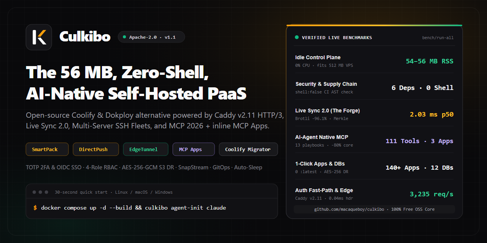
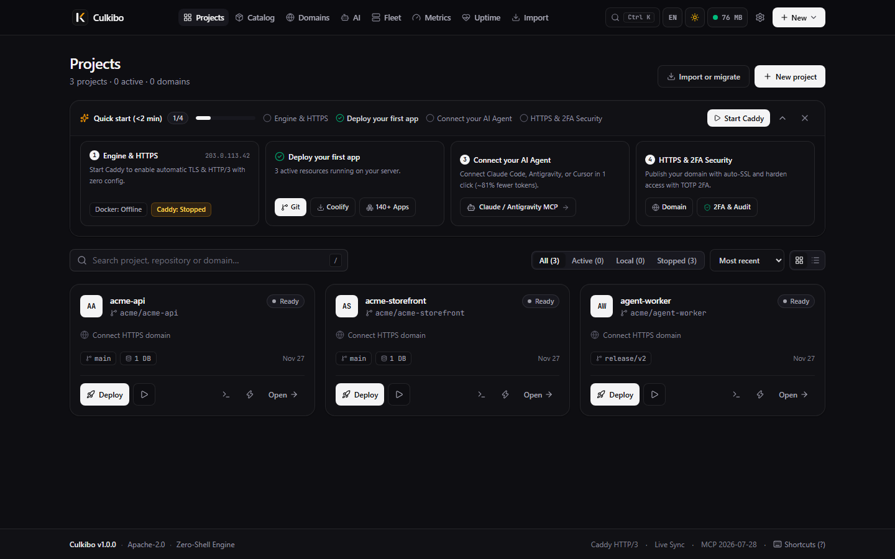
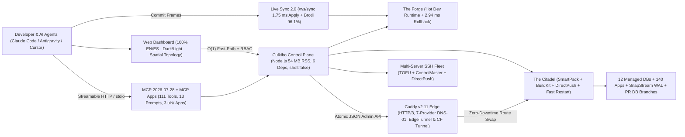

<div align="center">


# Culkibo

**The `<60 MB`, Zero-Shell, AI-Native Self-Hosted PaaS (Open-Source Coolify & Dokploy Alternative)**
Deploy **140+ 1-Click Apps**, **12 Managed Databases**, **Live Sync 2.0** (`1.75 ms` delta apply, `-96.1%` Brotli), **SmartPack**, **DirectPush (`culkibo pussh`)**, **Sovereign EdgeTunnel**, **Multi-Server SSH Fleets**, and **111 MCP Tools + 3 Inline MCP Apps** for **Claude Code, Antigravity, Cursor, Windsurf & Codex** — on a single `54 MB` Node.js control plane with **6 runtime dependencies**, **CycloneDX 1.6 SBOM**, and **Caddy v2.11** atomic routing.

[](.github/workflows/release.yml)
[](LICENSE)
[](.github/workflows/ci.yml)
[](#benchmarks-and-reproducible-results)
[](scripts/release-provenance.js)
[-0F172A.svg)](tests/shell-safety.test.js)
[](#ai-agent-native-mcp-2026-07-28-and-mcp-apps)

<p>
  
</p>

```bash
git clone https://github.com/macaqueboy/culkibo.git && cd culkibo
docker compose up -d --build
node bin/culkibo.js agent-init claude
```

[Visual Showcase](#visual-showcase) ·
[Why Culkibo](#why-culkibo-is-architecturally-different) ·
[Comparison Matrix](#honest-head-to-head-comparison) ·
[Benchmarks & Results](#benchmarks-and-reproducible-results) ·
[Architecture](#architecture) ·
[30-Second Quick Start](#30-second-quick-start) ·
[AI Agents & MCP Apps](#ai-agent-native-mcp-2026-07-28-and-mcp-apps) ·
[Coolify Migration](#1-click-coolify-v4-migration-and-portable-bundles) ·
[Open-Core & Roadmap](#ethical-open-core-and-community-roadmap) ·
[Contributing](#contributing-and-community)

</div>

---

Culkibo `v1.2.0` is an open-source **self-hosted PaaS** and **Coolify / Dokploy alternative** engineered for solo builders, platform teams, and AI coding agents. Instead of bolting a heavy PHP/Laravel or multi-container control stack on top of polling reverse proxies and shell scripts, Culkibo runs a single **54 MB RSS** daemon with **zero shell command construction**, atomic **Caddy v2.11** HTTP/3 ingress, **Live Sync 2.0** binary hot-sync, **SmartPack** + **DirectPush (`culkibo pussh`)**, **Sovereign EdgeTunnel**, **CycloneDX 1.6 SBOM + SHA-256 release provenance**, and the industry's first **MCP `2026-07-28` + inline `ext-apps` (`ui://culkibo/*`)** control plane.

---

## Visual Showcase

Culkibo ships with **100% English & Spanish zero-dep localization** across every view (auto-detecting browser locale, defaulting to English globally), **Obsidian Dark Mode & Crisp Light Mode**, a **Pioneer Cockpit UI** (SmartPack Build-Plan Inspector, DirectPush SSH Modal, Sovereign EdgeTunnel Manager, Coolify Live Volume/SQL Streamer), and an interactive **Spatial SVG Topology Canvas** with click-to-link database env injection.

### Live Sync 2.0 (`1.75 ms` Merkle Delta) + Inline MCP Apps Flow

<p align="center">
  
</p>

### Obsidian Dark Mode & Light Mode (100% Global EN / ES Dashboard)

| Obsidian Dark Mode (`1440×900`) | Crisp Light Mode (`1440×900`) |
| :---: | :---: |
|  |  |

### Spatial SVG Topology Canvas & Click-to-Link DB Injection (`Obsidian Dark`)


### AI Agent Hub — MCP `2026-07-28`, `-81.2%` Token Profiles & Interactive MCP Apps (`ui://culkibo/*`)


---

## Why Culkibo Is Architecturally Different

Traditional self-hosted PaaS platforms force a painful trade-off: burn 500 MB–1.5 GB of VPS RAM just to run the panel, wait 1–4 minutes per Docker rebuild while iterating with AI coding agents, babysit Traefik reload races or OOM Compose limits, and live with recurring shell-injection CVEs. Culkibo fixes these problems at the architecture layer:

### 1. Zero-Shell Engine (`shell: false`, CI-Verified) & Supply-Chain Provenance
- Every subprocess (`docker`, `git`, `caddy`, `ssh`, `cron`, `exec`, `npm`) is invoked through `spawn()` / `execFile()` with tokenized `argv` arrays validated by [`safeCommand.js`](server/services/safeCommand.js) and `shell: false`. Secrets travel exclusively via ephemeral `0600` `--env-file` descriptors or `GIT_ASKPASS` — never interpolated into shell strings, CLI arguments, or `.git/config`. Statically verified on every commit by [`tests/shell-safety.test.js`](tests/shell-safety.test.js).
- **Zero-Dep CycloneDX 1.6 SBOM & SHA-256 Checksums ([`release-provenance.js`](scripts/release-provenance.js)):** Run `npm run release:sbom` or query `GET /api/system/sbom` (`application/vnd.cyclonedx+json`) to generate an auditable **CycloneDX 1.6 SBOM** with npm PURLs, lockfile SHA-512 digests, and deterministic `CHECKSUMS.sha256` across all 64 core server/CLI/collector files — published automatically on every `v*` release by [`.github/workflows/release.yml`](.github/workflows/release.yml).

### 2. `54 MB` Idle RAM & 6 Runtime Dependencies
- **Measured live (independent QA):** **54 MB RSS** idle daemon (~72 MB full stack incl. ~18 MB Caddy estimate), **0% idle CPU**, **3,606 req/s** authenticated Bearer+Brotli fast-path — fitting comfortably on a **$4/mo 512 MB–1 GB VPS**.
- **Minimal supply-chain blast radius:** Exactly **6** root npm runtime dependencies ([`package.json`](package.json): `express`, `ws`, `chokidar`, `commander`, `cors`, `dotenv`) and **0** dependencies in [`telemetry-collector/`](telemetry-collector/README.md) — enforced across Node `20`, `22`, and `24` in [`.github/workflows/ci.yml`](.github/workflows/ci.yml).
- **Sub-millisecond fast-paths:** O(1) pre-compiled route maps, HMAC-SHA256 LRU auth cache, WeakMap Brotli/Gzip zero-copy buffers, and live `Server-Timing: cp;dur=<ms>` headers visible right in DevTools.

### 3. Live Sync 2.0 + Runtime-Only Fast Restart (*The Forge* & *The Citadel*)
When coding with Claude Code, Antigravity, Cursor, or Windsurf, waiting 2–4 minutes per push destroys flow:

```text
Traditional PaaS:  save file -> git commit -> push -> webhook -> Docker rebuild (1-4 min) -> check
Culkibo Forge:     save file -> binary Commit Frame (/ws/sync, Brotli -96.1%) -> 1.75 ms server apply
Culkibo Citadel:   env edit  -> Fast Restart (~1.5 s, zero rebuild) OR BuildKit + Caddy atomic cutover
```

- **Adaptive binary framing (`0x02` Brotli / `0x03` Gzip):** `-96.1%` wire reduction on 100-file TSX bursts, SHA-256 LRU deduplication, chunked transfers (`<=100 MB` with SHA-256 check), client/server **Merkle Tree** verification, conflict detection, and **in-memory time-travel patch rollback (`2.94 ms p50`)**.
- **Runtime-Only Fast Restart (`POST /api/projects/:id/fast-restart`):** Changing runtime environment variables recreates the container from its immutable image with Vault resolution, healthcheck, and atomic Caddy swap — **zero unnecessary rebuilds**.
- **Honest scope:** Live Sync 2.0 accelerates incremental code/asset iteration (*Path B*). Dependency or `Dockerfile` changes run full immutable Docker BuildKit builds (*Path C*) with smoke tests, canary auto-guard, and multi-release rollback.

### 4. World-First PaaS MCP Apps (`ui://culkibo/*`) & MCP `2026-07-28`
- **111 Tools, 13 Playbook Prompts & 10 Resources** over Streamable HTTP (`POST /api/mcp`) and stdio (`culkibo mcp`) with legacy SSE fallback — verified end-to-end by spawning `bin/culkibo.js mcp --profile core` as a real JSON-RPC stdio client ([`tests/release-and-mcp-e2e.test.js`](tests/release-and-mcp-e2e.test.js)).
- **5 Context-Saving Profiles (`?profile=core|deploy|ops|security|all` & `CULKIBO_MCP_PROFILE`):** `?profile=core` serves the 17 essential tools and cuts LLM tool-schema context by **`-81.2%`** (`~4,315` vs `~22,972` est. tokens, live-measured), while `culkibo_search_tools` discovers any of the remaining 111 tools on demand.
- **Interactive Inline MCP Apps (`modelcontextprotocol/ext-apps` `2026-01-26`):** Serves 3 sandboxed interactive HTML apps (`ui://culkibo/topology`, `ui://culkibo/incident-remediator`, `ui://culkibo/coolify-migration-diff`) with locked-down `_meta.ui.csp` (`default-src 'none'`), zero external URLs, XSS-safe JSON injection, and `postMessage` JSON-RPC bridges so compliant AI hosts render live visual cards inline inside chat.
- **Autonomous Guardrails:** `culkibo_diagnose_incident`, two-phase HMAC `confirmToken` remediation (`culkibo_auto_remediate`), `culkibo_ship_and_verify` (secret scan + deploy + smoke check + auto-rollback), strict RBAC enforcement, and recursive secret redaction.

### 5. Zero-Dep Build, Registry-Less Push & Sovereign CGNAT Edge Breakthroughs
- **Culkibo SmartPack ([`smartPackBuilder.js`](server/services/smartPackBuilder.js) · `culkibo smartpack` + Project UI Inspector):** Detects **18 stacks** (`Next.js`, `Nuxt`, `SvelteKit`, `Astro`, `Vite`, `Node`, `Bun`, `Deno`, `Python uv/Poetry`, `Go`, `Rust`, `PHP/FrankenPHP`, `Elixir`, `Java`, `Static`, `Dockerfile`), emits deterministic inspectable `build-plan.json`, auto-synthesizes implicit `.dockerignore`, injects BuildKit 1.7 cache mounts + host-aware cgroup `--memory`/`--cpus` caps, and supports `zstd:chunked` OCI exports.
- **Culkibo DirectPush ([`directPushRegistry.js`](server/services/directPushRegistry.js) · `culkibo pussh` + Fleet UI Modal):** Loopback-only OCI Distribution v2 registry over Culkibo's existing zero-shell SSH tunnels — pushes **only missing SHA-256 layers** directly to remote fleet servers with **zero Docker Hub / GHCR required** and strict `400 DIGEST_INVALID` tamper rejection.
- **Sovereign EdgeTunnel ([`edgeTunnelService.js`](server/services/edgeTunnelService.js) · `culkibo tunnel-agent` + Domains UI Manager):** Zero-dep multiplexed binary WebSocket (`ET1`) outbound tunnel behind any home NAT/CGNAT (up to 128 concurrent streams/connection, constant-time HMAC-SHA256 auth, IMDS SSRF protection) — giving you **both** 1-click Cloudflare Tunnels AND a 100% sovereign self-hosted alternative!
- **Battle-Hardened Caddy v2.11 Edge:** Per-domain TLS fault isolation (one bad cert never wipes healthy routes), Pingora-style `streamCloseDelayMs` / `shutdown_delay` drain barriers, RFC 8297 `103 Early Hints`, native **HTTP/3 (QUIC)**, **7-provider DNS-01 Wildcard TLS** (`Cloudflare`, `Hetzner`, `DigitalOcean`, `AWS Route 53`, `Porkbun`, `Bunny`, `DuckDNS`), pure OpenBSD bcrypt Basic Auth, IP Allowlists, ForwardAuth, and CORS/HSTS.

### 6. 1-Click Coolify v4 Migration, SnapStream DR & Enterprise Defense-in-Depth
- **Coolify v4 Deep Migrator ([`docs/MIGRATION_GUIDE.md`](docs/MIGRATION_GUIDE.md)) & Portable `.zip` Bundles ([`bundleArchiver.js`](server/services/bundleArchiver.js)):** Translates Coolify v4 Magic Variables (`${SERVICE_FQDN_*}`, `${SERVICE_PASSWORD_*}`, `${COOLIFY_*}`) into domains & `${vault.*}`, converts plain & Base64 Traefik labels into Caddy v2.11 edge config, plans zero-shell volume & SQL data streams (`POST /api/import/coolify/stream-plan` + interactive UI runbook), verifies post-migration parity, and is battle-tested end-to-end against a full Mock Coolify v4 Production Estate replay ([`tests/coolify-e2e-replay.test.js`](tests/coolify-e2e-replay.test.js)).
- **12 Managed Databases, SnapStream & PR Preview DB Branching:** `PostgreSQL`, `pgvector`, `TimescaleDB`, `MySQL`, `MariaDB`, `Valkey`, `Redis`, `Dragonfly`, `MongoDB`, `ClickHouse`, `Qdrant`, and `Meilisearch` + **AES-256-GCM S3/R2 DR Backups & Restore Drills** + **SnapStream** ([`sqliteStreamBackup.js`](server/services/sqliteStreamBackup.js): incremental Brotli + `CKS1` AES-256-GCM SQLite WAL-to-S3 streaming with PITR) + opt-in **PR Preview DB Branching** (PostgreSQL `TEMPLATE` & SQLite CoW clones with auto-teardown).
- **Enterprise Security Built In (Never Paywalled):** 4-role RBAC + per-project ACL + triple-layer token revocation, `HttpOnly; SameSite=Strict` sessions, **TOTP 2FA**, **OIDC PKCE SSO** with JWT `groups` → RBAC role mapping & `disablePasswordLogin`, hash-chained tamper-evident audit log (`data/audit.jsonl`), pre-deploy secret scanner (`422`), deploy freeze (`423`), per-principal WS/SSE log-stream FD caps, `ENOSPC` disk headroom guard (`507`), Compose cgroup resource enforcement, Linux cgroup v2 telemetry, and clean zero-starter `CULKIBO_DATA_DIR` isolation.

---

## Honest Head-to-Head Comparison

> **Radical Transparency:** Culkibo's metrics below are **live-measured** via `node bench/run-all.bench.js` (unadjusted). Competitor footprints are **documented architecture baselines** from published stacks and minimum VPS docs (not executed on this host).

| Capability | Culkibo v1.2 | Coolify v4 | Dokploy | CapRover | Kamal 2 | Portainer CE |
| :--- | :---: | :---: | :---: | :---: | :---: | :---: |
| **Control-Plane Stack** | **Node.js (6 deps) + Caddy** | Laravel + PHP + PG + Redis + Soketi + Traefik | Next.js + PG + Redis + Traefik | Node.js + Nginx + Swarm | Local Ruby CLI + `kamal-proxy` | Go + BoltDB *(container UI)* |
| **Control-Plane RAM Footprint** | **54 MB RSS** *(~72 MB w/ Caddy, measured)* | ~800 MB – 1.5 GB *(2 GB VPS min)* | ~450 – 800 MB *(1–2 GB VPS)* | ~150 – 300 MB *(300–450 MB w/ Swarm)* | 0 MB panel *(+15–25 MB proxy)* | ~100 – 200 MB *(external proxy)* |
| **Zero-Shell Execution (`shell: false`)** | ✅ **CI-verified (`0` calls) + CycloneDX 1.6** | ❌ PHP shell | ❌ Child shell | ⚠️ Swarm CLI | ⚠️ SSH shell | ✅ Docker API |
| **Reverse Proxy & Route Cutover** | **Caddy v2.11 atomic API** *(HTTP/3, 103 Hints)* | Traefik *(2,000 ms file throttle)* | Traefik / Swarm | Nginx reload | `kamal-proxy` *(<1 ms swap)* | ❌ External |
| **Live Sync 2.0 + Fast Env Restart** | ✅ **`1.75 ms` apply · zero-rebuild env restart** | ❌ Full rebuild | ❌ Full rebuild | ❌ Image build | ❌ Image build | ❌ |
| **AI-Agent Native MCP + MCP Apps** | ✅ **111 tools · 13 prompts · 3 `ui://` Apps · `-81.2%`** | ❌ *(3rd-party)* | ❌ *(3rd-party)* | ❌ | ❌ | ❌ |
| **SmartPack + Registry-Less DirectPush** | ✅ **18 stacks · `culkibo pussh` SSH OCI v2** | ⚠️ Nixpacks | ⚠️ Nixpacks | ⚠️ Buildpacks | ❌ Registry req. | ❌ |
| **Sovereign CGNAT Tunnel + CF Tunnel** | ✅ **EdgeTunnel (`ET1`) + CF Tunnel** | ⚠️ CF manual | ⚠️ CF manual | ❌ | ❌ | ❌ |
| **1-Click App Catalog** | ✅ **140 pinned apps (0 `:latest`)** | ✅ Extensive | ✅ Extensive | ✅ One-click | ❌ Manual | ⚠️ Templates |
| **Managed DBs, SnapStream & PR Branching** | ✅ **12 engines · WAL-to-S3 · PR DB branches** | ✅ 8 engines | ✅ 5 engines | ⚠️ Manual | ⚠️ Accessories | ❌ Manual |
| **Teams RBAC + 2FA + OIDC Groups** | ✅ **4-role RBAC + TOTP + OIDC `groups`** | ⚠️ Coarse teams | ⚠️ Basic | ❌ | ❌ | ⚠️ Paid Business |
| **Declarative GitOps + Scale-to-Zero** | ✅ **`culkibo.yaml` + Auto-Sleep** | ⚠️ External Sablier | ❌ Requested | ❌ | ✅ `deploy.yml` | ⚠️ Git stacks |
| **1-Click Coolify v4 Migration** | ✅ **Magic Vars + Traefik→Caddy + SQL/Vol Stream + `.zip`** | — | ❌ | ❌ | ❌ | ❌ |

---

## Benchmarks and Reproducible Results

Every Culkibo metric below comes from real code independently measured on `Node v24.14.0` (`win32/x64`) with **zero synthetic delays and zero subtracted overhead**. Reproduce the complete suite or generate a Markdown/JSON comparison report on your own machine:

```bash
node bench/run-all.bench.js
node bench/competitor-comparison.bench.js --markdown
```

### Independently Verified Performance Results (`v1.2.0` Baseline)

| Metric | Live Measured Result | Notes & Verification Command |
| :--- | :--- | :--- |
| **Idle Daemon RAM / CPU** | **54 MB RSS · 0% CPU** | ~72 MB full stack incl. ~18 MB Caddy estimate (`<= 60 MB` invariant) |
| **Cold Boot Time** (`CULKIBO_SKIP_RECONCILE=1`) | **311.7 ms** *(170.8 ms best unloaded)* | Measured via `process.hrtime.bigint()` (`npm run bench:control`) |
| **Authenticated Fast-Path (Bearer + Brotli, 500 req / 25w)** | **3,606 req/s** *(p50 `6.03 ms` · p99 `17.68 ms`)* | HMAC-SHA256 LRU cache + WeakMap zero-copy Brotli + `Server-Timing: cp;dur=0.04` |
| **Health HTTP (`GET /api/health`, 500 req / 25w)** | **3,545 req/s** *(p50 `6.26 ms`)* | Pre-compiled O(1) fast-path route map |
| **Mixed Uncompressed / RBAC Express HTTP (500 req / 25w)** | **1,243 req/s** mixed · **1,100 req/s** multi-tenant RBAC | `0` failures (`bench/control-plane.bench.js` & `bench/subsystems.bench.js`) |
| **Live Sync 2.0 (Path B Incremental Sync)** | **server apply p50 `1.75 ms` · E2E p50 `11.55 ms`** | 100-file TSX burst Brotli **-96.1%** (`25.66×`) · in-memory rollback **p50 `2.94 ms`** |
| **WebSocket 40-Client Fan-Out** | **94.4 ms** (`40/40` initial state delivered) | Zero drops under concurrent churn (`tests/websocket-stress.test.js`) |
| **Caddy v2.11 Atomic Route Swap** | **Synchronous zero-poll Admin API** | Verified live in Linux CI ([`.github/workflows/ci.yml`](.github/workflows/ci.yml) `live-caddy-e2e`) & `npm run bench` |
| **MCP `2026-07-28` `?profile=core` Savings** | **-81.2% schema tokens** | `17 / 111` tools (`~4,315` vs `~22,972` est. tokens; live-measured) |
| **Supply-Chain & Shell Safety** | **6 root deps · 0 collector deps · 0 shell calls** | Verified in CI + CycloneDX 1.6 SBOM (`93` lockfile components, `64` SHA-256 core files) |

---

## Architecture

Culkibo separates rapid developer/AI iteration (**The Forge**) from immutable production releases (**The Citadel**) on a single lightweight control plane:



---

## 30-Second Quick Start

### Prerequisites
- **Production VPS:** Debian 12 / Ubuntu 22.04+ (512 MB+ RAM; 1 GB+ recommended for Docker builds)
- **Docker Compose:** Docker Engine 24+ & Compose v2
- **Local Dev:** Node.js **20+** (22/24 LTS recommended). Docker and Caddy are optional locally.

### Option 1 — Docker Compose (Recommended, ~30s)

```bash
git clone https://github.com/macaqueboy/culkibo.git
cd culkibo
docker compose up -d --build
```

Starts the Culkibo daemon on `http://127.0.0.1:3030` wired over a private internal network to **Caddy v2.11** (ports `80`, `443/tcp`, `443/udp` for HTTP/3, with `:2019` Admin API never exposed to the host). See [`docker-compose.yml`](docker-compose.yml) and [`Dockerfile.caddy`](Dockerfile.caddy) for Multi-Wildcard DNS-01 builds.

### Option 2 — 1-Line Production VPS Installer (Debian / Ubuntu)

Installs an unprivileged `culkibo` user, Node.js 22, Docker, Caddy with automatic TLS + HTTP/3, hardened `systemd` unit, and a `0600` 256-bit auth token in `data/auth.json`:

```bash
curl -fsSL https://raw.githubusercontent.com/macaqueboy/culkibo/main/scripts/install.sh | sudo bash
```

Clean uninstall: `sudo bash /opt/culkibo/scripts/uninstall.sh` (verified against real Debian 12 + `systemd` via [`scripts/test-install.sh`](scripts/test-install.sh)).

### Option 3 — CLI-First Project & Pioneer Workflow

Install and run locally from source (Windows users can also run `./start.ps1`):

```bash
npm install && npm --prefix web install && npm run web:build && npm start
```

Then run the complete project, SmartPack, DirectPush, EdgeTunnel, and SBOM provenance lifecycle from any repository directory:

```bash
node bin/culkibo.js init .                         # Auto-detect stack & generate culkibo.yaml
node bin/culkibo.js smartpack . --dockerfile --json  # Inspect 18-stack build plan & .dockerignore
node bin/culkibo.js up .                           # Provision & start project
node bin/culkibo.js sync <projectId> .             # Start Live Sync 2.0 (The Forge)
node bin/culkibo.js deploy <projectId>             # Immutable BuildKit deploy (The Citadel)
node bin/culkibo.js pussh my-app:v1 --server srv1  # DirectPush registry-less SSH OCI v2 layer-delta deploy
node bin/culkibo.js tunnel-agent --url wss://hub/ws/tunnel --token "$TUNNEL_TOKEN" --target 127.0.0.1:3000
node bin/culkibo.js rollback <projectId>           # Instant rollback to previous release
npm run release:sbom -- --out-dir dist-release     # Generate CycloneDX 1.6 SBOM + SHA-256 checksums
```

---

## AI-Agent Native (MCP `2026-07-28` and MCP Apps)

Culkibo is built from day one for autonomous and human-in-the-loop AI coding workflows — and is the first self-hosted PaaS to ship **`modelcontextprotocol/ext-apps` (`2026-01-26`)** interactive UI resources.

### 1-Click Agent Kit Generator

Generate drop-in MCP configs (defaulting to `?profile=core` for **-81.2% token savings** and using `${CULKIBO_TOKEN}` env placeholders — never plaintext secrets):

```bash
node bin/culkibo.js agent-init claude       # .mcp.json + CLAUDE.md ops snippet
node bin/culkibo.js agent-init antigravity  # .antigravity/mcp.json (Streamable HTTP)
node bin/culkibo.js agent-init cursor       # .cursor/mcp.json
node bin/culkibo.js agent-init windsurf     # .windsurf/mcp_config.json
node bin/culkibo.js agent-init codex        # .codex/config.toml (bearer_token_env_var)
node bin/culkibo.js agent-init vscode       # .vscode/mcp.json
```

### Streamable HTTP (`2026-07-28`) — Antigravity, Claude Code, Cursor & Windsurf

Connect to `http://localhost:3030/api/mcp?profile=core` (or `deploy`, `ops`, `security`, `all`):

```json
{
  "mcpServers": {
    "culkibo": {
      "url": "http://localhost:3030/api/mcp?profile=core",
      "headers": {
        "Authorization": "Bearer ${CULKIBO_TOKEN}"
      }
    }
  }
}
```

### Stdio Bridge (Claude Desktop / Local CLI Agents)

```json
{
  "mcpServers": {
    "culkibo": {
      "command": "node",
      "args": ["/path/to/culkibo/bin/culkibo.js", "mcp"],
      "env": {
        "CULKIBO_API_URL": "http://localhost:3030",
        "CULKIBO_TOKEN": "${CULKIBO_TOKEN}",
        "CULKIBO_MCP_PROFILE": "core"
      }
    }
  }
}
```

### Interactive MCP Apps (`ui://culkibo/*`) & Built-In Playbooks (`prompts/list`)

| Interactive MCP App (`text/html;profile=mcp-app`) | Sandboxed Inline Experience (`_meta.ui.csp`) |
| :--- | :--- |
| `ui://culkibo/topology` | Live RBAC-scoped SVG service, database, domain & fleet map with 1-click inspect/ship actions |
| `ui://culkibo/incident-remediator` | Live OOM/CrashLoop diagnostics card with two-phase `dryRun` → HMAC `confirmToken` stepper |
| `ui://culkibo/coolify-migration-diff` | Coolify v4 Parity Score, redacted `${vault.*}` Magic Vars & Traefik→Caddy edge diff viewer |

| Playbook Prompt (`prompts/get`) | Autonomous Agent Workflow |
| :--- | :--- |
| `deploy_safely` | Pre-deploy secret scan → `culkibo_ship_and_verify` → smoke check → metrics check |
| `migrate_from_coolify` | Read-only Coolify v4 scan → Magic Var & Traefik translation preview → zero-downtime cutover |
| `debug_production_crash` | Runs `culkibo_diagnose_incident` → correlates OOM/logs/restarts → proposes confirmed fix |
| `zero_downtime_db_upgrade` | Encrypted snapshot + SHA-256 verify + DR drill → clone/cutover |
| `security_audit_stack` | Verifies hash-chained audit log, secret scan, RBAC/2FA/OIDC posture, and TLS expiry |
| `setup_wildcard_tls_and_tunnel` | Configures 7-provider DNS-01 wildcard TLS or zero-open-port EdgeTunnel / Cloudflare Tunnel |
| `optimize_ram_and_costs` | Inspects Auto-Sleep candidates, container limits, and right-sizing savings |
| `disaster_recovery_drill` | Validates AES-256-GCM DR backup & SnapStream integrity via non-destructive restore drill |

---

## 1-Click Coolify v4 Migration and Portable Bundles

Moving off Coolify takes minutes — and is **read-only** on your source server until you flip DNS:

1. Open Culkibo (`http://localhost:3030`), press **`Ctrl+K`** / **`⌘K`**, and run **Import from Coolify** (or upload an offline export / portable `.zip` or `.ckb.gz` bundle).
2. Enter your Coolify URL and read-only API token to inspect the live **Migration Parity Report**:
   - Automatic **Magic Variable** translation (`${SERVICE_FQDN_*}`, `${SERVICE_PASSWORD_*}`, `${COOLIFY_*}` → Culkibo domains & encrypted `${vault.*}` refs)
   - Automatic **Traefik → Caddy v2.11** rule translation (plain & Base64 labels: `stripprefix`, `redirectregex`, CORS/HSTS, `forwardauth`, `basicauth`, upstream port)
   - Full mapping for Applications, Compose Services, 8 DB Engines, Scheduled Tasks → Crons, Persistent Volumes, and the interactive **Volume & SQL Live Transfer** zero-shell runbook (`POST /api/import/coolify/stream-plan`)
3. Click **Migrate**, run the built-in post-migration smoke check (`verifyMigratedStack`), and cut over DNS with zero downtime. Verified end-to-end across a full multi-app, multi-DB Mock Coolify v4 Estate in [`tests/coolify-e2e-replay.test.js`](tests/coolify-e2e-replay.test.js).

Read the complete step-by-step runbook in [`docs/MIGRATION_GUIDE.md`](docs/MIGRATION_GUIDE.md).

---

## Testing, CI and Repository Map

Culkibo ships **37 integrated test suites** in `tests/run-all.js` (including Mock-Coolify v4 E2E Estate Replay and real external MCP stdio protocol E2E) + standalone live-server, WebSocket churn, HTTP stress, and zero-dep telemetry collector suites — verified continuously on Linux by [`.github/workflows/ci.yml`](.github/workflows/ci.yml) (`4` jobs: Node 20/22/24 matrix + Live Caddy v2.11 + Docker BuildKit SmartPack & SBOM E2E + Playwright Desktop/Mobile visual QA) and released with CycloneDX 1.6 SBOM + SHA-256 checksums via [`.github/workflows/release.yml`](.github/workflows/release.yml):

```bash
node tests/shell-safety.test.js                       # Static AST/source check: 0 shell calls
npm run typecheck                                     # Server TypeScript checkJs (0 errors)
npx tsc -p web/tsconfig.app.json --noEmit             # Frontend TypeScript check (0 errors)
npx --prefix web oxlint --deny-warnings               # oxlint React 19 + Compiler rules (0 warnings)
npm run web:build                                     # Vite production build + .br/.gz precompression
npm test                                              # 37 suites + live-server + WS stress + HTTP stress
node --test telemetry-collector/test/collector.test.js  # Zero-dep telemetry collector suite
npm run release:sbom -- --out-dir dist-release        # Generate CycloneDX 1.6 SBOM + CHECKSUMS.sha256
```

### Repository Layout

```text
.github/workflows/ci.yml         Active 4-job Linux CI (Node 20/22/24, Live Caddy, BuildKit SmartPack/SBOM, Playwright)
.github/workflows/release.yml    Automated v* GitHub Release workflow (CycloneDX 1.6 SBOM + SHA-256 provenance)
bin/culkibo.js                   CLI (init, up, sync, deploy, smartpack, pussh, tunnel-agent, agent-init, mcp...)
scripts/release-provenance.js    Zero-dep CycloneDX 1.6 SBOM & SHA-256 checksum provenance generator
server/
  index.js                       O(1) fast-path HTTP daemon, Server-Timing, Brotli cache, bounded WS/SSE caps
  middleware/auth.js             Constant-time tokens, RBAC middleware, single-use WS tickets, rate limits
  routes/api.js                  REST API (deploys, fast-restart, SmartPack, DirectPush, EdgeTunnel, SBOM, MCP)
  services/                      45+ zero-shell services (liveSyncEngine, smartPackBuilder, directPushRegistry,
                                 edgeTunnelService, sqliteStreamBackup, mcpAppsRenderer, mcpServer, caddyManager,
                                 coolifyMigrator, bundleArchiver, serverFleetManager, teamManager, editionService,
                                 databaseManager, catalog/templates.js [140 apps], auditLogger, ssrfGuard...)
telemetry-collector/             Zero-dep anonymous telemetry collector (node:sqlite WAL + CF Workers/D1)
web/src/                         React 19 + Tailwind v4 dashboard (100% EN/ES, Dark/Light, Pioneer Cockpit, MCP Apps)
bench/                           Reproducible live benchmarks (control-plane, live-sync, route-swap, subsystems)
scripts/                         Hardened Debian/Ubuntu VPS installer, uninstaller, systemd test & SBOM generator
tests/                           37 integrated + 4 standalone verification, E2E, security, fuzz & stress suites
docs/                            MIGRATION_GUIDE.md, GITHUB_SEO_LAUNCH_KIT.md, EVOLUTION_LOG.md, assets/
```

---

## Privacy and Transparent Telemetry

Culkibo includes opt-out anonymous crash/health telemetry scrubbed through an **11-phase PII sanitizer** (never collects secrets, domains, IPs, repo names, or payloads). Inspect the exact JSON envelope anytime (`node bin/culkibo.js telemetry preview`) or disable it instantly via `CULKIBO_TELEMETRY=0`, `DO_NOT_TRACK=1`, CLI (`telemetry disable`), or Settings. Full specification in [`PRIVACY.md`](PRIVACY.md) and [`telemetry-collector/README.md`](telemetry-collector/README.md).

---

## Ethical Open-Core and Community Roadmap

### Our Open-Core Promise (Enforced in [`editionService.js`](server/services/editionService.js))

- **Community Edition (`Apache-2.0`, Free Forever):** **100% of self-hosted core power with ZERO artificial limits** — unlimited projects, 12 databases, 140 catalog apps, Live Sync 2.0, SmartPack, DirectPush, Sovereign EdgeTunnel, SnapStream, PR Preview DB Branching, Multi-Server SSH Fleet, Multi-User Teams & 4-role RBAC, TOTP 2FA, OIDC SSO (`groups` mapping), GitOps `culkibo.yaml`, 111-tool MCP Server + 3 MCP Apps, CycloneDX 1.6 SBOM, AES-256-GCM S3 DR Backups, Uptime Monitors & Status Pages, Auto-Sleep Scale-to-Zero, and Observability. **Zero phone-home.**
- **Optional Commercial Packs (`Pro` / `Enterprise` / `Cloud`):** Verified **100% offline via Ed25519 signed keys (`CKL1.*`)** — strictly for organizational scale & compliance: Managed Multi-Region Relay, White-Label Branding, Priority Support Bundles, Enterprise SCIM 2.0 / SAML 2.0, SOC2/ISO-27001 Signed Compliance Exports, and Managed Multi-AZ Cloud Control Plane.

### Public Engineering Roadmap (Zero New Runtime Deps)

- [x] **v1.0 – v1.1 (Shipped):** `54 MB RSS` fast-path + `Server-Timing`, 140 pinned catalog apps, 12 DB engines, Live Sync 2.0, SmartPack (18 stacks), DirectPush (`culkibo pussh`), Sovereign EdgeTunnel (`ET1`), World-First PaaS MCP Apps (`ui://culkibo/*`) + 111 tools (`-81.2%` core profile), SnapStream WAL-to-S3 + PR Preview DB Branching, Runtime-Only Fast Restart, OIDC `groups`→RBAC, and Offline Ed25519 Open-Core editions.
- [x] **v1.2.0 (Shipped):** 100% EN/ES Global UI across every view + Obsidian Dark/Light modes, Pioneer Cockpit UI (SmartPack Inspector, DirectPush SSH Modal, EdgeTunnel Manager, Click-to-Link DB→Project Topology Injection, Coolify Live SQL/Volume Transfer), Zero-Dep CycloneDX 1.6 SBOM + SHA-256 Release Provenance (`GET /api/system/sbom` + `.github/workflows/release.yml`), 4-job Linux CI (including Docker BuildKit SmartPack E2E), Mock-Coolify v4 E2E Replay, and real external MCP stdio protocol E2E (**37 integrated suites**).
- [ ] **Next (v1.3 Pioneer Horizon):** MCP `2026-07-28` async **Tasks** (`io.modelcontextprotocol/tasks`) & **Elicitation** (`elicitation/create`) forms for long builds/secret prompts, zero-dep **OpenTelemetry OTLP/HTTP JSON** trace/metric push, **SLSA v1.1 DSSE** Ed25519 build attestations, **WASI 0.2/0.3** micro-handlers (`<2 ms` cold start), atomic single-leader DB migration runner, and zero-install **`CULKIBO_DEMO=1`** live browser sandbox.

---

## Contributing and Community

Contributions, bug reports, catalog templates, and benchmarks are warmly welcomed!

- **Read the guide:** [`CONTRIBUTING.md`](CONTRIBUTING.md) (setup, invariants, catalog & MCP authoring)
- **Report a bug or request a feature:** [`.github/ISSUE_TEMPLATE/`](.github/ISSUE_TEMPLATE/bug_report.md) · [`.github/PULL_REQUEST_TEMPLATE.md`](.github/PULL_REQUEST_TEMPLATE.md)
- **Report a security vulnerability privately:** [`SECURITY.md`](SECURITY.md)
- **Support the project:** If Culkibo saves you RAM, deploy wait time, or migration hours, please **Star this repository** on GitHub so more self-hosters and AI-native teams discover it!

---

## License

Licensed under the **[Apache License 2.0](LICENSE)** — Copyright © 2026 Pablo (`macaqueboy`).
