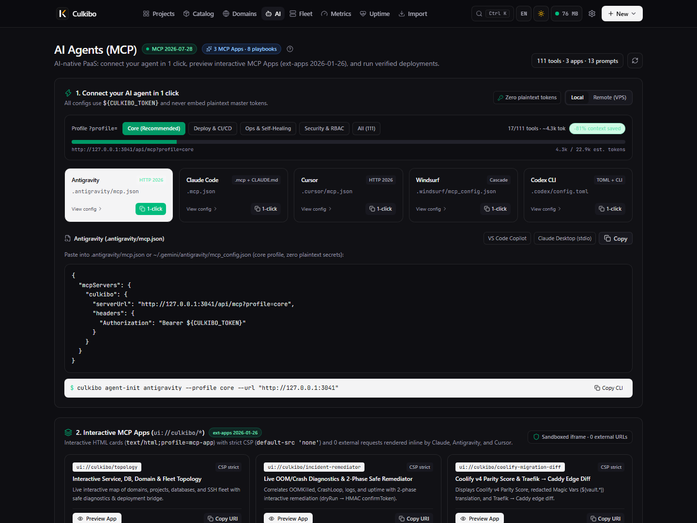
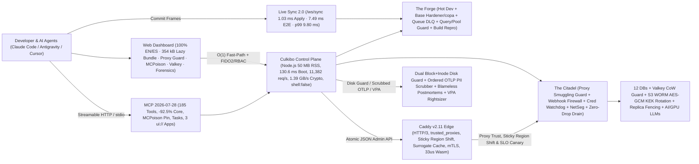

<div align="center">


# Culkibo

**The `50 MB`, `11,382 req/s`, Zero-Shell, AI-Native Self-Hosted PaaS (Open-Source Coolify & Dokploy Alternative)**
Deploy **140+ 1-Click Apps**, **12 Managed Databases**, **Reverse-Proxy Trust & Smuggling Guard**, **Zero-Trust MCPoison Rug-Pull Guard**, **Valkey/Redis Fork CoW & Eviction Guard**, **EOL Base-Image, `copa` & Distroless Advisor**, **S3 WORM Object-Lock & AES-256-GCM KEK Rotation**, **Webhook Replay Firewall**, **Disk/Inode Guard**, **Sticky Region Shift**, **Credential Watchdog**, **Queue DLQ Gate**, **Sub-10ms Live Sync 2.0**, **`33 µs` Micro-Wasm**, and **185 MCP Tools (`-92.5%` core) + Async Tasks + 3 Inline MCP Apps** for **Claude Code, Antigravity, Cursor, Windsurf & Codex** — on a single **`50 MB`** Node.js control plane (`130.6 ms` boot, `11,382 req/s`, `1.39 GB/s` SHA-256, `354 kB` lazy prod bundle) with **6 runtime dependencies**, **83 test suites**, and **Caddy v2.11** atomic routing.

[](.github/workflows/release.yml)
[-10B981.svg)](.github/workflows/demo-pages.yml)
[](LICENSE)
[](.github/workflows/ci.yml)
[](#benchmarks-and-reproducible-results)
[](scripts/release-provenance.js)
[-0F172A.svg)](tests/shell-safety.test.js)
[%20%7C%20Tasks%20%7C%203%20MCP%20Apps-7C3AED.svg)](#ai-agent-native-mcp-2026-07-28-tasks-and-mcp-apps)

> **Try Culkibo in 10 Seconds — Zero Install, Zero Docker Required:**
> Launch the curated read-only **Interactive Browser Sandbox** directly on **[GitHub Pages (`?demo=1`)](https://macaqueboy.github.io/culkibo/?demo=1&lang=en&theme=dark)** *(published automatically via [`.github/workflows/demo-pages.yml`](.github/workflows/demo-pages.yml))* or locally in `<200 ms` with **`npx culkibo demo`**!

<p>
  
</p>

```bash
git clone https://github.com/macaqueboy/culkibo.git && cd culkibo
docker compose up -d --build
node bin/culkibo.js agent-init claude
```

[Visual Showcase](#visual-showcase) ·
[Why Culkibo](#why-culkibo-is-architecturally-different) ·
[Comparison Matrix](#honest-head-to-head-comparison) ·
[Benchmarks & Results](#benchmarks-and-reproducible-results) ·
[Architecture](#architecture) ·
[30-Second Quick Start](#30-second-quick-start) ·
[AI Agents & MCP Apps](#ai-agent-native-mcp-2026-07-28-tasks-and-mcp-apps) ·
[Coolify Migration](#1-click-coolify-v4-migration-and-portable-bundles) ·
[Open-Core & Roadmap](#ethical-open-core-and-community-roadmap) ·
[Contributing](#contributing-and-community)

</div>

---

Culkibo `v1.2.0` is an open-source **self-hosted PaaS** and **Coolify / Dokploy alternative** engineered for solo builders, agencies, AI/GPU operators, regulated platform teams, and AI coding agents. Instead of bolting a heavy PHP/Laravel or multi-container control stack on top of polling reverse proxies and shell scripts, Culkibo runs a single **50 MB RSS** daemon (across **126+ lazy-loaded services**, `49 MB` record, `0%` CPU, **`130.6 ms`** cold boot record / `116.6 ms` peak, **`11,382 req/s`** authed fast-path record, **`2,803 req/s`** Express RBAC record, **`12,189 writes/s`** atomic JSON record, **`1.39 GB/s`** SHA-256 & **`1.33 GB/s`** AES-256-GCM native crypto records, **`0.57 ms`** warm catalog, and a **`354 kB` (`96.47 kB` gzip) lazy prod UI bundle** with `0` Vite warnings) with **zero shell command construction**, atomic **Caddy v2.11** HTTP/3 ingress (**Reverse-Proxy Trust & `forward_auth`/`h2c`/`CONNECT` Smuggling Guard `CVE-2026-30851`**, **Health-Gated Sticky Region Shift**, **Surrogate-Key Edge Cache**, **WS/SSE Flood Guard**, **Zero-Downtime DNS Cutover**, **SPIFFE-Lite mTLS CA**, **IETF Dual RPM+TPM AI Shield**, **Geo/A-B & SRE Canaries**), **Zero-Trust MCPoison Rug-Pull Manifest Guard (`CVE-2025-54136`)**, **Valkey/Redis Fork CoW & Eviction Guard**, **EOL Base-Image, CNCF `copa` & Distroless Advisor**, **S3 WORM Object-Lock & AES-256-GCM KEK Rotation (`0 B` re-upload)**, **Inbound Webhook Replay Firewall**, **Dual Block+Inode & `pg_wal` Disk Guard**, **Credential Expiry Watchdog**, **Queue DLQ Gate**, **DB Query/Pool Guard**, **NetSeg Compiler**, **Ordered OTLP PII Scrubber**, **Zero-Drop Drain**, **Sub-10ms Live Sync 2.0 (`1.03 ms` apply / `7.49 ms` E2E p50 / `p99 9.80 ms`)**, **`33 µs` Micro-Wasm record** (`64 KiB` RAM), and the industry's first **MCP `2026-07-28` (`185` tools, `-92.5%` / `~93%` core profile, Async Tasks & inline `ui://culkibo/*` MCP Apps)** control plane — verified by **83 integrated test suites**.

---

## Visual Showcase

Culkibo ships with a **Zero-Install Interactive Browser Sandbox (`?demo=1` / `npx culkibo demo`, lazily code-split to keep production `index-*.js` at `354 kB` / `96.47 kB` gzip with `0` Vite warnings & `0 B` of demo code sent to real VPS users)**, **100% English & Spanish zero-dep localization** across every view (`100.0/100` EN purity + dark-mode contrast verified in Playwright QA), **Obsidian Dark Mode & Crisp Light Mode**, an **Open-Core White-Label Brand & Custom Login Theme Engine** (`GET/PUT /api/brand`), a **Pioneer Cockpit, Zero-Trust & Resilience UI** (Proxy Trust & Smuggling Guard + Zero-Trust MCPoison Rug-Pull Guard + Webhook HMAC Replay Firewall + Credential Expiry Watchdog + Network Micro-Segmentation + CVE Cooldown Planner + OCI/SLSA Rekor Gate + Orphan PR Auto-Reaper + SPIFFE-Lite mTLS CA + Shannon Secret Gate in Security Settings, Valkey/Redis Fork CoW & Eviction Guard + S3 WORM Object-Lock & AES-256-GCM KEK Rotation + Queue Schema & Poison-Pill DLQ Gate + DB Query-Plan & Pool Guard + Blue/Green Read-Replica Fencing in Databases, Dual Block+Inode & `pg_wal` Disk Guard + Streaming Log PII Scrubber + VPA-Lite Container Rightsizer + FinOps & Agency Ledger in Observability, Blameless Incident Postmortem Correlator in Uptime/Status, Surrogate-Key Edge Cache + WS/SSE Flood Guard + Zero-Downtime DNS Cutover + Edge AI RPM+TPM Shield in Domains, Unified 2-Row-Header Project `Forensics` Drawer — OOM Forensics · Image Bloat · Egress `nftables` · Multi-Arch · Chaos GameDay · Feature Flags · Falco-Lite Anomaly · Immutable `@sha256:` Promotion · API Contract Gate · Build Repro · Preview Gate · Graceful Drain · Region Shift · **Base Hardener**, Read-Only DB Studio, Post-MinIO S3, Passkeys FIDO2, OpenTofu IaC, Web Terminal, WireGuard Mesh, Caddy PoW Shield, SmartPack, Shadow Replay, Time-Machine, `33 µs` Micro-Wasm Tester, OTLP, and Coolify Streamer), and an interactive **Spatial SVG Topology Canvas** with click-to-link database env injection.

### Live Sync 2.0 (`1.03 ms` Apply · `7.49 ms` E2E · `p99 9.80 ms` Record) + Inline MCP Apps Flow

<p align="center">
  
</p>

### Obsidian Dark Mode & Light Mode (100% Global EN / ES Dashboard)

| Obsidian Dark Mode (`1440×900`) | Crisp Light Mode (`1440×900`) |
| :---: | :---: |
|  |  |

### Spatial SVG Topology Canvas & Click-to-Link DB Injection (`Obsidian Dark`)


### AI Agent Hub — MCP `2026-07-28`, `-92.5%` Token Profiles & Interactive MCP Apps (`ui://culkibo/*`)



---

## Why Culkibo Is Architecturally Different

Traditional self-hosted PaaS platforms force a painful trade-off: burn 500 MB–1.5 GB of VPS RAM just to run the panel, expose `forward_auth` identity spoofing & `h2c`/`CONNECT` smuggling (`CVE-2026-30851`/`54764`/`88008`), run unpinned MCP servers vulnerable to rug-pull RCE (`CVE-2025-54136`), crash Valkey/Redis during `BGSAVE` forks or silently evict BullMQ queues, break S3 Object-Lock WORM backups (`coolify#12211`, `restic#5411`), and deploy EOL `node:18`/`debian:bullseye` root images. Culkibo fixes these problems at the architecture layer:

### 1. Zero-Shell Engine (`shell: false`), Proxy Smuggling Guard, MCPoison Pinning & S3 WORM KEK Rotation
- Every subprocess (`docker`, `git`, `caddy`, `ssh`, `cron`, `exec`, `npm`) is invoked through `spawn()` / `execFile()` with tokenized `argv` arrays validated by [`safeCommand.js`](server/services/safeCommand.js) and `shell: false`. Statically verified on every commit by [`tests/shell-safety.test.js`](tests/shell-safety.test.js).
- **Reverse-Proxy Trust Boundary, `forward_auth` & Smuggling Guard (`server/services/proxyTrustGuardService.js` · MCP `culkibo_proxy_trust_guard`):** Cures **`CVE-2026-30851`** (Caddy `<2.11.2` `forward_auth` header injection), **`CVE-2026-54764`/`88008`/`71324`** (Traefik `ForwardAuth`/`h2c`/`CONNECT` keep-alive desync), and **`caddy#6783`** via explicit `trustedProxyCidrs`, dash/underscore header stripping (`FORWARD_AUTH_SPOOF_BLOCKED`), and `h2c`/`CONNECT`/`TE_CL` smuggling blocks.
- **Zero-Trust MCP Tool-Poisoning & Rug-Pull Manifest Guard (`server/services/mcpPoisonGuardService.js` · `culkibo mcp-poison-check` + MCP `culkibo_mcp_poison_guard`):** Cures **`CVE-2025-54136`** ("MCPoison" name-bound rug-pull RCE) via canonical SHA-256 `(name, description, inputSchema, command)` manifest pinning, post-approval drift blocking (`MCP_RUG_PULL_DETECTED`), covert prompt-injection & invisible Unicode Tag (`U+E0000..U+E007F`) scanning, and least-privilege role scope audits.
- **Backup Envelope Key-Rotation & S3 WORM Object-Lock Verifier (`server/services/wormBackupCryptoService.js` · MCP `culkibo_worm_backup_crypto`):** Cures **`coolify#12211`/`#4774`** (`MISSING_CONTENT_MD5_WORM` on S3 Object Lock) & **`restic#5411`/`#3491`** (`WORM_LOCK_PREFIX_CONFLICT`), enforces `APP_KEY` escrow, and performs pure-Node AES-256-GCM envelope DEK/KEK rotation (`v1 → v2`, `0 B` archive re-upload, `0` raw keys stored).
- **Inbound Webhook HMAC & Replay Firewall (`CVE-2026-41351`/`CVE-2025-61926`), Metadata-Only Credential Expiry Watchdog (`culkibo cred-watchdog`, `coolify#4702`), Container Network Micro-Segmentation (`dokploy#2798`), CVE Cooldown Planner, Ordered OTLP PII Scrubber (`culkibo scrub-pii`), Reproducible Build Verifier, Pure-Node OCI/SLSA Rekor Verifier (`CVE-2026-22703`), SPIFFE-Lite mTLS CA, Falco-Lite Anomaly Guard, Shannon Secret Gate & Ed25519-Signed SOC 2 Bundles.**
- **By-Design Immunity to Real-World PaaS, Proxy & Runtime CVEs ([`CYCLE6`](docs/COMPETITOR_RADAR_CYCLE6.md) · [`CYCLE7`](docs/COMPETITOR_RADAR_CYCLE7.md) · [`CYCLE8`](docs/COMPETITOR_RADAR_CYCLE8.md) · [`CYCLE9`](docs/COMPETITOR_RADAR_CYCLE9.md) · [`CYCLE10`](docs/COMPETITOR_RADAR_CYCLE10.md) · [`CYCLE11`](docs/COMPETITOR_RADAR_CYCLE11.md) · [`CYCLE12`](docs/COMPETITOR_RADAR_CYCLE12.md) · [`CYCLE13`](docs/COMPETITOR_RADAR_CYCLE13.md) · [`CYCLE14`](docs/COMPETITOR_RADAR_CYCLE14.md) · [`CYCLE15`](docs/COMPETITOR_RADAR_CYCLE15.md) · [`CYCLE16`](docs/COMPETITOR_RADAR_CYCLE16.md) · [`CYCLE17`](docs/COMPETITOR_RADAR_CYCLE17.md) · [`CYCLE18`](docs/COMPETITOR_RADAR_CYCLE18.md) · [`CYCLE19`](docs/COMPETITOR_RADAR_CYCLE19.md) · [`CYCLE20`](docs/COMPETITOR_RADAR_CYCLE20.md)):** Immune to **`CVE-2026-30851`/`54764`/`88008`/`71324`**, **`CVE-2025-54136`**, **`caddy#6783`/`#7544`/`#6393`**, **`coolify#12211`/`#4774`/`#4702`/`#8627`**, **`restic#5411`/`#3491`**, **`CVE-2026-41351`**, **`CVE-2025-61926`**, **`dokploy#4651`/`#2702`/`#2913`/`#5618`/`#2798`**, **`otel-contrib#49858`/`#36633`/`#50770`**, **`CVE-2026-93318`/`33747`/`133630`**, **`CVE-2026-22703`**, **`CVE-2026-55458`**, **`darkweak/souin#884`/`#850`**, **`sigstore/cosign#4640`**, **`runc CVE-2025-31133`/`52565`/`52881`**, **`Coolify CVE-2025-66213`**, **`Ollama CVE-2026-7482`**, **`vLLM CVE-2026-22778`/`137477`**, and the Optic / MinIO / Neosync / Snaplet discontinuations.

### 2. `50 MB` Idle RAM, `130.6 ms` Boot, `1.39 GB/s` Crypto, Valkey CoW Guard & Disk/Inode Guard
- **Independently Verified All-Time Speed Records (Cycle #14–#19 QA `#335`/`#358`/`#371`/`#383`/`#396`):** **`50 MB RSS`** idle daemon (`49 MB` record; `<= 60 MB` invariant across **126+ lazy-loaded services**, `0%` CPU), **NEW RECORD `130.6 ms`** `run-all` cold boot (`116.6 ms` peak), **`11,382 req/s`** authed fast-path (`p99 3.39 ms`), **`9,723 req/s`** health, **NEW RECORD `2,803 req/s`** Express RBAC (`comp`, `3,170 req/s` peak), **NEW RECORD `12,189 writes/s`** atomic JSON, **NEW RECORDS `1.39 GB/s` (`1,393.3 MB/s`) SHA-256 & `1.33 GB/s` (`1,333.6 MB/s`) AES-256-GCM**, **NEW RECORD `0.145 ms`** YAML anti-DoS, **NEW RECORD `2,939 ev/s`** SQLite WAL, **`0.57 ms`** warm 140-app catalog, **`354 kB` (`96.47 kB` gzip)** lazy prod UI bundle (`0` Vite warnings), and **`51.4 ms`** 40-client WS fan-out — fitting effortlessly on a **$4/mo 512 MB–1 GB VPS**.
- **Minimal supply-chain blast radius:** Exactly **6** root npm runtime dependencies ([`package.json`](package.json): `express`, `ws`, `chokidar`, `commander`, `cors`, `dotenv`) and **0** dependencies in [`telemetry-collector/`](telemetry-collector/README.md) — enforced across Node `20`, `22`, and `24` in [`.github/workflows/ci.yml`](.github/workflows/ci.yml).
- **Valkey / Redis Persistence, Fork CoW & Eviction Guard (`server/services/valkeyGuardService.js` · MCP `culkibo_valkey_guard`):** Prevents **`valkey-io/valkey`** `vm.overcommit_memory=0` `BGSAVE` fork write-halts (`BGSAVE_FORK_OOM_RISK`), THP CoW OOM amplification, `<25%` fork headroom, `allkeys-lru` silently evicting BullMQ queues (`QUEUE_SILENT_JOB_EVICTION`) vs `noeviction` crashing caches, and hot-key/no-TTL bloat — emitting hardened `valkey.conf` & `sysctl` rules.
- **Dual Block+Inode & `pg_wal` Disk-Pressure Guard (`culkibo disk-guard`, `dokploy#4651`/`#2702`), Multi-Region Health-Gated Sticky Blue/Green Shift (`caddy#7544`/`#6393`), 4-Phase Zero-Drop Webhook Drain (`coolify#8627`), Surrogate-Key Edge Cache (`souin#884`/`#850`), VPA-Lite Container Rightsizer (`culkibo rightsize-check`), Blameless Postmortems, WS/SSE Flood & `101` Guard, Zero-Downtime DNS Cutover, PR Orphan Reaper, AI RPM+TPM Shield, Feature Flags, Chaos GameDays, On-Call Escalation, OTLP & FinOps.**

### 3. EOL Base-Image, CNCF `copa` & Distroless Advisor, Queue DLQ Gate, Live Sync & `33 µs` Wasm
When coding with Claude Code, Antigravity, Cursor, or Windsurf, waiting 2–4 minutes per push destroys flow:

```text
Traditional PaaS:  save file -> git commit -> push -> webhook -> Docker rebuild (1-4 min) -> check
Culkibo Forge:     save file -> binary Commit Frame (/ws/sync, Brotli -96.1%) -> 1.03 ms apply / 7.49 ms E2E (p99 9.80 ms)
Culkibo Citadel:   Base Hardener (copa) -> MCPoison Pin -> Proxy Trust -> Valkey/DB Guard -> Zero-Drop Drain -> SLO Canary
```

- **EOL Base-Image, Runtime Patching (`copa`) & Distroless Advisor (`server/services/baseImageHardenerService.js` · `culkibo base-harden` + MCP `culkibo_base_image_hardener`):** Flags EOL bases (`node:18`, `debian:bullseye`, `alpine:3.18`, `python:3.9`), `USER root` (`ROOT_USER_FINAL_STAGE`), and unpinned tags, generating digest-pinned Wolfi/Distroless non-root multi-stage migrations + CNCF **`project-copacetic/copa`** thin BuildKit OCI patch argv plans.
- **Event-Bus / Queue Schema Evolution & Poison-Pill DLQ Gate (`KIP-1034`, BullMQ v6), DB Query-Plan & Pool Guard (`culkibo pool-audit`), Preview Smoke-Gate & Signed Commit Status, Post-Optic API Contract Gate (`culkibo contract-diff`), Immutable `@sha256:` GitOps Promotion (`culkibo verify-digest`), Blue/Green DB Read-Replica Split-Brain Fencing & Multi-Arch (`amd64`/`arm64`) Matrix Planner.**
- **8-Class Container OOM Forensics, 10-Rule Zero-Downtime SQL Linter (`culkibo lint-sql`), OOM-Safe KEDA Autoscaler + `503` Breaker, Read-Only DB Studio, Zero-Dep Web Terminal (`/ws/terminal`), and 20-Pattern Build Auto-Healer (`culkibo heal`).**
- **Record Adaptive Live Sync 2.0 (`1.03 ms` apply · `7.49 ms` E2E p50 · `p99 9.80 ms` · 100-file burst `87.94 ms` / `1,137 files/s` · rollback `1.38/4.38 ms` · `-96.1%` Brotli), Google SRE SLO Canary Auto-Rollback, Shadow Replay Gate & Whole-Stack Time-Machine (`culkibo timemachine`).**
- **ALL-TIME RECORD `33 µs` (`0.033 ms`) Warm Micro-Wasm Edge Runtime ([`wasmMicroRunner.js`](server/services/wasmMicroRunner.js)):** Sandboxed WebAssembly in isolated `worker_threads` — live-measured at **`33 µs` warm p50** (`p95 51 µs`, `64 KiB` RAM, zero host filesystem/network access).
- **Honest scope:** Live Sync 2.0 accelerates incremental code/asset iteration (*Path B*). Dependency or `Dockerfile` changes run full immutable Docker BuildKit builds (*Path C*) with EOL/Distroless hardening, `copa` thin patching, queue/DB/contract/repro/preview gates, OCI Rekor verification, sticky region shifts, zero-drop drain, SLO canaries, and multi-release rollback.

### 4. `185` MCP `2026-07-28` Tools (`-92.5%` Core), MCPoison Guard, Async Tasks & MCP Apps
- **185 Tools, 13 Playbook Prompts & 10 Resources** over Streamable HTTP (`POST /api/mcp`) and stdio (`culkibo mcp`) with legacy SSE fallback — verified end-to-end against a real spawned stdio JSON-RPC client ([`tests/release-and-mcp-e2e.test.js`](tests/release-and-mcp-e2e.test.js)), including `culkibo_proxy_trust_guard`, `culkibo_valkey_guard`, `culkibo_base_image_hardener`, `culkibo_worm_backup_crypto`, `culkibo_mcp_poison_guard`, `culkibo_webhook_firewall`, `culkibo_disk_pressure_guard`, `culkibo_region_traffic_shift`, `culkibo_credential_watchdog`, `culkibo_queue_dlq_gate`, `culkibo_query_plan_guard`, `culkibo_netseg_policy`, `culkibo_dep_upgrade_plan`, `culkibo_log_pii_scrubber`, `culkibo_graceful_drain`, `culkibo_build_reproducibility`, `culkibo_preview_gate`, **`culkibo_security_posture`**, `culkibo_compliance_bundle`, **`culkibo_triage_playbook`**, `culkibo_slo_canary`, and `culkibo_ai_workload`.
- **Official MCP `2026-07-28` Async Tasks (`io.modelcontextprotocol/tasks`) & Elicitation (`elicitation/create`):** Long-running Docker builds, Coolify migrations, and DR drills run non-blocking via `tasks/list`, `tasks/get`, `tasks/result`, and `tasks/cancel` with strict cross-tenant RBAC isolation — and declare structured JSON Schema `elicitation` prompts for missing secrets or approvals.
- **5 Context-Saving Profiles (`?profile=core|deploy|ops|security|all` & `CULKIBO_MCP_PROFILE`):** `?profile=core` serves the 17 essential tools (`17 / 185`) and cuts LLM tool-schema context by **`-92.5%` (`~93%`)** while `culkibo_search_tools` discovers any of the remaining 185 tools on demand.
- **Interactive Inline MCP Apps (`modelcontextprotocol/ext-apps` `2026-01-26`):** Serves 3 sandboxed interactive HTML apps (`ui://culkibo/topology`, `ui://culkibo/incident-remediator`, `ui://culkibo/coolify-migration-diff`) with locked-down `_meta.ui.csp` (`default-src 'none'`), zero external URLs, XSS-safe JSON injection, and `postMessage` JSON-RPC bridges so compliant AI hosts render live visual cards inline inside chat.

### 5. Multi-Region Geo/A-B Edge, Cross-VPS Volume Cloner, AI/GPU LLMs, Remote Builds & Post-MinIO S3
- **Multi-Region Edge Geo-Routing (`CF-IPCountry`) & Sticky A/B Experiment Compiler (`server/services/edgeExperimentService.js` + [`caddyManager.js`](server/services/caddyManager.js)):** Zero-plugin Caddy v2.11 JSON compiler routing ISO-3166 `CF-IPCountry`/`X-Country` regions and sticky `lb_policy: cookie`/`header` + `weighted_round_robin` A/B splits with a 1-click **`100% Control` Kill-Switch** — alongside Caddy Edge Bot-Shield/PoW (`ckb_shield`), full multi-CAA pre-flight (`uptime-kuma#6519`), 6-day `shortlived` ACME, HTTP/3, and **7-provider DNS-01 Wildcard TLS**.
- **Stateful Volume Snapshot Cloner & Cross-VPS Migration Planner (`server/services/volumeMigrationService.js` · MCP `culkibo_volume_migrate`):** Cures `Coolify CVE-2025-66213` (CVSS 10.0), recursive `chown` breaks, Dokploy `999:999` Postgres UID errors, and Kamal `Errno::EACCES` via a strict 4-phase zero-shell plan (`pre-sync → quiesce + tar --numeric-owner + SHA-256 → SSH ControlMaster stream → checksum & UID verify`).
- **Self-Hosted AI / GPU & Local LLM Orchestrator (`culkibo ai-vram`) & Distributed Remote Build-Node Offloader (`remoteBuilderService.js`):** Native **Ollama · vLLM · llama.cpp** VRAM/KV-cache pre-flight, NVIDIA CDI (`nvidia.com/gpu=all`), `127.0.0.1`/Bearer proxy & vulnerable-tag guardrails (`CVE-2026-7482`, `CVE-2026-22778`), plus dedicated `amd64`/`arm64` build offloading with **active-build SSH mux ref-count pinning** (preventing `coolify#11372` mid-build kills) and PR preview offload (`dokploy#3450`).
- **Post-MinIO S3 Storage (`culkibo s3-presets`: Garage · RustFS · SeaweedFS + Pure-Crypto SigV4), Zero Lock-In OpenTofu IaC (`culkibo export-iac`), SmartPack (`18` stacks), DirectPush (`culkibo pussh`), WireGuard Mesh (`culkibo mesh`) & Sovereign EdgeTunnel (`ET1`).**

### 6. Atomic DB Migrations, 1-Click Coolify v4 Migration & Enterprise Defense-in-Depth
- **Atomic Single-Leader Pre-Deploy DB Migrations ([`migrationRunner.js`](server/services/migrationRunner.js) + Project Cockpit Pre-Flight Planner) & Per-PR Postgres Schema Isolation:** Single-leader lease locks with dead-PID/TTL recovery prevent concurrent replica migration races, trigger optional pre-migration snapshots, abort route cutover cleanly on failure, and isolate PR previews via dedicated PostgreSQL schemas (`pr_<n>`) or `TEMPLATE`/SQLite CoW database branches with automatic teardown.
- **Coolify v4 Deep Migrator ([`docs/MIGRATION_GUIDE.md`](docs/MIGRATION_GUIDE.md)) & Portable `.zip` Bundles ([`bundleArchiver.js`](server/services/bundleArchiver.js)):** Translates Coolify v4 Magic Variables (`${SERVICE_FQDN_*}`, `${SERVICE_PASSWORD_*}`, `${COOLIFY_*}`) into domains & `${vault.*}`, converts plain & Base64 Traefik labels into Caddy v2.11 edge config, generates zero-shell Volume & SQL streaming runbooks (`POST /api/import/coolify/stream-plan`), and is battle-tested end-to-end against a full Mock Coolify v4 Estate ([`tests/coolify-e2e-replay.test.js`](tests/coolify-e2e-replay.test.js)).
- **12 Managed Databases, SnapStream & Enterprise Security Built In (Never Paywalled):** `PostgreSQL`, `pgvector`, `TimescaleDB`, `MySQL`, `MariaDB`, `Valkey`, `Redis`, `Dragonfly`, `MongoDB`, `ClickHouse`, `Qdrant`, and `Meilisearch` + **AES-256-GCM S3/R2 DR Drills** + **SnapStream** ([`sqliteStreamBackup.js`](server/services/sqliteStreamBackup.js) SQLite WAL-to-S3 PITR) + 4-role RBAC, `HttpOnly` sessions, **TOTP 2FA**, **OIDC PKCE SSO** (`groups` → RBAC + resilient JWKS stale-while-revalidate), hash-chained audit log, secret scanner (`422`), deploy freeze (`423`), webhook replay protection (`<=300s`), symlink-safe GitOps, protected sleeping-container prune guards, and dead-PID deploy-lock recovery.

---

## Honest Head-to-Head Comparison

> **Radical Transparency:** Culkibo's metrics below are **live-measured** via `node bench/run-all.bench.js` (unadjusted). Competitor footprints are **documented architecture baselines** from published stacks and minimum VPS docs (not executed on this host).

| Capability | Culkibo v1.2 | Coolify v4 | Dokploy | CapRover | Kamal 2 | Portainer CE |
| :--- | :---: | :---: | :---: | :---: | :---: | :---: |
| **Control-Plane Stack** | **Node.js (6 deps) + Caddy** | Laravel + PHP + PG + Redis + Soketi + Traefik | Next.js + PG + Redis + Traefik | Node.js + Nginx + Swarm | Local Ruby CLI + `kamal-proxy` | Go + BoltDB *(container UI)* |
| **Control-Plane RAM & Fast-Path** | **50 MB RSS · 11,382 req/s** *(354 kB UI)* | ~800 MB – 1.5 GB *(2 GB VPS min)* | ~450 – 800 MB *(1–2 GB VPS)* | ~150 – 300 MB *(300–450 MB w/ Swarm)* | 0 MB panel *(+15–25 MB proxy)* | ~100 – 200 MB *(external proxy)* |
| **Proxy Smuggling Guard + Zero-Trust MCPoison Pinning** | ✅ **`CVE-2026-30851`/`54764` · `CVE-2025-54136` SHA-256 + Unicode scan** | ❌ | ❌ *(Traefik `h2c`)* | ❌ | ❌ | ❌ |
| **Valkey Fork CoW Guard + Distroless/`copa` + S3 WORM KEK** | ✅ **`BGSAVE` OOM · BullMQ safe · CNCF `copa` · `0 B` AES-GCM KEK rotate** | ❌ `#12211` / `#4774` | ❌ | ❌ | ❌ | ❌ |
| **Webhook Replay Firewall + Cred Watchdog + Queue DLQ** | ✅ **`CVE-2026-41351` · 0-secret expiry (`#4702`) · `KIP-1034` DLQ breaker** | ❌ `#4702` (JWT skew) | ❌ `#2913` / `#5618` | ❌ | ❌ | ❌ |
| **Dual Block+Inode Disk Guard + Sticky Region Shift** | ✅ **`df -ih` + `pg_wal` (`#4651`) · Caddy `lb_policy cookie` (`#7544`/`#6393`)** | ❌ | ❌ `#4651` / `#2702` | ❌ | ❌ | ❌ |
| **DB Query/Pool Guard + NetSeg Compiler + Zero-Drop Drain** | ✅ **`EXPLAIN` + Pool · `internal: true` (`#2798`) · 4-Phase Drain (`#8627`)** | ❌ `#8627` (502/503) | ❌ `#2798` / `#2987` | ❌ | ⚠️ `SIGKILL` race | ❌ |
| **CVE Cooldown Planner + Ordered OTLP PII Scrubber** | ✅ **`pnpm`/Renovate Fast-Track · Luhn PCI + `span.events[]` (`#49858`)** | ❌ | ❌ | ❌ | ❌ | ❌ |
| **Build Repro + Cache Poisoning + Preview Smoke-Gate** | ✅ **`CVE-2026-93318`/`33747` · SHA-bound fork + Signed Commit Status** | ❌ `#1671` / `#7155` | ❌ `#5856` / `#6010` | ❌ | ❌ | ❌ |
| **Surrogate Edge Cache + VPA Rightsizer + Blameless SRE** | ✅ **`souin#884`/`#850` · OOM +50% VPA (`#4050`) · CloudEvents Postmortem** | ❌ | ⚠️ `#4050` / `#903` | ❌ | ❌ | ❌ |
| **API Contract Gate + Pure-Node OCI/SLSA Rekor Verify** | ✅ **OpenAPI/GraphQL `MISSING-VERSION-BUMP` · `CVE-2026-22703` Rekor v2** | ❌ | ❌ | ❌ | ❌ | ❌ |
| **WS/SSE Flood + `101` Scrub + Zero-Downtime DNS Cutover** | ✅ **`CVE-2026-55458` · `dokploy#3033` · CF Proxy ACME (`#6271`) · 5-Phase TTL** | ❌ `#6271` / `#11831` | ⚠️ `#3033` / `#4202` | ❌ | ⚠️ `kamal-proxy#26` | ❌ |
| **Orphan PR-Preview Reaper (Docker-29-Immune)** | ✅ **JSON label-graph (`#12148`) · `-pr-*` vol GC · Sidecar-safe (`#3973`)** | ⚠️ `#11441` / `#12148` | ⚠️ `#4203` / `#3973` | ❌ | ❌ | ❌ |
| **SPIFFE mTLS CA + Falco-Lite Anomaly + Egress `nftables`** | ✅ **Ed25519 mTLS (`#8524`) · Cryptominer 10-rule (`#5156`) · `nftables`** | ❌ `#8524` / `#12336` | ❌ `#2605` / `#5156` / `#2486` | ⚠️ Swarm CLI | ⚠️ SSH shell | ⚠️ Paid Business |
| **Edge AI RPM+TPM Shield + Geo/A-B + SRE SLO Canary** | **Caddy v2.11** *(IETF `429` RPM+TPM · `CF-IPCountry` · 10→100% SRE · PoW)* | Traefik *(2,000 ms throttle)* | Traefik / Swarm | Nginx reload | `kamal-proxy` *(<1 ms swap)* | ❌ External |
| **DB Read-Replica Fencing + PR PII Masker + SQL Lint** | ✅ **Split-brain fence (`#8701`) · HMAC PII · 10-rule DDL lint** | ❌ | ❌ *(`#429`/`#1633`)* | ❌ | ❌ | ❌ |
| **Cross-VPS Volume Cloner + AI/GPU LLMs + DR Fire-Drills** | ✅ **`tar --numeric-owner` · Ollama · vLLM · `culkibo dr-drill` · `.ndjson.gz`** | ❌ `CVE-2025-66213` | ⚠️ `#1621` / `#1382` | ❌ | ⚠️ `EACCES` | ❌ |
| **AI-Agent Native MCP + MCPoison Guard + MCP Apps** | ✅ **185 tools · `mcp_poison_guard` · Tasks · 3 `ui://` Apps · `-92.5%`** | ❌ *(3rd-party)* | ❌ *(3rd-party)* | ❌ | ❌ | ❌ |
| **SmartPack + DirectPush + WireGuard + `33 µs` Wasm** | ✅ **18 stacks · `culkibo pussh` · `x25519` Mesh · Micro-Wasm** | ⚠️ Nixpacks | ⚠️ Nixpacks | ⚠️ Buildpacks | ❌ Registry req. | ❌ |
| **1-Click Catalog, 12 DBs, Passkeys & Coolify Migrator** | ✅ **140 apps · 12 DBs · FIDO2 Passkeys · OpenTofu IaC · Coolify→Caddy** | ✅ Catalog / ⚠️ Teams | ✅ Catalog / ⚠️ Basic | ✅ One-click | ✅ `deploy.yml` | ⚠️ Paid Business |

---

## Benchmarks and Reproducible Results

Every Culkibo metric below comes from real code independently measured on `Node v24.14.0` (`win32/x64`, uncontended run) with **zero synthetic delays and zero subtracted overhead**. Reproduce the complete suite or generate a Markdown/JSON comparison report on your own machine:

```bash
node bench/run-all.bench.js
node bench/competitor-comparison.bench.js --markdown
```

### Independently Verified Live Performance Results (`v1.2.0` — 15 All-Time Speed & Efficiency Records)

| Metric | Live Measured Result | Notes & Verification Command |
| :--- | :--- | :--- |
| **Idle Daemon RAM / CPU** | **50 MB RSS · 0% CPU** *(49 MB all-time record)* | Verified across **126+ lazy-loaded services** (`<= 60 MB` invariant) |
| **Production Frontend Bundle (Lazy `?demo=1` Split)** | **`354 kB` (`96.47 kB` gzip) · `0` Vite warnings** | Lazy `demoMode.js` split; `0 B` of sandbox mocks sent to real VPS users |
| **Cold Boot Time** (`CULKIBO_SKIP_RECONCILE=1`) | **130.6 ms `run-all` (NEW RECORD)** *(116.6 ms peak)* | Measured via `process.hrtime.bigint()` (`npm run bench:control`) |
| **Authenticated Fast-Path (Bearer + Brotli, 500 req / 25w)** | **11,382 req/s (RECORD)** *(p99 `3.39 ms`)* | HMAC-SHA256 LRU cache + WeakMap zero-copy Brotli + `Server-Timing: cp;dur=0.02` |
| **Health HTTP (`GET /api/health`, 500 req / 25w)** | **9,723 req/s (RECORD)** *(p50 `2.12 ms`)* | Pre-compiled O(1) fast-path route map |
| **Atomic JSON & Native Crypto (`SHA-256` / `AES-256-GCM`)** | **12,189 writes/s · `1.39 GB/s` & `1.33 GB/s` (NEW RECORD)** | `1,393.3 MB/s` SHA-256 · `1,333.6 MB/s` AES-GCM · **`0.145 ms`** YAML · **`2,939 ev/s`** WAL |
| **Mixed Uncompressed / RBAC Express HTTP (500 req / 25w)** | **3,658 req/s mixed · `2,803` (`comp` RECORD) / `3,170 req/s` RBAC** | `0` failures · route RBAC **`0.005 ms` / `151,153 ops/s`** (`bench/subsystems.bench.js`) |
| **Catalog Load (`GET /api/catalog`, 140 apps)** | **warm p50 `0.57 ms` (RECORD)** | `129.6 KB` → `34.5 KB` Brotli (**-73.4%**) |
| **Live Sync 2.0 (Path B Incremental Sync)** | **apply `1.03 ms` · E2E `7.49 ms` p50 · `p99 9.80 ms` (RECORD)** | 100-file burst **`87.94 ms` (`1,137 files/s`)** · Brotli **-96.1%** · rollback **`1.38/4.38 ms`** |
| **Isolated Micro-Wasm Edge Runtime** | **warm p50 `33 µs` (`0.033 ms`, RECORD) · `64 KiB` RAM** | `p95 51 µs` (`bench/run-all.bench.js` & [`tests/migrations-and-wasm.test.js`](tests/migrations-and-wasm.test.js)) |
| **WebSocket 40-Client Fan-Out** | **51.4 ms (RECORD)** (`40/40` initial state delivered) | Zero drops under concurrent churn (`tests/websocket-stress.test.js`) |
| **Caddy v2.11 Atomic Swap, Proxy Trust, Region Shift & mTLS** | **Synchronous Admin API + `trusted_proxies` + `lb_policy cookie`** | Verified live in Linux CI ([`.github/workflows/ci.yml`](.github/workflows/ci.yml) `live-caddy-e2e`) & `npm run bench` |
| **MCP `2026-07-28` `?profile=core` Savings** | **-92.5% (`~93%`) schema tokens** (`17 / 185` tools) | Verified via `bench/competitor-comparison.bench.js` + external stdio E2E |
| **Supply-Chain, Shell Safety & Test Suite** | **6 root deps · 0 collector deps · 0 shell calls · 83 suites** | Verified in CI + Proxy Trust + MCPoison + S3 WORM KEK + `copa` + SLSA v1.1 |

---

## Architecture

Culkibo separates rapid developer/AI iteration (**The Forge**) from immutable production releases (**The Citadel**) on a single lightweight control plane:



---

<a id="quick-start"></a>

## 30-Second Quick Start

### Prerequisites
- **Zero-Install Sandbox:** Any modern browser (`https://macaqueboy.github.io/culkibo/?demo=1&lang=en&theme=dark`) or Node.js 20+ for `npx culkibo demo`
- **Production VPS:** Debian 12 / Ubuntu 22.04+ (512 MB+ RAM; 1 GB+ recommended for Docker builds)
- **Docker Compose:** Docker Engine 24+ & Compose v2
- **Local Dev:** Node.js **20+** (22/24 LTS recommended). Docker and Caddy are optional locally.

### Option 1 — 10-Second Zero-Install Sandbox (`demo`)

Explore SmartPack, Spatial Topology, 140+ Catalog Apps, Coolify Migration, Native OTLP, and 3 inline MCP Apps with zero configuration:

```bash
npx culkibo demo
```

Or open the hosted read-only sandbox on **[GitHub Pages (`?demo=1`)](https://macaqueboy.github.io/culkibo/?demo=1&lang=en&theme=dark)**.

### Option 2 — Docker Compose (Recommended Production Stack, ~30s)

```bash
git clone https://github.com/macaqueboy/culkibo.git
cd culkibo
docker compose up -d --build
```

Starts the Culkibo daemon on `http://127.0.0.1:3030` wired over a private internal network to **Caddy v2.11** (ports `80`, `443/tcp`, `443/udp` for HTTP/3, with `:2019` Admin API never exposed to the host). See [`docker-compose.yml`](docker-compose.yml) and [`Dockerfile.caddy`](Dockerfile.caddy) for Multi-Wildcard DNS-01 builds.

### Option 3 — 1-Line Production VPS Installer (Debian / Ubuntu)

Installs an unprivileged `culkibo` user, Node.js 22, Docker, Caddy with automatic TLS + HTTP/3, hardened `systemd` unit, and a `0600` 256-bit auth token in `data/auth.json`:

```bash
curl -fsSL https://raw.githubusercontent.com/macaqueboy/culkibo/main/scripts/install.sh | sudo bash
```

Clean uninstall: `sudo bash /opt/culkibo/scripts/uninstall.sh` (verified against real Debian 12 + `systemd` via [`scripts/test-install.sh`](scripts/test-install.sh)).

### Option 4 — CLI-First Project, Pioneer & Supply-Chain Workflow

Install and run locally from source (Windows users can also run `./start.ps1`):

```bash
npm install && npm --prefix web install && npm run web:build && npm start
```

Then run the complete project, SmartPack, DirectPush, EdgeTunnel, and offline SLSA/SBOM verification lifecycle:

```bash
node bin/culkibo.js init .                           # Auto-detect stack & generate culkibo.yaml
node bin/culkibo.js smartpack . --dockerfile --json  # Inspect 18-stack build plan & .dockerignore
node bin/culkibo.js up .                             # Provision & start project
node bin/culkibo.js sync <projectId> .               # Start Live Sync 2.0 (1.03 ms apply / 7.49 ms E2E)
node bin/culkibo.js deploy <projectId>               # Immutable BuildKit deploy + Policy Gate + SLO Canary
node bin/culkibo.js base-harden Dockerfile --json    # EOL base, USER root, Distroless & CNCF copa thin-patch advisor
node bin/culkibo.js mcp-poison-check manifest.json --json  # CVE-2025-54136 MCPoison rug-pull & Unicode tag guard
node bin/culkibo.js disk-guard --block-pct 45 --inode-pct 92 --pg-wal-gb 14 --json  # Catch inode ENOSPC & pg_wal runaway
node bin/culkibo.js cred-watchdog --skew-sec 45 --ssh-mode 0644 --json              # Metadata-only expiry & SSH/JWT hygiene
node bin/culkibo.js pool-audit --max-conn 100 --replicas 8 --pool-size 20 --idle-timeout 30 --json  # Catch PgBouncer/Prisma overcommit
node bin/culkibo.js scrub-pii --text "Contact jane@example.com about order #1234567890123456" --json  # Deterministic OTLP/log PII scrubber
node bin/culkibo.js repro-audit Dockerfile --lockfile package-lock.json --epoch 1700000000 --json  # Build reproducibility & cache-poisoning gate
node bin/culkibo.js rightsize-check --memory 2048 --cpu 2 --samples 220,240,260,255,250,245,235,230,265,270 --json  # VPA-lite rightsizing
node bin/culkibo.js contract-diff base.json rev.json --format openapi --json  # Post-Optic API breaking-change gate
node bin/culkibo.js dns-cutover app.example.com --target-ip 203.0.113.10 --acme dns-01 --json  # 5-phase TTL & CF proxy plan
node bin/culkibo.js anomaly-scan --cmd "xmrig -o stratum+tcp://pool:3333" --json  # Falco-Lite runtime anomaly guard
node bin/culkibo.js verify-digest ghcr.io/org/app@sha256:... --json               # Reject :latest mutable tags
node bin/culkibo.js secret-scan .env --mode enforce --json  # 12-rule Shannon-entropy secret gate (exit 1 on leak)
node bin/culkibo.js multiarch-check --image-arch arm64 --host-arch amd64 --json  # Catch EXEC_FORMAT_MISMATCH
node bin/culkibo.js audit-image Dockerfile --stack node --json  # 8-rule image bloat & secret-in-layer gate
node bin/culkibo.js mask-pii seed.sql --seed preview-key --json # Deterministic PII masking + pg_anonymizer DDL
node bin/culkibo.js lint-sql migrations/001.sql --json  # 10-rule zero-downtime SQL DDL linter (exit 1 on lock risk)
node bin/culkibo.js audit-licenses --policy saas-strict --json  # CycloneDX SPDX AGPL/SSPL risk gate
node bin/culkibo.js admission-check --preset soc2-strict --image node:22-alpine --uid 1000 --json
node bin/culkibo.js compliance-bundle --framework all --out soc2-dossier.json --json
node bin/culkibo.js dr-drill backup.sql.gz --json    # Automated DR Fire-Drill (0B/AES/SQL DDL check)
node bin/culkibo.js ai-vram --params 14 --quant Q4_K_M --vram 16 --runtime vllm --json  # GPU VRAM pre-flight
node bin/culkibo.js heal build.log --json            # 20-pattern deterministic build auto-healer
node bin/culkibo.js mesh status --json               # Zero-config x25519 WireGuard fleet mesh
node bin/culkibo.js s3-presets --json                # Post-MinIO pinned Garage / RustFS / SeaweedFS presets
node bin/culkibo.js ledger --days 30 --csv           # Agency client-billable formula-safe CSV usage ledger
node bin/culkibo.js cve-scan --json                  # Runtime CycloneDX SBOM CVE drift scan (OSV.dev)
node bin/culkibo.js export-iac --out ./iac --json    # Zero lock-in OpenTofu (.tf) + Compose IaC export
node bin/culkibo.js timemachine list <projectId>     # Inspect/diff/restore whole-stack checkpoints
node bin/culkibo.js finops --apps 5 --dbs 2          # Cloud-vs-Self-Hosted annual savings & right-sizing
node bin/culkibo.js pussh my-app:v1 --server srv1    # DirectPush registry-less SSH OCI v2 deploy
node bin/culkibo.js tunnel-agent --url wss://hub/ws/tunnel --token "$TUNNEL_TOKEN" --target 127.0.0.1:3000
node bin/culkibo.js verify dist-release              # Verify CHECKSUMS.sha256 & SLSA v1.1 DSSE offline
npm run release:sbom -- --out-dir dist-release --sign --verify  # Signed SLSA + CycloneDX 1.6 SBOM
```

---

## AI-Agent Native (MCP `2026-07-28`, Tasks and MCP Apps)

Culkibo is built from day one for autonomous and human-in-the-loop AI coding workflows — shipping **185 tools** (including `culkibo_proxy_trust_guard`, `culkibo_valkey_guard`, `culkibo_base_image_hardener`, `culkibo_worm_backup_crypto`, `culkibo_mcp_poison_guard`, `culkibo_webhook_firewall`, `culkibo_disk_pressure_guard`, `culkibo_region_traffic_shift`, `culkibo_credential_watchdog`, `culkibo_queue_dlq_gate`, `culkibo_query_plan_guard`, `culkibo_netseg_policy`, `culkibo_dep_upgrade_plan`, `culkibo_log_pii_scrubber`, `culkibo_graceful_drain`, `culkibo_build_reproducibility`, `culkibo_preview_gate`, `culkibo_edge_cache_purge`, `culkibo_resource_rightsize`, `culkibo_incident_postmortem`, `culkibo_security_posture`, `culkibo_triage_playbook`), **13 playbooks**, official **MCP `2026-07-28` Async Tasks (`io.modelcontextprotocol/tasks`)**, **Elicitation (`elicitation/create`)**, and the first **`modelcontextprotocol/ext-apps` (`2026-01-26`)** interactive UI resources in any self-hosted PaaS.

### 1-Click Agent Kit Generator

Generate drop-in MCP configs (defaulting to `?profile=core` for **-92.5% token savings** across `17 / 185` tools and using `${CULKIBO_TOKEN}` env placeholders — never plaintext secrets):

```bash
node bin/culkibo.js agent-init claude       # .mcp.json + CLAUDE.md ops snippet
node bin/culkibo.js agent-init antigravity  # .antigravity/mcp.json (Streamable HTTP)
node bin/culkibo.js agent-init cursor       # .cursor/mcp.json
node bin/culkibo.js agent-init windsurf     # .windsurf/mcp_config.json
node bin/culkibo.js agent-init codex        # .codex/config.toml (bearer_token_env_var)
node bin/culkibo.js agent-init vscode       # .vscode/mcp.json
```

### Streamable HTTP (`2026-07-28`) — Antigravity, Claude Code, Cursor & Windsurf

Connect to `http://localhost:3030/api/mcp?profile=core` (or `deploy`, `ops`, `security`, `all`):

```json
{
  "mcpServers": {
    "culkibo": {
      "url": "http://localhost:3030/api/mcp?profile=core",
      "headers": {
        "Authorization": "Bearer ${CULKIBO_TOKEN}"
      }
    }
  }
}
```

### Stdio Bridge (Claude Desktop / Local CLI Agents)

```json
{
  "mcpServers": {
    "culkibo": {
      "command": "node",
      "args": ["/path/to/culkibo/bin/culkibo.js", "mcp"],
      "env": {
        "CULKIBO_API_URL": "http://localhost:3030",
        "CULKIBO_TOKEN": "${CULKIBO_TOKEN}",
        "CULKIBO_MCP_PROFILE": "core"
      }
    }
  }
}
```

### Interactive MCP Apps (`ui://culkibo/*`) & Built-In Playbooks (`prompts/list`)

| Interactive MCP App (`text/html;profile=mcp-app`) | Sandboxed Inline Experience (`_meta.ui.csp`) |
| :--- | :--- |
| `ui://culkibo/topology` | Live RBAC-scoped SVG service, database, domain & fleet map with 1-click inspect/ship actions |
| `ui://culkibo/incident-remediator` | Live OOM/CrashLoop diagnostics card with two-phase `dryRun` → HMAC `confirmToken` stepper |
| `ui://culkibo/coolify-migration-diff` | Coolify v4 Parity Score, redacted `${vault.*}` Magic Vars & Traefik→Caddy edge diff viewer |

| Playbook Prompt (`prompts/get`) | Autonomous Agent Workflow |
| :--- | :--- |
| `deploy_safely` | Pre-deploy secret scan → atomic DB migration → `culkibo_ship_and_verify` → SLSA attestation |
| `migrate_from_coolify` | Read-only Coolify v4 scan → Magic Var & Traefik translation preview → zero-downtime cutover |
| `debug_production_crash` | Runs `culkibo_diagnose_incident` → correlates OOM/logs/OTLP traces → proposes confirmed fix |
| `zero_downtime_db_upgrade` | Encrypted snapshot + SHA-256 verify + DR drill → single-leader migration → cutover |
| `security_audit_stack` | Verifies hash-chained audit log, SLSA DSSE attestations, secret scan, RBAC/2FA/OIDC & TLS |
| `setup_wildcard_tls_and_tunnel` | Configures 7-provider DNS-01 wildcard TLS or zero-open-port EdgeTunnel / Cloudflare Tunnel |
| `optimize_ram_and_costs` | Inspects Auto-Sleep candidates, container limits, and right-sizing savings |
| `disaster_recovery_drill` | Validates AES-256-GCM DR backup & SnapStream integrity via non-destructive restore drill |

---

## 1-Click Coolify v4 Migration and Portable Bundles

Moving off Coolify takes minutes — and is **read-only** on your source server until you flip DNS:

1. Open Culkibo (`http://localhost:3030`), press **`Ctrl+K`** / **`⌘K`**, and run **Import from Coolify** (or upload an offline export / portable `.zip` or `.ckb.gz` bundle).
2. Enter your Coolify URL and read-only API token to inspect the live **Migration Parity Report**:
   - Automatic **Magic Variable** translation (`${SERVICE_FQDN_*}`, `${SERVICE_PASSWORD_*}`, `${COOLIFY_*}` → Culkibo domains & encrypted `${vault.*}` refs)
   - Automatic **Traefik → Caddy v2.11** rule translation (plain & Base64 labels: `stripprefix`, `redirectregex`, CORS/HSTS, `forwardauth`, `basicauth`, upstream port)
   - Full mapping for Applications, Compose Services, 8 DB Engines, Scheduled Tasks → Crons, Persistent Volumes, and the interactive **Volume & SQL Live Transfer** zero-shell runbook (`POST /api/import/coolify/stream-plan`)
3. Click **Migrate**, run the built-in post-migration smoke check (`verifyMigratedStack`), and cut over DNS with zero downtime. Verified end-to-end across a full multi-app, multi-DB Mock Coolify v4 Estate in [`tests/coolify-e2e-replay.test.js`](tests/coolify-e2e-replay.test.js).

Read the complete step-by-step runbook in [`docs/MIGRATION_GUIDE.md`](docs/MIGRATION_GUIDE.md).

---

## Testing, CI and Repository Map

Culkibo ships **83 integrated test suites** in `tests/run-all.js` (including Reverse-Proxy Trust & Smuggling Guard `CVE-2026-30851`/`54764`/`88008`, Zero-Trust MCPoison Rug-Pull Manifest Guard `CVE-2025-54136`, Valkey/Redis Fork CoW & Eviction Guard, EOL Base-Image & CNCF `copa` Distroless Advisor, S3 WORM Object-Lock & AES-256-GCM Envelope KEK Rotation `coolify#12211`/`restic#5411`, Inbound Webhook HMAC Replay Firewall `CVE-2026-41351`, Dual Block+Inode & `pg_wal` Disk Guard `dokploy#4651`, Health-Gated Sticky Region Shift `caddy#7544`/`#6393`, Metadata-Only Credential Watchdog `coolify#4702`, Queue Schema & Poison-Pill DLQ Gate `KIP-1034`, DB Query-Plan & Pool Guard, Network Micro-Segmentation Compiler `dokploy#2798`, CVE Cooldown Planner, Ordered Streaming Log PII Scrubber `otel-contrib#49858`, 4-Phase Zero-Drop Webhook Drain `coolify#8627`, Reproducible Build Verifier, Preview Smoke-Gate, Surrogate Edge Cache, VPA-Lite Rightsizer, Blameless Postmortems, Post-Optic API Contract Gate, Pure-Node OCI/SLSA Rekor Verifier `CVE-2026-22703`, Edge WS/SSE Flood & `101` Guard `CVE-2026-55458`, Zero-Downtime DNS Cutover, Docker-29-Immune Orphan PR Reaper, SPIFFE-Lite mTLS CA, Feature Flags, AI RPM+TPM Shield, Falco-Lite Anomaly Guard, Immutable `@sha256:` GitOps, Container Egress `nftables` Auditor, Blue/Green DB Read-Replica Split-Brain Fencing, Pre-Deploy Shannon Secret Gate, Multi-Arch Matrix, Chaos GameDays, PR PII Masker, 8-Class OOM Forensics, 10-Rule SQL Linter, Signed SOC 2 Bundles, Ollama/vLLM GPU, Post-MinIO S3, Read-Only DB Studio, FIDO2 Passkeys, OpenTofu IaC, Mock-Coolify v4 E2E, external MCP stdio E2E, OTLP/SLSA E2E, and `33 µs` Micro-Wasm E2E) + standalone live-server, WebSocket churn, HTTP stress, and zero-dep telemetry collector suites — verified continuously on Linux by [`.github/workflows/ci.yml`](.github/workflows/ci.yml) (`4` jobs: Node 20/22/24 matrix + Live Caddy v2.11 + Docker BuildKit SmartPack & SBOM E2E + Playwright Desktop/Mobile visual QA), released with signed SLSA v1.1 + CycloneDX 1.6 via [`.github/workflows/release.yml`](.github/workflows/release.yml), and published as a zero-install sandbox via [`.github/workflows/demo-pages.yml`](.github/workflows/demo-pages.yml):

```bash
node tests/shell-safety.test.js                       # Static AST/source check: 0 shell calls
npm run typecheck                                     # Server TypeScript checkJs (0 errors)
npx tsc -p web/tsconfig.app.json --noEmit             # Frontend TypeScript check (0 errors)
npx --prefix web oxlint --deny-warnings               # oxlint React 19 + Compiler rules (0 warnings)
npm run web:build                                     # Vite production build (354 kB / 96.47 kB gzip, 0 warnings)
npm test                                              # 83 suites + live-server + WS stress + HTTP stress
node --test telemetry-collector/test/collector.test.js  # Zero-dep telemetry collector suite
npm run release:sbom -- --out-dir dist-release --sign --verify  # Signed SLSA v1.1 + CycloneDX 1.6 SBOM
```

### Repository Layout

```text
.github/workflows/ci.yml         Active 4-job Linux CI (Node 20/22/24, Live Caddy, BuildKit SmartPack/SBOM, Playwright)
.github/workflows/release.yml    Automated v* GitHub Release workflow (Signed SLSA v1.1 DSSE + CycloneDX 1.6 SBOM)
.github/workflows/demo-pages.yml Zero-Install Interactive Browser Sandbox workflow (GitHub Pages ?demo=1)
bin/culkibo.js                   CLI (demo, init, up, sync, deploy, base-harden, mcp-poison-check, disk-guard, cred-watchdog, mcp...)
scripts/release-provenance.js    Zero-dep CycloneDX 1.6 SBOM, SHA-256 checksums & Ed25519 SLSA DSSE signer
server/
  index.js                       O(1) fast-path HTTP daemon (50 MB RSS, 130.6 ms boot, 11,382 req/s, 1.39 GB/s crypto), /ws/sync
  middleware/auth.js             Constant-time tokens, RBAC middleware (2,803 req/s / 151k ops/s), single-use WS tickets
  routes/api.js                  REST API (edge/proxy-trust, db/valkey-guard, builds/base-hardener, backups/worm-crypto, mcp/poison-guard)
  services/                      126+ zero-shell services (proxyTrustGuardService, valkeyGuardService, baseImageHardenerService,
                                 wormBackupCryptoService, mcpPoisonGuardService, webhookFirewallService, diskPressureGuardService,
                                 regionTrafficShiftService, credentialExpiryWatchdogService, queueSchemaDlqService,
                                 queryPlanGuardService, netSegCompilerService, depUpgradePlannerService, logPiiScrubberService,
                                 gracefulDrainService, reproducibleBuildService, previewGateService, edgeCacheService,
                                 resourceRightsizerService, postmortemCorrelatorService, apiContractGateService, ociSignatureVerifier,
                                 streamFloodGuardService, dnsCutoverService, orphanReaperService, mtlsMeshService, featureFlagService,
                                 apiRateLimitService, runtimeAnomalyService, digestPromotionService, egressFirewallService,
                                 replicaFailoverService, preDeploySecretGate, multiArchPlannerService, chaosGameDayService,
                                 imageBloatAuditor, cronLeaseService, piiMaskerService, oomForensicsService, oncallEscalationService,
                                 syntheticSentinelService, workerAutoscalerService, sqlMigrationLinter, licenseAuditorService,
                                 seccompProfileService, admissionPolicyService, complianceBundleService, volumeMigrationService,
                                 edgeExperimentService, backupDrillService, sloCanaryController, aiWorkloadService, mcpServer...)
telemetry-collector/             Zero-dep anonymous telemetry collector (node:sqlite WAL + CF Workers/D1)
web/src/                         React 19 + Tailwind v4 dashboard (100% EN/ES, 354 kB Lazy Bundle, White-Label, Pioneer Cockpit)
bench/                           Reproducible live benchmarks (control-plane, live-sync, route-swap, subsystems)
scripts/                         Hardened Debian/Ubuntu VPS installer (chmod 700), uninstaller, systemd test & SBOM signer
tests/                           83 integrated + 4 standalone verification, E2E, security, fuzz & stress suites
docs/                            MIGRATION_GUIDE.md, GITHUB_SEO_LAUNCH_KIT.md, COMPETITOR_RADAR_CYCLE{6..20}.md, EVOLUTION_LOG.md, assets/
```

---

## Privacy and Transparent Telemetry

Culkibo includes opt-out anonymous crash/health telemetry scrubbed through an **11-phase PII sanitizer** (never collects secrets, domains, IPs, repo names, or payloads). Inspect the exact JSON envelope anytime (`node bin/culkibo.js telemetry preview`) or disable it instantly via `CULKIBO_TELEMETRY=0`, `DO_NOT_TRACK=1`, CLI (`telemetry disable`), or Settings. Full specification in [`PRIVACY.md`](PRIVACY.md) and [`telemetry-collector/README.md`](telemetry-collector/README.md).

---

## Ethical Open-Core and Community Roadmap

### Our Open-Core Promise (Enforced in [`editionService.js`](server/services/editionService.js))

- **Community Edition (`Apache-2.0`, Free Forever):** **100% of self-hosted core power with ZERO artificial limits** — unlimited projects, 12 databases + Valkey/Redis Fork CoW & Eviction Guard + DB Query-Plan & Pool Exhaustion Guard (`culkibo pool-audit`) + Blue/Green Read-Replica Split-Brain Fencing + PgBouncer + Read-Only DB Studio + PR-Preview DB PII Masker (`culkibo mask-pii`) + 10-Rule SQL Linter (`culkibo lint-sql`), Reverse-Proxy Trust & `forward_auth`/`h2c` Smuggling Guard (`CVE-2026-30851`), Zero-Trust MCPoison Rug-Pull Manifest Guard (`culkibo mcp-poison-check`, `CVE-2025-54136`), EOL Base-Image, CNCF `copa` & Distroless Advisor (`culkibo base-harden`), S3 WORM Object-Lock & AES-256-GCM Envelope KEK Rotation (`0 B` re-upload), Inbound Webhook HMAC & Replay Firewall (`CVE-2026-41351`), Dual Block+Inode & `pg_wal` Disk-Pressure Guard (`culkibo disk-guard`), Multi-Region Health-Gated Sticky Blue/Green Shift (`caddy#7544`/`#6393`), Metadata-Only Credential Expiry & SSH/JWT Watchdog (`culkibo cred-watchdog`), Queue Schema Evolution & Poison-Pill DLQ Gate (`KIP-1034`), Container Network Micro-Segmentation Compiler (`dokploy#2798`), CVE Fast-Track & Cooldown Dependency Upgrade Planner (`pnpm`/Renovate), Ordered Streaming Log PII Scrubber (`culkibo scrub-pii`, `otel-contrib#49858`), 4-Phase Graceful Shutdown & Zero-Drop Webhook Drain (`coolify#8627`), Reproducible Build & Cache-Poisoning Verifier (`culkibo repro-audit`), Preview Synthetic Smoke-Gate & Signed Commit Status, Surrogate-Key Edge Cache & Stampede Coalescer, Goldilocks/VPA-Lite Container Resource Rightsizer (`culkibo rightsize-check`), Blameless Incident Postmortem & Timeline Correlator, Post-Optic API Contract & Schema Drift Gate (`culkibo contract-diff`), Pure-Node OCI Artifact Signature & SLSA Rekor Verifier (`CVE-2026-22703`), Edge WS/SSE Connection-Flood & `101` Hop-by-Hop Guard (`CVE-2026-55458`), Zero-Downtime DNS Cutover & Cloudflare Proxy Verifier (`culkibo dns-cutover`), Docker-29-Immune Orphan PR-Preview Auto-Reaper, Zero-Trust SPIFFE-Lite mTLS Identity CA, OpenFeature-Lite Declarative Feature Flags & Instant Kill-Switch, Edge API Rate-Limit & AI RPM+TPM Wallet-Drain Shield, Falco-Lite Container Runtime Anomaly Detector (`culkibo anomaly-scan`), Immutable `@sha256:` GitOps Promotion Pipeline (`culkibo verify-digest`), Pre-Deploy Shannon-Entropy Secret Gate (`culkibo secret-scan`), Container Egress & `DOCKER-USER`/`nftables` Drift Auditor, Multi-Arch (`amd64`/`arm64`) OCI Matrix Planner (`culkibo multiarch-check`), Toxiproxy/Chaos Mesh GameDay Simulator, 8-Class OOM Forensics, Cron Fencing Leases, On-Call Escalation, Synthetic TLS Sentinel, SPDX & Seccomp/`runc` Guards, Policy Admission, Ed25519-Signed SOC 2 Bundles, Ollama/vLLM GPU, Post-MinIO S3, 140 catalog apps, Agency Ledger, OSS White-Label, Live Sync 2.0, FIDO2 Passkeys, OpenTofu IaC, Web Terminal, WireGuard Mesh, Caddy PoW Shield, 20-Pattern Auto-Healer, Shadow Replay, Time-Machine, FinOps, OTLP, SLSA v1.1 + CycloneDX 1.6 SBOM, `33 µs` Micro-Wasm, Teams & 4-role RBAC, TOTP 2FA, OIDC SSO, GitOps `culkibo.yaml`, **185-tool MCP Server (`-92.5%` core)** + Async Tasks + 3 MCP Apps, and Auto-Sleep Scale-to-Zero. **Zero phone-home.**
- **Optional Commercial Packs (`Pro` / `Enterprise` / `Cloud`):** Verified **100% offline via Ed25519 signed keys (`CKL1.*`)** — strictly for organizational scale & compliance: Managed Multi-Region Relay, Extended Status/Email White-Label Packs, Priority Support Bundles, Enterprise SCIM 2.0 / SAML 2.0, Continuous SIEM Audit Streaming, and Managed Multi-AZ Cloud Control Plane.

### Public Engineering Roadmap (Zero New Runtime Deps)

- [x] **v1.0 – v1.1 (Shipped):** Sub-50 MB (`49 MB` record) fast-path + `Server-Timing`, 140 pinned catalog apps, 12 DB engines, Sub-10ms Live Sync 2.0, SmartPack (18 stacks), DirectPush (`culkibo pussh`), Sovereign EdgeTunnel (`ET1`), World-First PaaS MCP Apps (`ui://culkibo/*`), SnapStream WAL-to-S3 + PR Preview DB Branching, Runtime-Only Fast Restart, OIDC `groups`→RBAC, and Offline Ed25519 Open-Core editions.
- [x] **v1.2.0 (Cycle #20 Shipped — 83 Suites, 185 MCP Tools `-92.5%` Core & 15 All-Time Speed Records):** **`50 MB RSS`** idle RAM (**126+ lazy services**, `49 MB` record), **`354 kB` (`96.47 kB` gzip)** lazy prod bundle (`0` Vite warnings), **NEW RECORD `130.6 ms`** cold boot, **`11,382 req/s`** authed fast-path, **NEW RECORD `2,803 req/s`** Express RBAC (`comp`), **NEW RECORD `12,189 writes/s`** atomic JSON, **NEW RECORDS `1.39 GB/s` SHA-256 & `1.33 GB/s` AES-256-GCM**, **NEW RECORD `0.145 ms`** YAML, **NEW RECORD `2,939 ev/s`** SQLite WAL, **`0.57 ms`** warm catalog, Live Sync **`p99 9.80 ms`**, and **`33 µs`** warm Micro-Wasm (`64 KiB` RAM); Reverse-Proxy Trust & Smuggling Guard (`CVE-2026-30851`/`54764`/`88008`/`71324`, `caddy#6783`), Valkey/Redis Fork CoW & Eviction Guard, EOL Base-Image & CNCF `copa` Distroless Advisor (`culkibo base-harden`), S3 WORM Object-Lock & AES-256-GCM Envelope KEK Rotation (`coolify#12211`, `restic#5411`), Zero-Trust MCPoison Rug-Pull Manifest Guard (`culkibo mcp-poison-check`, `CVE-2025-54136`), Inbound Webhook Replay Firewall, Dual Block+Inode & `pg_wal` Disk Guard (`culkibo disk-guard`), Health-Gated Sticky Region Shift, Metadata-Only Credential Watchdog (`culkibo cred-watchdog`), Queue Schema & Poison-Pill DLQ Gate, DB Query/Pool Guard, NetSeg Compiler, CVE Cooldown Planner, Ordered OTLP PII Scrubber, 4-Phase Zero-Drop Drain, Reproducible Build Verifier, Preview Smoke-Gate, Surrogate Edge Cache, VPA-Lite Rightsizer, Blameless Postmortems, Post-Optic Contract Gate, Pure-Node OCI/SLSA Rekor Verifier, WS/SSE Flood Guard, DNS Cutover, PR Orphan Reaper, SPIFFE-Lite mTLS CA, Feature Flags, AI RPM+TPM Shield, Falco-Lite Anomaly Guard, `@sha256:` GitOps, DB Replica Fencing, Shannon Secret Gate, Ollama/vLLM GPU, Post-MinIO S3, Read-Only DB Studio, FIDO2 Passkeys, OpenTofu IaC, MCP `2026-07-28` (**`185` tools, `-92.5%` core**, Async Tasks + 3 MCP Apps), 4-job Linux CI, and **83 integrated test suites**.
- [ ] **Next (v1.3 Ecosystem & Multi-Region):** Interactive drag-to-wire Topology edges, live multi-node Coolify v4 VPS migration showcase video, official Homebrew / Docker Hub / GHCR signed multi-arch (`amd64`/`arm64`) releases, and multi-region active-active failover policies.

---

## Contributing and Community

Contributions, bug reports, catalog templates, and benchmarks are warmly welcomed!

- **Read the guide:** [`CONTRIBUTING.md`](CONTRIBUTING.md) (setup, invariants, catalog & MCP authoring)
- **Report a bug or request a feature:** [`.github/ISSUE_TEMPLATE/`](.github/ISSUE_TEMPLATE/bug_report.md) · [`.github/PULL_REQUEST_TEMPLATE.md`](.github/PULL_REQUEST_TEMPLATE.md)
- **Report a security vulnerability privately:** [`SECURITY.md`](SECURITY.md)
- **Support the project:** If Culkibo saves you RAM, deploy wait time, or migration hours, please **Star this repository** on GitHub so more self-hosters and AI-native teams discover it!

---

## License

Licensed under the **[Apache License 2.0](LICENSE)** — Copyright © 2026 Pablo (`macaqueboy`).
