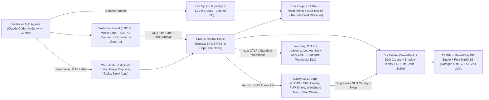

<div align="center">


# Culkibo

**The `54 MB`, Zero-Shell, AI-Native Self-Hosted PaaS (Open-Source Coolify & Dokploy Alternative)**
Deploy **140+ 1-Click Apps**, **12 Managed Databases**, **Self-Hosted AI / GPU LLM Workloads (Ollama · vLLM · llama.cpp)**, **Google SRE SLO Canary Auto-Rollback**, **Automated DR Fire-Drills**, **Remote Build-Node Offloader**, **Persistent `.ndjson.gz` Log Archive**, **Sub-8ms Live Sync 2.0**, **Post-MinIO S3 (Garage · RustFS · SeaweedFS)**, **Read-Only DB Studio**, **Agency Ledger & OSS White-Label**, **Passkeys (FIDO2)**, **OSV CVE Scan**, **OpenTofu IaC**, **Record `0.089 ms` (89 µs) Micro-Wasm**, and **135 MCP Tools + Async Tasks + 3 Inline MCP Apps** for **Claude Code, Antigravity, Cursor, Windsurf & Codex** — on a single `54 MB` Node.js control plane with **6 runtime dependencies**, **53 test suites**, and **Caddy v2.11** atomic routing.

[](.github/workflows/release.yml)
[-10B981.svg)](.github/workflows/demo-pages.yml)
[](LICENSE)
[](.github/workflows/ci.yml)
[](#benchmarks-and-reproducible-results)
[](scripts/release-provenance.js)
[-0F172A.svg)](tests/shell-safety.test.js)
[](#ai-agent-native-mcp-2026-07-28-tasks-and-mcp-apps)

> **Try Culkibo in 10 Seconds — Zero Install, Zero Docker Required:**
> Launch the curated read-only **Interactive Browser Sandbox** directly on **[GitHub Pages (`?demo=1`)](https://macaqueboy.github.io/culkibo/?demo=1&lang=en&theme=dark)** *(published automatically via [`.github/workflows/demo-pages.yml`](.github/workflows/demo-pages.yml))* or locally in `<200 ms` with **`npx culkibo demo`**!

<p>
  
</p>

```bash
git clone https://github.com/macaqueboy/culkibo.git && cd culkibo
docker compose up -d --build
node bin/culkibo.js agent-init claude
```

[Visual Showcase](#visual-showcase) ·
[Why Culkibo](#why-culkibo-is-architecturally-different) ·
[Comparison Matrix](#honest-head-to-head-comparison) ·
[Benchmarks & Results](#benchmarks-and-reproducible-results) ·
[Architecture](#architecture) ·
[30-Second Quick Start](#30-second-quick-start) ·
[AI Agents & MCP Apps](#ai-agent-native-mcp-2026-07-28-tasks-and-mcp-apps) ·
[Coolify Migration](#1-click-coolify-v4-migration-and-portable-bundles) ·
[Open-Core & Roadmap](#ethical-open-core-and-community-roadmap) ·
[Contributing](#contributing-and-community)

</div>

---

Culkibo `v1.2.0` is an open-source **self-hosted PaaS** and **Coolify / Dokploy alternative** engineered for solo builders, agencies, AI/GPU operators, platform teams, and AI coding agents. Instead of bolting a heavy PHP/Laravel or multi-container control stack on top of polling reverse proxies and shell scripts, Culkibo runs a single **54 MB RSS** daemon (`0%` CPU, `132.4 ms` cold boot, `9,693 req/s` authed Bearer+Brotli fast-path, `7,951 req/s` health) with **zero shell command construction**, atomic **Caddy v2.11** HTTP/3 ingress with **Google SRE Error-Budget SLO Canary Auto-Rollback** & **Native Edge Bot-Shield / PoW**, **Automated DR Backup Restore Fire-Drills**, **Self-Hosted AI / GPU & Local LLM Orchestration (Ollama · vLLM · llama.cpp)**, **Distributed Remote Build-Node Offloading**, **Compressed `.ndjson.gz` Persistent Log Archive**, **Post-MinIO S3 (Garage · RustFS · SeaweedFS + SigV4)**, **Read-Only DB Studio**, **Agency Billing Ledger & OSS White-Label**, **Standard-Webhooks Bus + DLQ**, **FIDO2 Passkeys & Secret Leases**, **OSV.dev CVE Drift**, **OpenTofu IaC Export**, **Sub-8ms Live Sync 2.0**, **Zero-Dep Web Terminal**, **WireGuard Fleet Mesh**, **20-Pattern Auto-Healer**, **Zero-Dep OTLP**, **Signed SLSA v1.1 + CycloneDX 1.6 SBOM**, **all-time record `0.089 ms` (89 µs) warm Micro-Wasm** (`0.140 ms` p95, `0.505 ms` cold, `64 KiB` RAM), and the industry's first **MCP `2026-07-28` (`135` tools, `-86%+` core profile, Autonomous Triage, Async Tasks & inline `ui://culkibo/*` MCP Apps)** control plane — verified by **53 integrated test suites**.

---

## Visual Showcase

Culkibo ships with a **Zero-Install Interactive Browser Sandbox (`?demo=1` / `npx culkibo demo`)**, **100% English & Spanish zero-dep localization** across every view (auto-detecting browser locale, defaulting to English globally), **Obsidian Dark Mode & Crisp Light Mode**, an **Open-Core White-Label Brand & Custom Login Theme Engine** (`GET/PUT /api/brand`), a **Pioneer Cockpit & Fleet UI** (SLO Canary Auto-Rollback Controller, Automated DR Fire-Drill Verifier, AI/GPU LLM VRAM Planner, Remote Build-Node Offloader, Persistent `.ndjson.gz` Log Archive Search, Read-Only Live DB Studio, Post-MinIO Garage/RustFS/SeaweedFS S3 + SigV4, Agency Quotas & CSV-Safe Ledger, Standard-Webhooks DLQ, WebAuthn Passkeys FIDO2, OSV.dev CVE Scanner, OpenTofu IaC Exporter, Config Drift Detector, Maintenance Windows & Geo-Failover, Zero-Dep Web Terminal, 20-Pattern Auto-Healer, WireGuard Mesh, Caddy PoW Shield, 24h Cron Heatmap, SmartPack, Shadow Replay, Time-Machine, SLSA Verifier, `89 µs` Micro-Wasm Tester, FinOps, DirectPush, EdgeTunnel, OTLP, and Coolify Streamer), and an interactive **Spatial SVG Topology Canvas** with click-to-link database env injection.

### Live Sync 2.0 (`1.32 ms` Apply · `7.85 ms` E2E) + Inline MCP Apps Flow

<p align="center">
  
</p>

### Obsidian Dark Mode & Light Mode (100% Global EN / ES Dashboard)

| Obsidian Dark Mode (`1440×900`) | Crisp Light Mode (`1440×900`) |
| :---: | :---: |
|  |  |

### Spatial SVG Topology Canvas & Click-to-Link DB Injection (`Obsidian Dark`)


### AI Agent Hub — MCP `2026-07-28`, `-86%+` Token Profiles & Interactive MCP Apps (`ui://culkibo/*`)


---

## Why Culkibo Is Architecturally Different

Traditional self-hosted PaaS platforms force a painful trade-off: burn 500 MB–1.5 GB of VPS RAM just to run the panel, ship silent empty backups or wipe logs on redeploy, kill mid-build SSH sessions, paywall white-labeling, and live with recurring shell-injection & LLM-runtime CVEs. Culkibo fixes these problems at the architecture layer:

### 1. Zero-Shell Engine (`shell: false`), FIDO2 Passkeys, DR Fire-Drills, OSV CVE Drift & Full CVE Immunity
- Every subprocess (`docker`, `git`, `caddy`, `ssh`, `cron`, `exec`, `npm`) is invoked through `spawn()` / `execFile()` with tokenized `argv` arrays validated by [`safeCommand.js`](server/services/safeCommand.js) and `shell: false`. Secrets travel exclusively via ephemeral `0600` `--env-file` descriptors or `GIT_ASKPASS` — statically verified on every commit by [`tests/shell-safety.test.js`](tests/shell-safety.test.js).
- **Automated DR Backup Restore Fire-Drill Verifier (`server/services/backupDrillService.js` · `culkibo dr-drill`):** Validates SHA-256 checksums, AES-GCM encryption, gzip decompression & SQL DDL integrity while rejecting silent `0 B`/`20 B` empty dumps (`dokploy#1382`, `coolify#6506`), stripped Supabase ACLs (`coolify#12244`), and rigid cross-service restore locks (`dokploy#6035`) — persisting signed DR Drill Scorecards (`rtoMs`/`rpoSec`/`verdict`).
- **Zero-Dep WebAuthn Passkeys (FIDO2), Secret Leases & OSV.dev SBOM CVE Drift (`passkeyService.js`, `secretLeaseService.js`, `cveDriftService.js` · `culkibo cve-scan`):** Pure-JS RFC 8949 CBOR/COSE + native ES256/Ed25519 Passkeys, time-bounded secret leases, 90d rotation alerts, audited 15m Break-Glass tokens, rate-limited TOTP, and runtime CycloneDX 1.6 PURL CVE scanning via `api.osv.dev/v1/querybatch`.
- **By-Design Immunity to Real-World PaaS & LLM CVEs ([`docs/COMPETITOR_RADAR_CYCLE6.md`](docs/COMPETITOR_RADAR_CYCLE6.md) · [`CYCLE7`](docs/COMPETITOR_RADAR_CYCLE7.md) · [`CYCLE8`](docs/COMPETITOR_RADAR_CYCLE8.md) · [`CYCLE9`](docs/COMPETITOR_RADAR_CYCLE9.md)):** Immune to **`Ollama CVE-2026-7482`** & **`vLLM CVE-2026-22778` (CVSS 9.8) / `CVE-2026-137477`** (vulnerable-tag guardrails + mandatory private/Bearer-proxy binding blocking `CVE-2025-63389`), Dokploy **`CVE-2026-116068`/`127212`/`24841`/`129433`/`129315`/`133520`**, Portainer **`CVE-2026-134756`**, Runtipi **`CVE-2026-47277`**, Dokku **`CVE-2026-54636`**, **`dokploy#1382/#6035/#3226/#3450/#1621`**, **`coolify#6506/#12244/#11372/#12170`**, **`kamal#1709/#1856/#1790`**, **`uptime-kuma#7704/#8193/#6519`**, and the 2025–2026 MinIO archiving.
- **Zero-Dep SLSA Provenance v1.1 Ed25519 DSSE ([`supplyChainAttestor.js`](server/services/supplyChainAttestor.js) · `culkibo verify`) & CycloneDX 1.6 SBOM ([`release-provenance.js`](scripts/release-provenance.js)):** Signs every Citadel & GitHub Release as an in-toto `Statement/v1` DSSE envelope alongside `GET /api/system/sbom`, `CHECKSUMS.sha256`, `release.slsa.dsse.json`, and `attestation-public-key.pem` via [`.github/workflows/release.yml`](.github/workflows/release.yml).

### 2. `54 MB` Idle RAM, `9,693 req/s` Fast-Path, Persistent `.ndjson.gz` Logs, Agency Quotas & White-Label
- **Measured live (independent QA):** **54 MB RSS** idle daemon (`<= 60 MB` invariant across 72+ lazy-loaded services), **0% idle CPU**, **132.4 ms** cold boot, **9,693 req/s** authenticated Bearer+Brotli fast-path (`p50 2.31 ms`, `p99 3.91 ms`, `Server-Timing: cp;dur=0.02`), and **7,951 req/s** health (`p50 2.68 ms`) — fitting comfortably on a **$4/mo 512 MB–1 GB VPS**.
- **Minimal supply-chain blast radius:** Exactly **6** root npm runtime dependencies ([`package.json`](package.json): `express`, `ws`, `chokidar`, `commander`, `cors`, `dotenv`) and **0** dependencies in [`telemetry-collector/`](telemetry-collector/README.md) — enforced across Node `20`, `22`, and `24` in [`.github/workflows/ci.yml`](.github/workflows/ci.yml).
- **Compressed `.ndjson.gz` Persistent Log Archive & ReDoS-Safe Search (`server/services/logArchiveService.js` · MCP `culkibo_log_archive_search`):** Native `zlib.gzip` rotated log archives survive every container redeploy (`coolify#12170`, `dokploy#2270/#6112`) with retention MB caps, ReDoS-safe search, and strict project ACL isolation.
- **Agency Multi-Tenant Quotas (`culkibo ledger --csv`), Open-Core White-Label Brand (`GET/PUT /api/brand`, `coolify#1744`) & Standard-Webhooks Bus + Anti-SSRF DLQ Replay (`webhookEventBus.js`):** Per-project CPU/RAM/storage/bandwidth caps, OWASP CSV-formula-safe billing ledgers, Apache-2.0 custom login/workspace themes, and `whsec_` dual-secret outbound webhooks with 500-item DLQ replay.
- **Zero-Dep OTLP/HTTP JSON ([`otlpExporter.js`](server/services/otlpExporter.js)), FinOps (`finopsOptimizer.js`), Cron Heatmap & Maintenance Windows ([`cronManager.js`](server/services/cronManager.js), [`uptimeMonitor.js`](server/services/uptimeMonitor.js)):** Native gzip OTLP traces/metrics to Tempo/SigNoz/Honeycomb, cloud savings calculator, 24h cron collision heatmap + `/api/heartbeat/:token`, live Maintenance Windows, public Incident Timelines, and Active-Passive Cloudflare DNS Geo-Failover plans.

### 3. Sub-8ms Live Sync 2.0, SLO Canary Auto-Rollback, Read-Only DB Studio & `0.089 ms` (89 µs) Micro-Wasm
When coding with Claude Code, Antigravity, Cursor, or Windsurf, waiting 2–4 minutes per push destroys flow:

```text
Traditional PaaS:  save file -> git commit -> push -> webhook -> Docker rebuild (1-4 min) -> check
Culkibo Forge:     save file -> binary Commit Frame (/ws/sync, Brotli -96.1%) -> 1.32 ms apply / 7.85 ms E2E
Culkibo Citadel:   env edit  -> Fast Restart (~1.5 s) OR BuildKit -> Shadow Replay -> SLO Canary (10->100%)
```

- **Adaptive binary framing (`0x02` Brotli / `0x03` Gzip):** `-96.1%` wire reduction on 100-file TSX bursts, SHA-256 LRU deduplication, chunked transfers (`<=100 MB` with SHA-256 check), **Merkle Tree** verification, and **in-memory time-travel patch rollback (`1.91 ms p50`)**.
- **Google SRE Error-Budget SLO Canary Auto-Rollback Controller (`server/services/sloCanaryController.js` · MCP `culkibo_slo_canary`):** Argo Rollouts / Flagger-class progressive weights (`10→25→50→100%`) directly over Caddy v2.11 `weighted_round_robin`, computing Google SRE burn-rate (`>14.4×` or p95 breach triggers instant **`100/0` rollback** + alert) — paired with **Shadow Traffic Replay Gate** and **Whole-Stack Time-Machine (`culkibo timemachine`)**.
- **Zero-Dep Read-Only Live DB Studio & Safe Redis/Valkey Inspector (`server/services/dbStudioService.js` · MCP `culkibo_db_studio`):** Zero-sidecar SQL/Redis studio replacing bloated Adminer containers — strips `--`/`/* */` comments before keyword scanning, blocks stacked `;`, DDL/DML, `COPY` & `psql \!`, wraps queries in `BEGIN TRANSACTION READ ONLY` + `5s` timeout + `LIMIT 200`, diagnoses Postgres bloat & `EXPLAIN (FORMAT JSON)`, and runs safe Redis `SCAN`/`TYPE`/`TTL`/`INFO`.
- **Zero-Dep Interactive Container Web Terminal (`/ws/terminal`, zero `node-pty`), 20-Pattern Build Auto-Healer (`culkibo heal`), & Live Config Drift Detector (`kamal#1790` + PgBouncer Smart Pool `max_prepared_statements=200`).**
- **All-Time Record `0.089 ms` (89 µs) Warm Micro-Wasm Edge Runtime ([`wasmMicroRunner.js`](server/services/wasmMicroRunner.js)):** Sandboxed WebAssembly in isolated `worker_threads` — live-measured at **`0.089 ms` (89 µs) warm p50**, **`0.140 ms` p95**, **`0.505 ms` cold**, and **`64 KiB` RAM** (zero host filesystem/network access).
- **Honest scope:** Live Sync 2.0 accelerates incremental code/asset iteration (*Path B*). Dependency or `Dockerfile` changes run full immutable Docker BuildKit builds (*Path C*) with smoke tests, shadow replay gates, SLO canaries, and multi-release rollback.

### 4. World-First PaaS MCP Apps (`ui://culkibo/*`), Autonomous Triage, Async Tasks & Elicitation (`MCP 2026-07-28`)
- **135 Tools, 13 Playbook Prompts & 10 Resources** over Streamable HTTP (`POST /api/mcp`) and stdio (`culkibo mcp`) with legacy SSE fallback — verified end-to-end against a real spawned stdio JSON-RPC client ([`tests/release-and-mcp-e2e.test.js`](tests/release-and-mcp-e2e.test.js)), including **`culkibo_triage_playbook`** (1-call autonomous triage), `culkibo_slo_canary`, `culkibo_ai_workload`, `culkibo_remote_builder`, `culkibo_log_archive_search`, `culkibo_db_studio`, `culkibo_s3_storage`, `culkibo_agency_ledger`, `culkibo_brand_theme`, `culkibo_cve_scan`, `culkibo_drift_check`, `culkibo_export_iac`, `culkibo_secret_lease`, `culkibo_heal_build_failure`, `culkibo_fleet_mesh`, `culkibo_cron_timeline`, `culkibo_edge_shield`, `culkibo_shadow_replay`, `culkibo_time_machine`, and `culkibo_finops_report`.
- **Official MCP `2026-07-28` Async Tasks (`io.modelcontextprotocol/tasks`) & Elicitation (`elicitation/create`):** Long-running Docker builds, Coolify migrations, and DR drills run non-blocking via `tasks/list`, `tasks/get`, `tasks/result`, and `tasks/cancel` with strict cross-tenant RBAC isolation — and declare structured JSON Schema `elicitation` prompts for missing secrets or deployment approvals.
- **5 Context-Saving Profiles (`?profile=core|deploy|ops|security|all` & `CULKIBO_MCP_PROFILE`):** `?profile=core` serves the 17 essential tools (`17 / 135`) and cuts LLM tool-schema context by **`-86%+`** while `culkibo_search_tools` discovers any of the remaining 135 tools on demand.
- **Interactive Inline MCP Apps (`modelcontextprotocol/ext-apps` `2026-01-26`):** Serves 3 sandboxed interactive HTML apps (`ui://culkibo/topology`, `ui://culkibo/incident-remediator`, `ui://culkibo/coolify-migration-diff`) with locked-down `_meta.ui.csp` (`default-src 'none'`), zero external URLs, XSS-safe JSON injection, and `postMessage` JSON-RPC bridges so compliant AI hosts render live visual cards inline inside chat.

### 5. Self-Hosted AI/GPU LLMs, Remote Build Offloader, Post-MinIO S3, OpenTofu IaC, WireGuard Mesh & Caddy PoW
- **Self-Hosted AI / GPU & Local LLM Workload Orchestrator (`server/services/aiWorkloadService.js` · `culkibo ai-vram` + MCP `culkibo_ai_workload`):** Native **Ollama · vLLM · llama.cpp** orchestrator with VRAM + KV-cache pre-flight (`Q4_K_M`/`Q8_0`/`FP16`), NVIDIA CDI (`nvidia.com/gpu=all`) + legacy toolkit support (`dokploy#1621`), persistent model-weight cache volumes, mandatory `127.0.0.1`/Bearer-proxy binding (blocking `CVE-2025-63389`), and vulnerable-tag guardrails (`Ollama CVE-2026-7482`, `vLLM CVE-2026-22778`/`137477`).
- **Distributed Remote Build-Node Offloader (`server/services/remoteBuilderService.js` · MCP `culkibo_remote_builder`):** Offload heavy production AND PR preview builds (`dokploy#3450`) to dedicated `amd64`/`arm64` build servers with per-builder concurrency queues (`dokploy#3226`), **active-build SSH mux ref-count pinning** (preventing `coolify#11372/#10853` mid-build `ssh -O exit` kills), `directPushRegistry.js` layer handoff, and remote cache pruning.
- **Post-MinIO S3 Storage Orchestrator (`culkibo s3-presets`) & Zero Lock-In OpenTofu/Compose IaC Exporter (`culkibo export-iac`):** 1-click pinned **Garage (`dxflrs/garage`)**, **RustFS (`rustfs/rustfs`)**, and **SeaweedFS** S3 presets + pure-crypto AWS SigV4 presigned URLs + Bucket CORS/Lifecycle XML builders, plus 1-command `main.tf`/`variables.tf`/`docker-compose.yml` export (**0 plaintext secrets**).
- **SmartPack (`18` stacks), DirectPush (`culkibo pussh`), WireGuard Fleet Mesh (`culkibo mesh`), Sovereign EdgeTunnel (`ET1`) & Caddy v2.11 Edge Bot-Shield/PoW + 6-Day ACME:** Zero Docker Hub lock-in, native `x25519` AES-GCM `10.88.0.0/24` mesh, zero-plugin Caddy scanner/AI-scraper matchers + Anubis-style SHA-256 PoW (`ckb_shield`), full multi-CAA pre-flight (`uptime-kuma#6519`), 6-day `shortlived` ACME, HTTP/3, and **7-provider DNS-01 Wildcard TLS**.

### 6. Atomic DB Migrations, 1-Click Coolify v4 Migration & Enterprise Defense-in-Depth
- **Atomic Single-Leader Pre-Deploy DB Migrations ([`migrationRunner.js`](server/services/migrationRunner.js) + Project Cockpit Pre-Flight Planner) & Per-PR Postgres Schema Isolation:** Single-leader lease locks with dead-PID/TTL recovery prevent concurrent replica migration races, trigger optional pre-migration snapshots, abort route cutover cleanly on failure, and isolate PR previews via dedicated PostgreSQL schemas (`pr_<n>`) or `TEMPLATE`/SQLite CoW database branches with automatic teardown.
- **Coolify v4 Deep Migrator ([`docs/MIGRATION_GUIDE.md`](docs/MIGRATION_GUIDE.md)) & Portable `.zip` Bundles ([`bundleArchiver.js`](server/services/bundleArchiver.js)):** Translates Coolify v4 Magic Variables (`${SERVICE_FQDN_*}`, `${SERVICE_PASSWORD_*}`, `${COOLIFY_*}`) into domains & `${vault.*}`, converts plain & Base64 Traefik labels into Caddy v2.11 edge config, generates zero-shell Volume & SQL streaming runbooks (`POST /api/import/coolify/stream-plan`), and is battle-tested end-to-end against a full Mock Coolify v4 Estate ([`tests/coolify-e2e-replay.test.js`](tests/coolify-e2e-replay.test.js)).
- **12 Managed Databases, SnapStream & Enterprise Security Built In (Never Paywalled):** `PostgreSQL`, `pgvector`, `TimescaleDB`, `MySQL`, `MariaDB`, `Valkey`, `Redis`, `Dragonfly`, `MongoDB`, `ClickHouse`, `Qdrant`, and `Meilisearch` + **AES-256-GCM S3/R2 DR Drills** + **SnapStream** ([`sqliteStreamBackup.js`](server/services/sqliteStreamBackup.js) SQLite WAL-to-S3 PITR) + 4-role RBAC, `HttpOnly` sessions, **TOTP 2FA**, **OIDC PKCE SSO** (`groups` → RBAC + resilient JWKS stale-while-revalidate), hash-chained audit log, secret scanner (`422`), deploy freeze (`423`), webhook replay protection (`<=300s`), symlink-safe GitOps, protected sleeping-container prune guards, and dead-PID deploy-lock recovery.

---

## Honest Head-to-Head Comparison

> **Radical Transparency:** Culkibo's metrics below are **live-measured** via `node bench/run-all.bench.js` (unadjusted). Competitor footprints are **documented architecture baselines** from published stacks and minimum VPS docs (not executed on this host).

| Capability | Culkibo v1.2 | Coolify v4 | Dokploy | CapRover | Kamal 2 | Portainer CE |
| :--- | :---: | :---: | :---: | :---: | :---: | :---: |
| **Control-Plane Stack** | **Node.js (6 deps) + Caddy** | Laravel + PHP + PG + Redis + Soketi + Traefik | Next.js + PG + Redis + Traefik | Node.js + Nginx + Swarm | Local Ruby CLI + `kamal-proxy` | Go + BoltDB *(container UI)* |
| **Control-Plane RAM Footprint** | **54 MB RSS** *(~72 MB w/ Caddy, measured)* | ~800 MB – 1.5 GB *(2 GB VPS min)* | ~450 – 800 MB *(1–2 GB VPS)* | ~150 – 300 MB *(300–450 MB w/ Swarm)* | 0 MB panel *(+15–25 MB proxy)* | ~100 – 200 MB *(external proxy)* |
| **Zero-Shell, OSV CVE Drift & SLSA v1.1** | ✅ **`0` shell · OSV SBOM Scan · SLSA v1.1 DSSE** | ❌ PHP shell | ❌ Child shell | ⚠️ Swarm CLI | ⚠️ SSH shell | ✅ Docker API |
| **SLO Canary Rollback & Caddy PoW Shield** | **Caddy v2.11** *(10→100% SRE burn rollback · PoW · 6d ACME)* | Traefik *(2,000 ms throttle)* | Traefik / Swarm | Nginx reload | `kamal-proxy` *(<1 ms swap)* | ❌ External |
| **Self-Hosted AI / GPU LLM Orchestrator** | ✅ **Ollama · vLLM · llama.cpp · VRAM + CDI + CVE shield** | ❌ Manual | ⚠️ Legacy GPU (`#1621`) | ❌ | ❌ | ❌ |
| **Automated DR Fire-Drills + `.ndjson.gz` Logs** | ✅ **`culkibo dr-drill` (0B/ACL guard) · Redeploy-safe logs** | ⚠️ Empty dump (`#6506`) | ⚠️ Empty dump (`#1382`) | ❌ | ❌ | ❌ |
| **Remote Build Offloader + Live Sync 2.0** | ✅ **SSH mux-pinned builds (`#11372`) · `1.32 ms` apply** | ⚠️ Mux kill (`#11372`) | ⚠️ Queue race (`#3226`) | ❌ Image build | ❌ Image build | ❌ |
| **Read-Only DB Studio + Post-MinIO S3** | ✅ **Safe SQL/Redis Studio · Garage/RustFS/SeaweedFS + SigV4** | ⚠️ Adminer / MinIO | ⚠️ Adminer / MinIO | ❌ | ❌ | ❌ |
| **Web Terminal + Auto-Healer + Config Drift** | ✅ **Docker hijack `/ws/terminal` · `culkibo heal` · Drift + PgBouncer** | ⚠️ PTY dep | ⚠️ PTY dep | ❌ | ❌ | ✅ Exec UI |
| **Agency Quotas, Ledger & White-Label** | ✅ **Tenant Quotas · CSV-safe Ledger · OSS White-Label (`#1744`)** | ❌ *(`#1744` open)* | 💰 Enterprise paywall | ❌ | ❌ | 💰 Business |
| **Standard-Webhooks Bus + OpenTofu IaC** | ✅ **Dual-secret `whsec_` + Anti-SSRF DLQ · `.tf`/Compose export** | ❌ | ❌ | ❌ | ❌ | ❌ |
| **AI-Agent Native MCP + Triage + MCP Apps** | ✅ **135 tools · `triage_playbook` · Tasks · 3 `ui://` Apps · `-86%+`** | ❌ *(3rd-party)* | ❌ *(3rd-party)* | ❌ | ❌ | ❌ |
| **SmartPack + DirectPush + WireGuard Mesh** | ✅ **18 stacks · `culkibo pussh` · Native `x25519` Mesh · `ET1`** | ⚠️ Nixpacks | ⚠️ Nixpacks | ⚠️ Buildpacks | ❌ Registry req. | ❌ |
| **Shadow Replay, Time-Machine & `89 µs` Wasm** | ✅ **Auto `PROMOTE`/`BLOCK` · SHA-256 restore · `0.089 ms` Wasm** | ❌ | ❌ | ❌ | ❌ | ❌ |
| **1-Click Catalog, 12 DBs, Passkeys & RBAC** | ✅ **140 apps · 12 DBs · FIDO2 Passkeys · Leases · 4-role RBAC** | ✅ Catalog / ⚠️ Teams | ✅ Catalog / ⚠️ Basic | ✅ One-click | ❌ Manual | ⚠️ Paid Business |
| **1-Click Coolify v4 Migration + GitOps** | ✅ **Magic Vars + Traefik→Caddy + `culkibo.yaml` + Auto-Sleep** | — | ❌ | ❌ | ✅ `deploy.yml` | ⚠️ Git stacks |

---

## Benchmarks and Reproducible Results

Every Culkibo metric below comes from real code independently measured on `Node v24.14.0` (`win32/x64`, uncontended run) with **zero synthetic delays and zero subtracted overhead**. Reproduce the complete suite or generate a Markdown/JSON comparison report on your own machine:

```bash
node bench/run-all.bench.js
node bench/competitor-comparison.bench.js --markdown
```

### Independently Verified Live Performance Results (`v1.2.0` Record Run)

| Metric | Live Measured Result | Notes & Verification Command |
| :--- | :--- | :--- |
| **Idle Daemon RAM / CPU** | **54 MB RSS · 0% CPU** | Measured across 72+ lazy-loaded services (`<= 60 MB` invariant) |
| **Cold Boot Time** (`CULKIBO_SKIP_RECONCILE=1`) | **132.4 ms** | Measured via `process.hrtime.bigint()` (`npm run bench:control`) |
| **Authenticated Fast-Path (Bearer + Brotli, 500 req / 25w)** | **9,693 req/s** *(p50 `2.31 ms` · p99 `3.91 ms`)* | HMAC-SHA256 LRU cache + WeakMap zero-copy Brotli + `Server-Timing: cp;dur=0.02` |
| **Health HTTP (`GET /api/health`, 500 req / 25w)** | **7,951 req/s** *(p50 `2.68 ms`)* | Pre-compiled O(1) fast-path route map |
| **Mixed Uncompressed / RBAC Express HTTP (500 req / 25w)** | **3,566 req/s** mixed · **2,275 req/s** RBAC | `0` failures (`bench/control-plane.bench.js` & `bench/subsystems.bench.js`) |
| **Catalog Load (`GET /api/catalog`, 140 apps)** | **warm p50 `0.68 ms`** | `129.6 KB` → `34.5 KB` Brotli (**-73.4%**) |
| **Live Sync 2.0 (Path B Incremental Sync)** | **server apply p50 `1.32 ms` · E2E p50 `7.85 ms` (sub-8ms!)** | 100-file TSX burst Brotli **-96.1%** (`25.66×`) · in-memory rollback **p50 `1.91 ms`** |
| **Isolated Micro-Wasm Edge Runtime (All-Time Record)** | **warm p50 `0.089 ms` (89 µs) · p95 `0.140 ms` · `64 KiB` RAM** | Cold `0.505 ms` · verified via `bench/competitor-comparison.bench.js` & [`tests/migrations-and-wasm.test.js`](tests/migrations-and-wasm.test.js) |
| **WebSocket 40-Client Fan-Out** | **51.9 ms** (`40/40` initial state delivered) | Zero drops under concurrent churn (`tests/websocket-stress.test.js`) |
| **Caddy v2.11 Atomic Route Swap & SLO Canary** | **Synchronous zero-poll Admin API + `weighted_round_robin`** | Verified live in Linux CI ([`.github/workflows/ci.yml`](.github/workflows/ci.yml) `live-caddy-e2e`) & `npm run bench` |
| **MCP `2026-07-28` `?profile=core` Savings** | **-86%+ schema tokens** (`17 / 135` tools) | Verified via `bench/competitor-comparison.bench.js` + external stdio E2E |
| **Supply-Chain, Shell Safety & Milestone Suite** | **6 root deps · 0 collector deps · 0 shell calls · 53 suites** | Verified in CI + Signed `release.slsa.dsse.json` + OSV.dev CycloneDX 1.6 SBOM |

---

## Architecture

Culkibo separates rapid developer/AI iteration (**The Forge**) from immutable production releases (**The Citadel**) on a single lightweight control plane:



---

<a id="quick-start"></a>

## 30-Second Quick Start

### Prerequisites
- **Zero-Install Sandbox:** Any modern browser (`https://macaqueboy.github.io/culkibo/?demo=1&lang=en&theme=dark`) or Node.js 20+ for `npx culkibo demo`
- **Production VPS:** Debian 12 / Ubuntu 22.04+ (512 MB+ RAM; 1 GB+ recommended for Docker builds)
- **Docker Compose:** Docker Engine 24+ & Compose v2
- **Local Dev:** Node.js **20+** (22/24 LTS recommended). Docker and Caddy are optional locally.

### Option 1 — 10-Second Zero-Install Sandbox (`demo`)

Explore SmartPack, Spatial Topology, 140+ Catalog Apps, Coolify Migration, Native OTLP, and 3 inline MCP Apps with zero configuration:

```bash
npx culkibo demo
```

Or open the hosted read-only sandbox on **[GitHub Pages (`?demo=1`)](https://macaqueboy.github.io/culkibo/?demo=1&lang=en&theme=dark)**.

### Option 2 — Docker Compose (Recommended Production Stack, ~30s)

```bash
git clone https://github.com/macaqueboy/culkibo.git
cd culkibo
docker compose up -d --build
```

Starts the Culkibo daemon on `http://127.0.0.1:3030` wired over a private internal network to **Caddy v2.11** (ports `80`, `443/tcp`, `443/udp` for HTTP/3, with `:2019` Admin API never exposed to the host). See [`docker-compose.yml`](docker-compose.yml) and [`Dockerfile.caddy`](Dockerfile.caddy) for Multi-Wildcard DNS-01 builds.

### Option 3 — 1-Line Production VPS Installer (Debian / Ubuntu)

Installs an unprivileged `culkibo` user, Node.js 22, Docker, Caddy with automatic TLS + HTTP/3, hardened `systemd` unit, and a `0600` 256-bit auth token in `data/auth.json`:

```bash
curl -fsSL https://raw.githubusercontent.com/macaqueboy/culkibo/main/scripts/install.sh | sudo bash
```

Clean uninstall: `sudo bash /opt/culkibo/scripts/uninstall.sh` (verified against real Debian 12 + `systemd` via [`scripts/test-install.sh`](scripts/test-install.sh)).

### Option 4 — CLI-First Project, Pioneer & Supply-Chain Workflow

Install and run locally from source (Windows users can also run `./start.ps1`):

```bash
npm install && npm --prefix web install && npm run web:build && npm start
```

Then run the complete project, SmartPack, DirectPush, EdgeTunnel, and offline SLSA/SBOM verification lifecycle:

```bash
node bin/culkibo.js init .                           # Auto-detect stack & generate culkibo.yaml
node bin/culkibo.js smartpack . --dockerfile --json  # Inspect 18-stack build plan & .dockerignore
node bin/culkibo.js up .                             # Provision & start project
node bin/culkibo.js sync <projectId> .               # Start Live Sync 2.0 (1.32 ms apply)
node bin/culkibo.js deploy <projectId>               # Immutable BuildKit deploy + SLO Canary + SLSA
node bin/culkibo.js dr-drill backup.sql.gz --json    # Automated DR Fire-Drill (0B/AES/SQL DDL check)
node bin/culkibo.js ai-vram --params 14 --quant Q4_K_M --vram 16 --runtime vllm --json  # GPU VRAM pre-flight
node bin/culkibo.js heal build.log --json            # 20-pattern deterministic build auto-healer
node bin/culkibo.js mesh status --json               # Zero-config x25519 WireGuard fleet mesh
node bin/culkibo.js s3-presets --json                # Post-MinIO pinned Garage / RustFS / SeaweedFS presets
node bin/culkibo.js ledger --days 30 --csv           # Agency client-billable formula-safe CSV usage ledger
node bin/culkibo.js cve-scan --json                  # Runtime CycloneDX SBOM CVE drift scan (OSV.dev)
node bin/culkibo.js export-iac --out ./iac --json    # Zero lock-in OpenTofu (.tf) + Compose IaC export
node bin/culkibo.js timemachine list <projectId>     # Inspect/diff/restore whole-stack checkpoints
node bin/culkibo.js finops --apps 5 --dbs 2          # Cloud-vs-Self-Hosted annual savings & right-sizing
node bin/culkibo.js pussh my-app:v1 --server srv1    # DirectPush registry-less SSH OCI v2 deploy
node bin/culkibo.js tunnel-agent --url wss://hub/ws/tunnel --token "$TUNNEL_TOKEN" --target 127.0.0.1:3000
node bin/culkibo.js verify dist-release              # Verify CHECKSUMS.sha256 & SLSA v1.1 DSSE offline
npm run release:sbom -- --out-dir dist-release --sign --verify  # Signed SLSA + CycloneDX 1.6 SBOM
```

---

## AI-Agent Native (MCP `2026-07-28`, Tasks and MCP Apps)

Culkibo is built from day one for autonomous and human-in-the-loop AI coding workflows — shipping **135 tools** (including 1-call `culkibo_triage_playbook`, `culkibo_slo_canary`, `culkibo_ai_workload`, `culkibo_remote_builder`, `culkibo_log_archive_search`, `culkibo_db_studio`, `culkibo_s3_storage`, `culkibo_agency_ledger`, `culkibo_brand_theme`), **13 playbooks**, official **MCP `2026-07-28` Async Tasks (`io.modelcontextprotocol/tasks`)**, **Elicitation (`elicitation/create`)**, and the first **`modelcontextprotocol/ext-apps` (`2026-01-26`)** interactive UI resources in any self-hosted PaaS.

### 1-Click Agent Kit Generator

Generate drop-in MCP configs (defaulting to `?profile=core` for **-86%+ token savings** across `17 / 135` tools and using `${CULKIBO_TOKEN}` env placeholders — never plaintext secrets):

```bash
node bin/culkibo.js agent-init claude       # .mcp.json + CLAUDE.md ops snippet
node bin/culkibo.js agent-init antigravity  # .antigravity/mcp.json (Streamable HTTP)
node bin/culkibo.js agent-init cursor       # .cursor/mcp.json
node bin/culkibo.js agent-init windsurf     # .windsurf/mcp_config.json
node bin/culkibo.js agent-init codex        # .codex/config.toml (bearer_token_env_var)
node bin/culkibo.js agent-init vscode       # .vscode/mcp.json
```

### Streamable HTTP (`2026-07-28`) — Antigravity, Claude Code, Cursor & Windsurf

Connect to `http://localhost:3030/api/mcp?profile=core` (or `deploy`, `ops`, `security`, `all`):

```json
{
  "mcpServers": {
    "culkibo": {
      "url": "http://localhost:3030/api/mcp?profile=core",
      "headers": {
        "Authorization": "Bearer ${CULKIBO_TOKEN}"
      }
    }
  }
}
```

### Stdio Bridge (Claude Desktop / Local CLI Agents)

```json
{
  "mcpServers": {
    "culkibo": {
      "command": "node",
      "args": ["/path/to/culkibo/bin/culkibo.js", "mcp"],
      "env": {
        "CULKIBO_API_URL": "http://localhost:3030",
        "CULKIBO_TOKEN": "${CULKIBO_TOKEN}",
        "CULKIBO_MCP_PROFILE": "core"
      }
    }
  }
}
```

### Interactive MCP Apps (`ui://culkibo/*`) & Built-In Playbooks (`prompts/list`)

| Interactive MCP App (`text/html;profile=mcp-app`) | Sandboxed Inline Experience (`_meta.ui.csp`) |
| :--- | :--- |
| `ui://culkibo/topology` | Live RBAC-scoped SVG service, database, domain & fleet map with 1-click inspect/ship actions |
| `ui://culkibo/incident-remediator` | Live OOM/CrashLoop diagnostics card with two-phase `dryRun` → HMAC `confirmToken` stepper |
| `ui://culkibo/coolify-migration-diff` | Coolify v4 Parity Score, redacted `${vault.*}` Magic Vars & Traefik→Caddy edge diff viewer |

| Playbook Prompt (`prompts/get`) | Autonomous Agent Workflow |
| :--- | :--- |
| `deploy_safely` | Pre-deploy secret scan → atomic DB migration → `culkibo_ship_and_verify` → SLSA attestation |
| `migrate_from_coolify` | Read-only Coolify v4 scan → Magic Var & Traefik translation preview → zero-downtime cutover |
| `debug_production_crash` | Runs `culkibo_diagnose_incident` → correlates OOM/logs/OTLP traces → proposes confirmed fix |
| `zero_downtime_db_upgrade` | Encrypted snapshot + SHA-256 verify + DR drill → single-leader migration → cutover |
| `security_audit_stack` | Verifies hash-chained audit log, SLSA DSSE attestations, secret scan, RBAC/2FA/OIDC & TLS |
| `setup_wildcard_tls_and_tunnel` | Configures 7-provider DNS-01 wildcard TLS or zero-open-port EdgeTunnel / Cloudflare Tunnel |
| `optimize_ram_and_costs` | Inspects Auto-Sleep candidates, container limits, and right-sizing savings |
| `disaster_recovery_drill` | Validates AES-256-GCM DR backup & SnapStream integrity via non-destructive restore drill |

---

## 1-Click Coolify v4 Migration and Portable Bundles

Moving off Coolify takes minutes — and is **read-only** on your source server until you flip DNS:

1. Open Culkibo (`http://localhost:3030`), press **`Ctrl+K`** / **`⌘K`**, and run **Import from Coolify** (or upload an offline export / portable `.zip` or `.ckb.gz` bundle).
2. Enter your Coolify URL and read-only API token to inspect the live **Migration Parity Report**:
   - Automatic **Magic Variable** translation (`${SERVICE_FQDN_*}`, `${SERVICE_PASSWORD_*}`, `${COOLIFY_*}` → Culkibo domains & encrypted `${vault.*}` refs)
   - Automatic **Traefik → Caddy v2.11** rule translation (plain & Base64 labels: `stripprefix`, `redirectregex`, CORS/HSTS, `forwardauth`, `basicauth`, upstream port)
   - Full mapping for Applications, Compose Services, 8 DB Engines, Scheduled Tasks → Crons, Persistent Volumes, and the interactive **Volume & SQL Live Transfer** zero-shell runbook (`POST /api/import/coolify/stream-plan`)
3. Click **Migrate**, run the built-in post-migration smoke check (`verifyMigratedStack`), and cut over DNS with zero downtime. Verified end-to-end across a full multi-app, multi-DB Mock Coolify v4 Estate in [`tests/coolify-e2e-replay.test.js`](tests/coolify-e2e-replay.test.js).

Read the complete step-by-step runbook in [`docs/MIGRATION_GUIDE.md`](docs/MIGRATION_GUIDE.md).

---

## Testing, CI and Repository Map

Culkibo ships **53 integrated test suites** in `tests/run-all.js` (including Automated DR Fire-Drill Verifier, Google SRE Error-Budget SLO Canary Auto-Rollback, Self-Hosted AI/GPU LLM Orchestrator, Distributed Remote Build-Node Offloader, Persistent `.ndjson.gz` Log Archive, Standard-Webhooks Dual-Secret + Anti-SSRF DLQ Replay, Post-MinIO Garage/RustFS/SeaweedFS S3 + Pure-Crypto SigV4, Zero-Dep Read-Only Live DB Studio + Safe Redis Inspector, Agency Multi-Tenant Quotas + CSV-Safe Ledger, Open-Core White-Label Brand Engine, WebAuthn Passkeys FIDO2 + Secret Leases + OSV.dev CVE Drift, Live Config Drift + PgBouncer + OpenTofu IaC Export, Maintenance Windows + Multi-CAA + 6-Day ACME + Geo-Failover, Mock-Coolify v4 E2E Estate Replay, real external MCP stdio E2E, OTLP/SLSA attestation E2E, Atomic DB Migrations + `0.089 ms` (89 µs) Micro-Wasm E2E, Shadow Replay, Whole-Stack Time-Machine, Cloud FinOps, Web Terminal, WireGuard Mesh, Caddy PoW Shield, 20-Pattern Auto-Healer, and 24h Cron Heatmap & Heartbeats) + standalone live-server, WebSocket churn, HTTP stress, and zero-dep telemetry collector suites — verified continuously on Linux by [`.github/workflows/ci.yml`](.github/workflows/ci.yml) (`4` jobs: Node 20/22/24 matrix + Live Caddy v2.11 + Docker BuildKit SmartPack & SBOM E2E + Playwright Desktop/Mobile visual QA), released with signed SLSA v1.1 + CycloneDX 1.6 via [`.github/workflows/release.yml`](.github/workflows/release.yml), and published as a zero-install sandbox via [`.github/workflows/demo-pages.yml`](.github/workflows/demo-pages.yml):

```bash
node tests/shell-safety.test.js                       # Static AST/source check: 0 shell calls
npm run typecheck                                     # Server TypeScript checkJs (0 errors)
npx tsc -p web/tsconfig.app.json --noEmit             # Frontend TypeScript check (0 errors)
npx --prefix web oxlint --deny-warnings               # oxlint React 19 + Compiler rules (0 warnings)
npm run web:build                                     # Vite production build + .br/.gz precompression
npm test                                              # 53 suites + live-server + WS stress + HTTP stress
node --test telemetry-collector/test/collector.test.js  # Zero-dep telemetry collector suite
npm run release:sbom -- --out-dir dist-release --sign --verify  # Signed SLSA v1.1 + CycloneDX 1.6 SBOM
```

### Repository Layout

```text
.github/workflows/ci.yml         Active 4-job Linux CI (Node 20/22/24, Live Caddy, BuildKit SmartPack/SBOM, Playwright)
.github/workflows/release.yml    Automated v* GitHub Release workflow (Signed SLSA v1.1 DSSE + CycloneDX 1.6 SBOM)
.github/workflows/demo-pages.yml Zero-Install Interactive Browser Sandbox workflow (GitHub Pages ?demo=1)
bin/culkibo.js                   CLI (demo, init, up, sync, deploy, dr-drill, ai-vram, heal, mesh, s3-presets, ledger, cve-scan, export-iac, mcp...)
scripts/release-provenance.js    Zero-dep CycloneDX 1.6 SBOM, SHA-256 checksums & Ed25519 SLSA DSSE signer
server/
  index.js                       O(1) fast-path HTTP daemon, Server-Timing, Brotli cache, /ws/terminal & /ws/sync
  middleware/auth.js             Constant-time tokens, RBAC middleware, single-use WS tickets, rate limits
  routes/api.js                  REST API (dr-drill, slo-canary, ai/vram, builders, logs/archive, brand, webhooks, db-studio, storage, MCP)
  services/                      72+ zero-shell services (backupDrillService, sloCanaryController, aiWorkloadService,
                                 remoteBuilderService, logArchiveService, webhookEventBus, dbStudioService,
                                 objectStorageService, quotaMeteringService, brandThemeService, passkeyService,
                                 secretLeaseService, cveDriftService, driftDetectorService, iacExporter,
                                 containerTerminalService, fleetMeshService, edgeShieldService, buildHealerService,
                                 liveSyncEngine, cronManager, uptimeMonitor, shadowReplayService, timeMachineService,
                                 finopsOptimizer, smartPackBuilder, directPushRegistry, edgeTunnelService,
                                 sqliteStreamBackup, otlpExporter, supplyChainAttestor, migrationRunner,
                                 wasmMicroRunner, mcpAppsRenderer, mcpServer, caddyManager, ingressManager,
                                 coolifyMigrator, bundleArchiver, serverFleetManager, teamManager, editionService...)
telemetry-collector/             Zero-dep anonymous telemetry collector (node:sqlite WAL + CF Workers/D1)
web/src/                         React 19 + Tailwind v4 dashboard (100% EN/ES, White-Label, ?demo=1 Sandbox, Pioneer Cockpit)
bench/                           Reproducible live benchmarks (control-plane, live-sync, route-swap, subsystems)
scripts/                         Hardened Debian/Ubuntu VPS installer (chmod 700), uninstaller, systemd test & SBOM signer
tests/                           53 integrated + 4 standalone verification, E2E, security, fuzz & stress suites
docs/                            MIGRATION_GUIDE.md, GITHUB_SEO_LAUNCH_KIT.md, COMPETITOR_RADAR_CYCLE{6,7,8,9}.md, EVOLUTION_LOG.md, assets/
```

---

## Privacy and Transparent Telemetry

Culkibo includes opt-out anonymous crash/health telemetry scrubbed through an **11-phase PII sanitizer** (never collects secrets, domains, IPs, repo names, or payloads). Inspect the exact JSON envelope anytime (`node bin/culkibo.js telemetry preview`) or disable it instantly via `CULKIBO_TELEMETRY=0`, `DO_NOT_TRACK=1`, CLI (`telemetry disable`), or Settings. Full specification in [`PRIVACY.md`](PRIVACY.md) and [`telemetry-collector/README.md`](telemetry-collector/README.md).

---

## Ethical Open-Core and Community Roadmap

### Our Open-Core Promise (Enforced in [`editionService.js`](server/services/editionService.js))

- **Community Edition (`Apache-2.0`, Free Forever):** **100% of self-hosted core power with ZERO artificial limits** — unlimited projects, 12 databases + PgBouncer pool + Read-Only Live DB Studio, Automated DR Backup Fire-Drills (`culkibo dr-drill`), Google SRE SLO Canary Auto-Rollback, Self-Hosted AI / GPU LLM Orchestrator (Ollama · vLLM · llama.cpp), Distributed Remote Build-Node Offloader, Persistent `.ndjson.gz` Log Archive, Post-MinIO S3 Storage (Garage · RustFS · SeaweedFS + Pure-Crypto SigV4), 140 catalog apps, Agency Multi-Tenant Quotas & CSV-Formula-Safe Billing Ledger, Open-Core White-Label Brand & Custom Login Theme (`GET/PUT /api/brand`), Standard-Webhooks Outbound Event Bus + Dual-Secret Rotation + Anti-SSRF DLQ Replay, Live Sync 2.0, Zero-Dep WebAuthn Passkeys (FIDO2), Ephemeral Secret Leases & 15m Break-Glass, OSV.dev SBOM CVE Drift Scanner, Live Config Drift Detector, Zero Lock-In OpenTofu/Compose IaC Exporter, Maintenance Windows + Incident Timeline + Geo-Failover + 6-Day `shortlived` ACME, Zero-Dep Web Terminal, WireGuard Fleet Mesh, 24h Cron Heatmap & Heartbeats, Caddy Edge Bot-Shield & PoW Gate, 20-Pattern Build Auto-Healer, Shadow Replay, Whole-Stack Time-Machine, Cloud FinOps, SmartPack, DirectPush, Sovereign EdgeTunnel, Zero-Dep OTLP, SLSA v1.1 Attestations, CycloneDX 1.6 SBOM, Atomic DB Migrations, `0.089 ms` (89 µs) Micro-Wasm, SnapStream, PR DB/Schema Isolation, Multi-Server SSH Fleet, Teams & 4-role RBAC, rate-limited TOTP 2FA, OIDC SSO (`groups` + JWKS SWR), GitOps `culkibo.yaml`, 135-tool MCP Server + Autonomous Triage + Async Tasks + 3 MCP Apps, and Auto-Sleep Scale-to-Zero. **Zero phone-home.**
- **Optional Commercial Packs (`Pro` / `Enterprise` / `Cloud`):** Verified **100% offline via Ed25519 signed keys (`CKL1.*`)** — strictly for organizational scale & compliance: Managed Multi-Region Relay, Extended Status/Email White-Label Packs, Priority Support Bundles, Enterprise SCIM 2.0 / SAML 2.0, SOC2/ISO-27001 Signed Compliance Exports, and Managed Multi-AZ Cloud Control Plane.

### Public Engineering Roadmap (Zero New Runtime Deps)

- [x] **v1.0 – v1.1 (Shipped):** `54 MB RSS` fast-path + `Server-Timing`, 140 pinned catalog apps, 12 DB engines, Sub-8ms Live Sync 2.0, SmartPack (18 stacks), DirectPush (`culkibo pussh`), Sovereign EdgeTunnel (`ET1`), World-First PaaS MCP Apps (`ui://culkibo/*`), SnapStream WAL-to-S3 + PR Preview DB Branching, Runtime-Only Fast Restart, OIDC `groups`→RBAC, and Offline Ed25519 Open-Core editions.
- [x] **v1.2.0 (Cycle #10 Milestone Shipped):** Zero-Install Browser Sandbox (`?demo=1` GitHub Pages + `npx culkibo demo`), 100% EN/ES Global UI + Open-Core White-Label Brand & Custom Login Theme, Automated DR Backup Fire-Drill Verifier (`culkibo dr-drill`), Google SRE Error-Budget SLO Canary Auto-Rollback Controller, Self-Hosted AI/GPU LLM Orchestrator (Ollama · vLLM · llama.cpp + `culkibo ai-vram` + NVIDIA CDI + CVE shield), Distributed Remote Build-Node Offloader (SSH mux ref-count pinning), Persistent `.ndjson.gz` Log Archive, Post-MinIO S3 Storage Orchestrator (Garage · RustFS · SeaweedFS + Pure-Crypto SigV4), Zero-Dep Read-Only Live DB Studio & Safe Redis Inspector, Agency Multi-Tenant Quotas & CSV-Safe Billing Ledger, Standard-Webhooks Bus + Dual-Secret DLQ, Zero-Dep FIDO2 Passkeys, Secret Leases & Break-Glass, OSV.dev CVE Drift, Live Config Drift + PgBouncer, Maintenance Windows + 6-Day ACME + Geo-Failover, OpenTofu IaC Exporter, Web Terminal, 20-Pattern Auto-Healer, WireGuard Mesh, Caddy PoW Shield, 24h Cron Heatmap, Shadow Replay, Time-Machine, FinOps, OTLP, Signed SLSA v1.1 + CycloneDX 1.6 SBOM, MCP `2026-07-28` (**`135` tools, `-86%+` core**, Autonomous Triage, Async Tasks + `elicitation/create`), **all-time record `0.089 ms` (89 µs) warm Micro-Wasm** (`0.140 ms` p95, `64 KiB` RAM), full Cycle 6–10 CVE immunity, 4-job Linux CI, and **53 integrated test suites**.
- [ ] **Next (v1.3 Ecosystem & Multi-Region):** Interactive drag-to-wire Topology edges, live multi-node Coolify v4 VPS migration showcase video, official Homebrew / Docker Hub / GHCR signed multi-arch (`amd64`/`arm64`) releases, and multi-region active-active failover policies.

---

## Contributing and Community

Contributions, bug reports, catalog templates, and benchmarks are warmly welcomed!

- **Read the guide:** [`CONTRIBUTING.md`](CONTRIBUTING.md) (setup, invariants, catalog & MCP authoring)
- **Report a bug or request a feature:** [`.github/ISSUE_TEMPLATE/`](.github/ISSUE_TEMPLATE/bug_report.md) · [`.github/PULL_REQUEST_TEMPLATE.md`](.github/PULL_REQUEST_TEMPLATE.md)
- **Report a security vulnerability privately:** [`SECURITY.md`](SECURITY.md)
- **Support the project:** If Culkibo saves you RAM, deploy wait time, or migration hours, please **Star this repository** on GitHub so more self-hosters and AI-native teams discover it!

---

## License

Licensed under the **[Apache License 2.0](LICENSE)** — Copyright © 2026 Pablo (`macaqueboy`).
