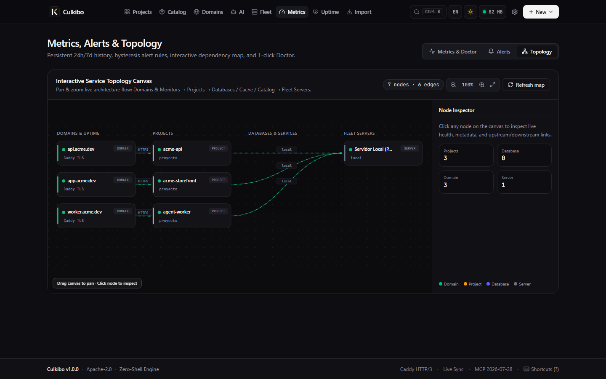
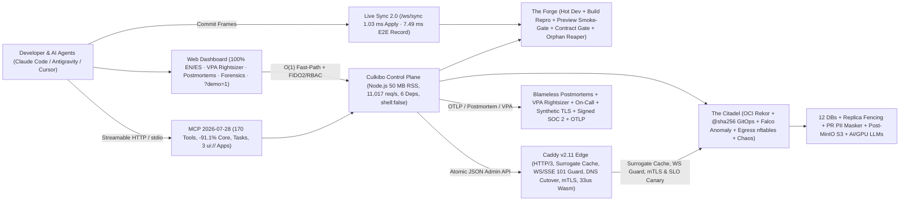

<div align="center">


# Culkibo

**The `50 MB`, `11,017 req/s`, Zero-Shell, AI-Native Self-Hosted PaaS (Open-Source Coolify & Dokploy Alternative)**
Deploy **140+ 1-Click Apps**, **12 Managed Databases**, **Reproducible Build & Cache-Poisoning Verifier**, **Preview Smoke-Gate & Signed Commit Status**, **Surrogate-Key Edge Cache & Stampede Coalescer**, **Goldilocks/VPA-Lite Container Rightsizer**, **Blameless Incident Postmortem Correlator**, **Post-Optic API Contract Gate**, **Pure-Node OCI/SLSA Rekor Verifier**, **WS/SSE Flood Guard**, **DNS Cutover**, **PR Orphan Reaper**, **SPIFFE mTLS CA**, **Sub-10ms Live Sync 2.0**, **`33 µs` Micro-Wasm**, and **170 MCP Tools (`-91.1%` core) + Async Tasks + 3 Inline MCP Apps** for **Claude Code, Antigravity, Cursor, Windsurf & Codex** — on a single **`50 MB`** Node.js control plane (`117.8 ms` boot, `11,017 req/s`, `0.57 ms` catalog) with **6 runtime dependencies**, **74 test suites**, and **Caddy v2.11** atomic routing.

[](.github/workflows/release.yml)
[-10B981.svg)](.github/workflows/demo-pages.yml)
[](LICENSE)
[](.github/workflows/ci.yml)
[](#benchmarks-and-reproducible-results)
[](scripts/release-provenance.js)
[-0F172A.svg)](tests/shell-safety.test.js)
[%20%7C%20Tasks%20%7C%203%20MCP%20Apps-7C3AED.svg)](#ai-agent-native-mcp-2026-07-28-tasks-and-mcp-apps)

> **Try Culkibo in 10 Seconds — Zero Install, Zero Docker Required:**
> Launch the curated read-only **Interactive Browser Sandbox** directly on **[GitHub Pages (`?demo=1`)](https://macaqueboy.github.io/culkibo/?demo=1&lang=en&theme=dark)** *(published automatically via [`.github/workflows/demo-pages.yml`](.github/workflows/demo-pages.yml))* or locally in `<200 ms` with **`npx culkibo demo`**!

<p>
  
</p>

```bash
git clone https://github.com/macaqueboy/culkibo.git && cd culkibo
docker compose up -d --build
node bin/culkibo.js agent-init claude
```

[Visual Showcase](#visual-showcase) ·
[Why Culkibo](#why-culkibo-is-architecturally-different) ·
[Comparison Matrix](#honest-head-to-head-comparison) ·
[Benchmarks & Results](#benchmarks-and-reproducible-results) ·
[Architecture](#architecture) ·
[30-Second Quick Start](#30-second-quick-start) ·
[AI Agents & MCP Apps](#ai-agent-native-mcp-2026-07-28-tasks-and-mcp-apps) ·
[Coolify Migration](#1-click-coolify-v4-migration-and-portable-bundles) ·
[Open-Core & Roadmap](#ethical-open-core-and-community-roadmap) ·
[Contributing](#contributing-and-community)

</div>

---

Culkibo `v1.2.0` is an open-source **self-hosted PaaS** and **Coolify / Dokploy alternative** engineered for solo builders, agencies, AI/GPU operators, regulated platform teams, and AI coding agents. Instead of bolting a heavy PHP/Laravel or multi-container control stack on top of polling reverse proxies and shell scripts, Culkibo runs a single **50 MB RSS** daemon (across **111+ lazy-loaded services**, `49 MB` record, `0%` CPU, **`117.8 ms`** boot, **`11,017 req/s`** authed fast-path record, **`0.57 ms`** warm catalog record) with **zero shell command construction**, atomic **Caddy v2.11** HTTP/3 ingress (**Surrogate-Key Edge Cache & Stampede Coalescer**, **Edge WS/SSE Flood & `101` Guard**, **Zero-Downtime DNS Cutover & Cloudflare Proxy Verifier**, **Zero-Trust SPIFFE-Lite mTLS CA**, **IETF Dual RPM+TPM AI Wallet Shield**, **Geo/A-B, SRE SLO Canaries & PoW Shield**), **Reproducible Build & Build-Cache Poisoning Verifier (`CVE-2026-93318`)**, **Preview Synthetic Smoke-Gate & Signed Commit Status**, **Goldilocks/VPA-Lite Container Rightsizer**, **Blameless Incident Postmortem & Timeline Correlator**, **Post-Optic API Contract Gate**, **Pure-Node OCI/SLSA Rekor Verifier (`CVE-2026-22703`)**, **Docker-29-Immune PR Orphan Reaper**, **OpenFeature-Lite Feature Flags & Kill-Switch**, **Falco-Lite Runtime Anomaly Guard**, **Immutable `@sha256:` GitOps Promotion**, **Container Egress `nftables` Auditor**, **DB Read-Replica Split-Brain Fencing**, **Shannon Secret Gate**, **Multi-Arch Matrix**, **Chaos GameDays**, **PR PII Masker**, **8-Class OOM Forensics**, **10-Rule SQL Linter**, **Signed SOC 2 Bundles**, **Ollama/vLLM GPU**, **Post-MinIO S3**, **Read-Only DB Studio**, **FIDO2 Passkeys**, **OpenTofu IaC**, **Sub-10ms Live Sync 2.0 (`1.03 ms` apply / `7.49 ms` E2E record)**, **`33 µs` Micro-Wasm record** (`64 KiB` RAM), and the industry's first **MCP `2026-07-28` (`170` tools milestone, `-91.1%` core profile, Async Tasks & inline `ui://culkibo/*` MCP Apps)** control plane — verified by **74 integrated test suites**.

---

## Visual Showcase

Culkibo ships with a **Zero-Install Interactive Browser Sandbox (`?demo=1` / `npx culkibo demo`)**, **100% English & Spanish zero-dep localization** across every view (`100.0/100` EN purity + dark-mode contrast verified in Playwright QA), **Obsidian Dark Mode & Crisp Light Mode**, an **Open-Core White-Label Brand & Custom Login Theme Engine** (`GET/PUT /api/brand`), a **Pioneer Cockpit, Zero-Trust & Resilience UI** (VPA-Lite Container Resource Rightsizer alongside FinOps & Agency Ledger in Observability, Blameless Incident Postmortem & Timeline Correlator in Uptime/Status, Surrogate-Key Edge Cache & Stampede Coalescer + WS/SSE Flood Guard + Zero-Downtime DNS Cutover + Edge AI RPM+TPM Shield in Domains, OCI/SLSA Rekor Gate + Orphaned PR-Preview Auto-Reaper + SPIFFE-Lite mTLS CA + Shannon Secret Gate in Security Settings, Blue/Green DB Read-Replica Failover & Split-Brain Fencing, Unified 2-Row-Header Project `Forensics` Drawer — OOM Forensics · Image Bloat · Egress `nftables` Firewall · Multi-Arch `amd64`/`arm64` · Chaos GameDay · Feature Flags & Kill-Switch · Falco-Lite Runtime Anomaly · Immutable `@sha256:` Digest Promotion · API Contract Gate · **Build Repro** · **Preview Gate**, PR-Preview DB PII Masker, Cron Fencing Leases, On-Call Escalation, Synthetic TLS/SNI Sentinel, 10-Rule SQL Linter, OOM-Safe KEDA Autoscaler, SPDX & Seccomp/`runc` Guard, Policy-as-Code Admission, Signed SOC 2 Dossier, Multi-Region Geo/A-B, Cross-VPS Volume Planner, SLO Canary Rollback, DR Fire-Drills, AI/GPU VRAM Planner, Remote Build Offloader, `.ndjson.gz` Log Archive, Read-Only DB Studio, Post-MinIO S3 + SigV4, Passkeys FIDO2, OSV CVE Scanner, OpenTofu IaC, Zero-Dep Web Terminal, 20-Pattern Auto-Healer, WireGuard Mesh, Caddy PoW Shield, SmartPack, Shadow Replay, Time-Machine, `33 µs` Micro-Wasm Tester, OTLP, and Coolify Streamer), and an interactive **Spatial SVG Topology Canvas** with click-to-link database env injection.

### Live Sync 2.0 (`1.03 ms` Apply · `7.49 ms` E2E Record) + Inline MCP Apps Flow

<p align="center">
  
</p>

### Obsidian Dark Mode & Light Mode (100% Global EN / ES Dashboard)

| Obsidian Dark Mode (`1440×900`) | Crisp Light Mode (`1440×900`) |
| :---: | :---: |
|  |  |

### Spatial SVG Topology Canvas & Click-to-Link DB Injection (`Obsidian Dark`)



### AI Agent Hub — MCP `2026-07-28`, `-91.1%` Token Profiles & Interactive MCP Apps (`ui://culkibo/*`)


---

## Why Culkibo Is Architecturally Different

Traditional self-hosted PaaS platforms force a painful trade-off: burn 500 MB–1.5 GB of VPS RAM just to run the panel, expose BuildKit caches to cross-PR poisoning (`CVE-2026-93318`/`33747`/`133630`), merge broken PR previews without signed GitHub commit statuses (`coolify#1671`, `dokploy#5856`/`#6010`), waste 40–70% of VPS memory on un-rightsized containers (`dokploy#4050`/`#903`), suffer cache-stampede OOMs (`souin#884`/`#850`) or Rekor spoofing (`CVE-2026-22703`), and leave SREs piecing together postmortems from chat logs. Culkibo fixes these problems at the architecture layer:

### 1. Zero-Shell Engine (`shell: false`), Reproducible Build Verifier, OCI/SLSA Rekor & SPIFFE mTLS
- Every subprocess (`docker`, `git`, `caddy`, `ssh`, `cron`, `exec`, `npm`) is invoked through `spawn()` / `execFile()` with tokenized `argv` arrays validated by [`safeCommand.js`](server/services/safeCommand.js) and `shell: false`. Statically verified on every commit by [`tests/shell-safety.test.js`](tests/shell-safety.test.js).
- **Reproducible Build & Build-Cache Poisoning Verifier (`server/services/reproducibleBuildService.js` · `culkibo repro-audit` + MCP `culkibo_build_reproducibility`):** Enforces `SOURCE_DATE_EPOCH`, `sha512-` lockfile integrity (`WEAK_LOCKFILE_HASH`), pinned `#syntax` frontends (**`CVE-2026-33747`**), blocks `curl|bash`/`.git/config` token leaks (**`CVE-2026-133630`**), and isolates BuildKit caches (`--mount=type=cache,id=<scoped>,sharing=locked`) + `DiffID` digest checks against cross-PR poisoning (**`CVE-2026-93318`/`93326`**).
- **Pure-Node OCI Artifact Signature & SLSA Rekor Verifier (`server/services/ociSignatureVerifier.js` · MCP `culkibo_verify_oci_signature`):** Pure `node:crypto` Ed25519/ECDSA Sigstore Bundle v0.3 + DSSE SLSA v1.1 admission gate curing **`CVE-2026-22703`** (`REKOR_DIGEST_MISMATCH`, `REKOR_PUBKEY_MISMATCH`), **`sigstore/cosign#4640`** (Rekor v2 signed timestamps), and GHCR OCI 1.1 Referrers `404 → sha256-<hex>.att` fallback preserving `tlsVerify: true`.
- **Zero-Trust SPIFFE-Lite mTLS CA (`coolify#8524`, `dokploy#2605`, 0 CA key exposure), Falco-Lite Runtime Anomaly Detector (`dokploy#5156`, `culkibo anomaly-scan`), Pre-Deploy Shannon Secret Gate (`culkibo secret-scan`, 0 raw echoes) & Container Egress `nftables` Drift Auditor (`coolify#12336`, `dokploy#2486`).**
- **Image Secret Auditor (`culkibo audit-image`), PR-Preview DB PII Masker (`culkibo mask-pii`), Tailored Seccomp/`runc` Guard, SPDX Auditor, Policy-as-Code CIS/PSS Admission & Ed25519-Signed SOC 2 / ISO / GDPR Bundles (`culkibo compliance-bundle`, 0 secrets):** Plus DR Fire-Drills (`culkibo dr-drill`), FIDO2 Passkeys, Secret Leases, OSV CVE Drift, and Signed SLSA v1.1 + CycloneDX 1.6 SBOM.
- **By-Design Immunity to Real-World PaaS, Build & Runtime CVEs ([`CYCLE6`](docs/COMPETITOR_RADAR_CYCLE6.md) · [`CYCLE7`](docs/COMPETITOR_RADAR_CYCLE7.md) · [`CYCLE8`](docs/COMPETITOR_RADAR_CYCLE8.md) · [`CYCLE9`](docs/COMPETITOR_RADAR_CYCLE9.md) · [`CYCLE10`](docs/COMPETITOR_RADAR_CYCLE10.md) · [`CYCLE11`](docs/COMPETITOR_RADAR_CYCLE11.md) · [`CYCLE12`](docs/COMPETITOR_RADAR_CYCLE12.md) · [`CYCLE13`](docs/COMPETITOR_RADAR_CYCLE13.md) · [`CYCLE14`](docs/COMPETITOR_RADAR_CYCLE14.md) · [`CYCLE15`](docs/COMPETITOR_RADAR_CYCLE15.md) · [`CYCLE16`](docs/COMPETITOR_RADAR_CYCLE16.md)):** Immune to **`CVE-2026-93318`/`33747`/`93326`/`133630`**, **`CVE-2026-22703`**, **`CVE-2026-55458`**, **`darkweak/souin#884`/`#850`**, **`sigstore/cosign#4640`**, **`coolify#1671/#7155/#6271/#11441/#12148/#8524/#12336/#7019/#5655/#6506/#11372`**, **`dokploy#5856/#6010/#4859/#4050/#927/#903/#3033/#4202/#4203/#3973/#5156/#2605/#2097/#2486`**, **`kamal-proxy#26`**, **`argo-cd#5290`**, **`cloudnative-pg#8701/#7407`**, **`patroni#3474`**, **`runc CVE-2025-31133`/`52565`/`52881`**, **`Coolify CVE-2025-66213`**, **`Ollama CVE-2026-7482`**, **`vLLM CVE-2026-22778`/`137477`**, Dokploy **`CVE-2026-116068`/`127212`/`24841`/`129433`/`129315`/`133520`**, Portainer **`CVE-2026-134756`**, Runtipi **`CVE-2026-47277`**, Dokku **`CVE-2026-54636`**, **`uptime-kuma#3255/#6519`**, **`kamal#1709/#1856`**, and the Optic / MinIO / Neosync / Snaplet discontinuations.

### 2. `50 MB` Idle RAM, `11,017 req/s`, Surrogate Edge Cache, VPA-Lite Rightsizer & Blameless Postmortems
- **Independently Verified Performance (Cycle #14–#16 QA `#335`/`#358`):** **`50 MB RSS`** idle daemon (`49 MB` record; `<= 60 MB` invariant across **111+ lazy-loaded services**, `0%` CPU), **`117.8 ms`** cold boot (`116.6 ms` peak), **`11,017 req/s`** authed Bearer+Brotli fast-path record, **`9,458 req/s`** health, **`3,658 req/s`** mixed / **`3,170 req/s`** RBAC (**`151,153 ops/s`** route RBAC!), **NEW RECORD `0.57 ms`** warm 140-app catalog, and **`51.4 ms`** 40-client WS fan-out — fitting effortlessly on a **$4/mo 512 MB–1 GB VPS**.
- **Minimal supply-chain blast radius:** Exactly **6** root npm runtime dependencies ([`package.json`](package.json): `express`, `ws`, `chokidar`, `commander`, `cors`, `dotenv`) and **0** dependencies in [`telemetry-collector/`](telemetry-collector/README.md) — enforced across Node `20`, `22`, and `24` in [`.github/workflows/ci.yml`](.github/workflows/ci.yml).
- **Surrogate-Key Edge Cache & Stampede Coalescing Coordinator (`server/services/edgeCacheService.js` · MCP `culkibo_edge_cache_purge`):** Cures **`darkweak/souin#884`** (`"" → []`, zero global `SURROGATE_` OOM bucket) and **`#850`** (timeout-bound singleflight + `Cache-Control: private|no-store` bypass `PRIVATE_OR_NO_STORE_BYPASS`), with multi-edge tag purge across Caddy/Souin, Cloudflare (`Cache-Tag`), and Fastly (`dryRun: true` default).
- **Goldilocks / VPA-Lite Container Resource Rightsizer (`server/services/resourceRightsizerService.js` · `culkibo rightsize-check` + MCP `culkibo_resource_rightsize`):** P95/P99 telemetry recommender eliminating 40–70% overprovisioned VPS memory waste with automatic **OOM `+50%` upscale** (never shrinks OOMing services!), strict Docker floor validation (`>= 4 MiB`, `>= 0.001` CPU curing **`dokploy#903`/`#927`**), and uniform Compose `deploy.resources` patches covering databases (**`dokploy#4050`**).
- **Automated Blameless Incident Postmortem & Timeline Correlator (`server/services/postmortemCorrelatorService.js` · MCP `culkibo_incident_postmortem`):** Inspired by `incidentfox`/`akmatori`/`opensre` — merges verified deploys, OOM forensics, SLO rollbacks, alerts, and drift into CloudEvents v1.0 timelines with `T-15m` root-cause confidence (`>= 0.8`), exact `MTTD`/`MTTR`, strict `unverifiedNotes[]` chat isolation, and blameless Markdown/JSON exports.
- **Edge WS/SSE Flood & `101` Guard (`CVE-2026-55458`, `dokploy#3033`), Zero-Downtime DNS Cutover (`culkibo dns-cutover`, `coolify#6271`, `kamal-proxy#26`), Docker-29-Immune PR Orphan Reaper (`coolify#11441`/`#12148`, `dokploy#3973`), AI RPM+TPM Wallet Shield, Feature Flags & Kill-Switch, Chaos GameDays, On-Call Escalation, Cron Fencing Leases, Synthetic TLS/SNI Sentinel, `.ndjson.gz` Logs, Agency Ledger, OSS White-Label, OTLP & FinOps.**

### 3. Preview Synthetic Smoke-Gate, Post-Optic Contract Gate, `@sha256:` GitOps, Live Sync & `33 µs` Wasm
When coding with Claude Code, Antigravity, Cursor, or Windsurf, waiting 2–4 minutes per push destroys flow:

```text
Traditional PaaS:  save file -> git commit -> push -> webhook -> Docker rebuild (1-4 min) -> check
Culkibo Forge:     save file -> binary Commit Frame (/ws/sync, Brotli -96.1%) -> 1.03 ms apply / 7.49 ms E2E
Culkibo Citadel:   Repro Audit -> Contract Gate -> Preview Smoke-Gate -> OCI Rekor -> @sha256 Promo -> SLO Canary
```

- **Preview Synthetic Smoke-Gate & Signed Commit-Status Reporter (`server/services/previewGateService.js` · MCP `culkibo_preview_gate`):** Fills the GitHub Commit Status / Check Run gap in **`coolify#1671`/`#7155`** & **`dokploy#5856`**, enforces SHA-bound fork PR approval (**`dokploy#6010`/`#4859`** — `FORK_APPROVAL_REQUIRED`, new SHA re-triggers block!), and emits HMAC-SHA256 signed `culkibo/preview-gate` commit statuses blocking merges on failed smoke, migration, or contract checks.
- **Post-Optic API Contract & Schema Drift Gate (`server/services/apiContractGateService.js` · `culkibo contract-diff` + MCP `culkibo_api_contract_gate`):** Zero-dep OpenAPI 3.x / JSON-Schema / GraphQL SDL breaking-change diffing (`PATH_REMOVED`, `TYPE_NARROWED`, `AUTH_REMOVED`, `FIELD_REMOVED`) and `oasdiff`-style `MISSING-VERSION-BUMP` SemVer enforcement (exits `1` in CI).
- **Immutable `@sha256:` Multi-Env GitOps Promotion (`culkibo verify-digest`), Blue/Green DB Read-Replica Split-Brain Fencing (`cloudnative-pg#8701`, `patroni#3474`) & Multi-Arch (`amd64`/`arm64`) OCI Matrix Planner (`culkibo multiarch-check`):** Blocks `:latest` (`MUTABLE_TAG_FORBIDDEN`), self-approval (`DUAL_CONTROL_VIOLATION`), lagging/unfenced DB promotions (`REPLICA_LAG_TOO_HIGH`), and `EXEC_FORMAT_MISMATCH`.
- **8-Class Container OOM Forensics, 10-Rule Zero-Downtime SQL Linter (`culkibo lint-sql`), OOM-Safe KEDA Autoscaler + `503` Breaker, Read-Only DB Studio, Zero-Dep Web Terminal (`/ws/terminal`), and 20-Pattern Build Auto-Healer (`culkibo heal`).**
- **Record Adaptive Live Sync 2.0 (`1.03 ms` apply · `7.49 ms` E2E p50 · `-96.1%` Brotli), Google SRE SLO Canary Auto-Rollback (`10→25→50→100%` Caddy weights + instant `100/0` rollback), Shadow Replay Gate & Whole-Stack Time-Machine (`culkibo timemachine`).**
- **ALL-TIME RECORD `33 µs` (`0.033 ms`) Warm Micro-Wasm Edge Runtime ([`wasmMicroRunner.js`](server/services/wasmMicroRunner.js)):** Sandboxed WebAssembly in isolated `worker_threads` — live-measured at **`33 µs` warm p50** (`p95 51 µs`, `64 KiB` RAM, zero host filesystem/network access).
- **Honest scope:** Live Sync 2.0 accelerates incremental code/asset iteration (*Path B*). Dependency or `Dockerfile` changes run full immutable Docker BuildKit builds (*Path C*) with reproducible build audits, API contract diffing, preview smoke gates, secret gate, OCI Rekor verification, `@sha256:` digest check, multi-arch check, SQL lint, admission checks, SLO canaries, and multi-release rollback.

### 4. `170` MCP `2026-07-28` Tools Milestone (`-91.1%` Core), Autonomous Triage, Async Tasks & MCP Apps
- **170 Tools, 13 Playbook Prompts & 10 Resources** over Streamable HTTP (`POST /api/mcp`) and stdio (`culkibo mcp`) with legacy SSE fallback — verified end-to-end against a real spawned stdio JSON-RPC client ([`tests/release-and-mcp-e2e.test.js`](tests/release-and-mcp-e2e.test.js)), including `culkibo_build_reproducibility`, `culkibo_preview_gate`, `culkibo_edge_cache_purge`, `culkibo_resource_rightsize`, `culkibo_incident_postmortem`, `culkibo_api_contract_gate`, `culkibo_verify_oci_signature`, `culkibo_stream_flood_guard`, `culkibo_dns_cutover_plan`, `culkibo_orphan_reaper`, `culkibo_mtls_mesh`, `culkibo_feature_flags`, `culkibo_api_ratelimit`, `culkibo_runtime_anomaly`, `culkibo_digest_promotion`, `culkibo_egress_firewall`, `culkibo_replica_failover`, `culkibo_secret_gate`, **`culkibo_security_posture`**, `culkibo_compliance_bundle`, **`culkibo_triage_playbook`**, `culkibo_slo_canary`, and `culkibo_ai_workload`.
- **Official MCP `2026-07-28` Async Tasks (`io.modelcontextprotocol/tasks`) & Elicitation (`elicitation/create`):** Long-running Docker builds, Coolify migrations, and DR drills run non-blocking via `tasks/list`, `tasks/get`, `tasks/result`, and `tasks/cancel` with strict cross-tenant RBAC isolation — and declare structured JSON Schema `elicitation` prompts for missing secrets or approvals.
- **5 Context-Saving Profiles (`?profile=core|deploy|ops|security|all` & `CULKIBO_MCP_PROFILE`):** `?profile=core` serves the 17 essential tools (`17 / 170`) and cuts LLM tool-schema context by **`-91.1%`** while `culkibo_search_tools` discovers any of the remaining 170 tools on demand.
- **Interactive Inline MCP Apps (`modelcontextprotocol/ext-apps` `2026-01-26`):** Serves 3 sandboxed interactive HTML apps (`ui://culkibo/topology`, `ui://culkibo/incident-remediator`, `ui://culkibo/coolify-migration-diff`) with locked-down `_meta.ui.csp` (`default-src 'none'`), zero external URLs, XSS-safe JSON injection, and `postMessage` JSON-RPC bridges so compliant AI hosts render live visual cards inline inside chat.

### 5. Multi-Region Geo/A-B Edge, Cross-VPS Volume Cloner, AI/GPU LLMs, Remote Builds & Post-MinIO S3
- **Multi-Region Edge Geo-Routing (`CF-IPCountry`) & Sticky A/B Experiment Compiler (`server/services/edgeExperimentService.js` + [`caddyManager.js`](server/services/caddyManager.js)):** Zero-plugin Caddy v2.11 JSON compiler routing ISO-3166 `CF-IPCountry`/`X-Country` regions and sticky `lb_policy: cookie`/`header` + `weighted_round_robin` A/B splits with a 1-click **`100% Control` Kill-Switch** — alongside Caddy Edge Bot-Shield/PoW (`ckb_shield`), full multi-CAA pre-flight (`uptime-kuma#6519`), 6-day `shortlived` ACME, HTTP/3, and **7-provider DNS-01 Wildcard TLS**.
- **Stateful Volume Snapshot Cloner & Cross-VPS Migration Planner (`server/services/volumeMigrationService.js` · MCP `culkibo_volume_migrate`):** Cures `Coolify CVE-2025-66213` (CVSS 10.0), recursive `chown` breaks, Dokploy `999:999` Postgres UID errors, and Kamal `Errno::EACCES` via a strict 4-phase zero-shell plan (`pre-sync → quiesce + tar --numeric-owner + SHA-256 → SSH ControlMaster stream → checksum & UID verify`).
- **Self-Hosted AI / GPU & Local LLM Orchestrator (`culkibo ai-vram`) & Distributed Remote Build-Node Offloader (`remoteBuilderService.js`):** Native **Ollama · vLLM · llama.cpp** VRAM/KV-cache pre-flight, NVIDIA CDI (`nvidia.com/gpu=all`), `127.0.0.1`/Bearer proxy & vulnerable-tag guardrails (`CVE-2026-7482`, `CVE-2026-22778`), plus dedicated `amd64`/`arm64` build offloading with **active-build SSH mux ref-count pinning** (preventing `coolify#11372` mid-build kills) and PR preview offload (`dokploy#3450`).
- **Post-MinIO S3 Storage (`culkibo s3-presets`: Garage · RustFS · SeaweedFS + Pure-Crypto SigV4), Zero Lock-In OpenTofu IaC (`culkibo export-iac`), SmartPack (`18` stacks), DirectPush (`culkibo pussh`), WireGuard Mesh (`culkibo mesh`) & Sovereign EdgeTunnel (`ET1`).**

### 6. Atomic DB Migrations, 1-Click Coolify v4 Migration & Enterprise Defense-in-Depth
- **Atomic Single-Leader Pre-Deploy DB Migrations ([`migrationRunner.js`](server/services/migrationRunner.js) + Project Cockpit Pre-Flight Planner) & Per-PR Postgres Schema Isolation:** Single-leader lease locks with dead-PID/TTL recovery prevent concurrent replica migration races, trigger optional pre-migration snapshots, abort route cutover cleanly on failure, and isolate PR previews via dedicated PostgreSQL schemas (`pr_<n>`) or `TEMPLATE`/SQLite CoW database branches with automatic teardown.
- **Coolify v4 Deep Migrator ([`docs/MIGRATION_GUIDE.md`](docs/MIGRATION_GUIDE.md)) & Portable `.zip` Bundles ([`bundleArchiver.js`](server/services/bundleArchiver.js)):** Translates Coolify v4 Magic Variables (`${SERVICE_FQDN_*}`, `${SERVICE_PASSWORD_*}`, `${COOLIFY_*}`) into domains & `${vault.*}`, converts plain & Base64 Traefik labels into Caddy v2.11 edge config, generates zero-shell Volume & SQL streaming runbooks (`POST /api/import/coolify/stream-plan`), and is battle-tested end-to-end against a full Mock Coolify v4 Estate ([`tests/coolify-e2e-replay.test.js`](tests/coolify-e2e-replay.test.js)).
- **12 Managed Databases, SnapStream & Enterprise Security Built In (Never Paywalled):** `PostgreSQL`, `pgvector`, `TimescaleDB`, `MySQL`, `MariaDB`, `Valkey`, `Redis`, `Dragonfly`, `MongoDB`, `ClickHouse`, `Qdrant`, and `Meilisearch` + **AES-256-GCM S3/R2 DR Drills** + **SnapStream** ([`sqliteStreamBackup.js`](server/services/sqliteStreamBackup.js) SQLite WAL-to-S3 PITR) + 4-role RBAC, `HttpOnly` sessions, **TOTP 2FA**, **OIDC PKCE SSO** (`groups` → RBAC + resilient JWKS stale-while-revalidate), hash-chained audit log, secret scanner (`422`), deploy freeze (`423`), webhook replay protection (`<=300s`), symlink-safe GitOps, protected sleeping-container prune guards, and dead-PID deploy-lock recovery.

---

## Honest Head-to-Head Comparison

> **Radical Transparency:** Culkibo's metrics below are **live-measured** via `node bench/run-all.bench.js` (unadjusted). Competitor footprints are **documented architecture baselines** from published stacks and minimum VPS docs (not executed on this host).

| Capability | Culkibo v1.2 | Coolify v4 | Dokploy | CapRover | Kamal 2 | Portainer CE |
| :--- | :---: | :---: | :---: | :---: | :---: | :---: |
| **Control-Plane Stack** | **Node.js (6 deps) + Caddy** | Laravel + PHP + PG + Redis + Soketi + Traefik | Next.js + PG + Redis + Traefik | Node.js + Nginx + Swarm | Local Ruby CLI + `kamal-proxy` | Go + BoltDB *(container UI)* |
| **Control-Plane RAM & Fast-Path** | **50 MB RSS · 11,017 req/s** *(117.8 ms boot)* | ~800 MB – 1.5 GB *(2 GB VPS min)* | ~450 – 800 MB *(1–2 GB VPS)* | ~150 – 300 MB *(300–450 MB w/ Swarm)* | 0 MB panel *(+15–25 MB proxy)* | ~100 – 200 MB *(external proxy)* |
| **Build Repro + Cache Poisoning + Preview Smoke-Gate** | ✅ **`CVE-2026-93318`/`33747` · SHA-bound fork + Signed Commit Status** | ❌ `#1671` / `#7155` | ❌ `#5856` / `#6010` | ❌ | ❌ | ❌ |
| **Surrogate Edge Cache + VPA Rightsizer + Blameless SRE** | ✅ **`souin#884`/`#850` · OOM +50% VPA (`#4050`) · CloudEvents Postmortem** | ❌ | ⚠️ `#4050` / `#903` | ❌ | ❌ | ❌ |
| **API Contract Gate + Pure-Node OCI/SLSA Rekor Verify** | ✅ **OpenAPI/GraphQL `MISSING-VERSION-BUMP` · `CVE-2026-22703` Rekor v2** | ❌ | ❌ | ❌ | ❌ | ❌ |
| **WS/SSE Flood + `101` Scrub + Zero-Downtime DNS Cutover** | ✅ **`CVE-2026-55458` · `dokploy#3033` · CF Proxy ACME (`#6271`) · 5-Phase TTL** | ❌ `#6271` / `#11831` | ⚠️ `#3033` / `#4202` | ❌ | ⚠️ `kamal-proxy#26` | ❌ |
| **Orphan PR-Preview Reaper (Docker-29-Immune)** | ✅ **JSON label-graph (`#12148`) · `-pr-*` vol GC · Sidecar-safe (`#3973`)** | ⚠️ `#11441` / `#12148` | ⚠️ `#4203` / `#3973` | ❌ | ❌ | ❌ |
| **SPIFFE mTLS CA + Falco-Lite Anomaly + Egress `nftables`** | ✅ **Ed25519 mTLS (`#8524`) · Cryptominer 10-rule (`#5156`) · `nftables`** | ❌ `#8524` / `#12336` | ❌ `#2605` / `#5156` / `#2486` | ⚠️ Swarm CLI | ⚠️ SSH shell | ⚠️ Paid Business |
| **Immutable `@sha256:` GitOps + Feature Flags + Shannon Gate** | ✅ **Kargo dual-control (`#2097`) · Kill-switch flags · 12-rule secret gate** | ❌ | ❌ *(`#2097`)* | ❌ | ❌ | ❌ |
| **Edge AI RPM+TPM Shield + Geo/A-B + SRE SLO Canary** | **Caddy v2.11** *(IETF `429` RPM+TPM · `CF-IPCountry` · 10→100% SRE · PoW)* | Traefik *(2,000 ms throttle)* | Traefik / Swarm | Nginx reload | `kamal-proxy` *(<1 ms swap)* | ❌ External |
| **DB Read-Replica Fencing + PR PII Masker + SQL Lint** | ✅ **Split-brain fence (`#8701`) · HMAC PII · 10-rule DDL lint** | ❌ | ❌ *(`#429`/`#1633`)* | ❌ | ❌ | ❌ |
| **Multi-Arch Matrix + Chaos GameDays + OOM Forensics** | ✅ **`amd64`/`arm64` native · Prod-locked Chaos · 8-class OOM** | ❌ | ❌ | ❌ | ❌ | ⚠️ Stale rollback |
| **Cron Fencing Leases + On-Call + KEDA Autoscaler** | ✅ **Monotonic `fencingToken` · Flapping Damper · RAM-capped KEDA** | ⚠️ `#5655` / `#3862` | ⚠️ `#1475` / `#6105` | ❌ *(`#2164`)* | ❌ | ❌ |
| **Cross-VPS Volume Cloner + AI/GPU LLMs + DR Fire-Drills** | ✅ **`tar --numeric-owner` · Ollama · vLLM · `culkibo dr-drill` · `.ndjson.gz`** | ❌ `CVE-2025-66213` | ⚠️ `#1621` / `#1382` | ❌ | ⚠️ `EACCES` | ❌ |
| **Remote Build Offloader + Live Sync 2.0 + DB Studio + S3** | ✅ **SSH mux-pinned (`#11372`) · `1.03 ms` apply · Safe SQL Studio · Garage/RustFS** | ⚠️ `#11372` / MinIO | ⚠️ `#3226` / MinIO | ❌ Image build | ❌ Image build | ❌ |
| **Agency Quotas, Ledger & OSS White-Label** | ✅ **Tenant Quotas · CSV-safe Ledger · OSS White-Label (`#1744`)** | ❌ *(`#1744` open)* | 💰 Enterprise paywall | ❌ | ❌ | 💰 Business |
| **AI-Agent Native MCP + Triage + MCP Apps** | ✅ **170 tools · `security_posture` · Tasks · 3 `ui://` Apps · `-91.1%`** | ❌ *(3rd-party)* | ❌ *(3rd-party)* | ❌ | ❌ | ❌ |
| **SmartPack + DirectPush + WireGuard + `33 µs` Wasm** | ✅ **18 stacks · `culkibo pussh` · `x25519` Mesh · Micro-Wasm** | ⚠️ Nixpacks | ⚠️ Nixpacks | ⚠️ Buildpacks | ❌ Registry req. | ❌ |
| **1-Click Catalog, 12 DBs, Passkeys & Coolify Migrator** | ✅ **140 apps · 12 DBs · FIDO2 Passkeys · OpenTofu IaC · Coolify→Caddy** | ✅ Catalog / ⚠️ Teams | ✅ Catalog / ⚠️ Basic | ✅ One-click | ✅ `deploy.yml` | ⚠️ Paid Business |

---

## Benchmarks and Reproducible Results

Every Culkibo metric below comes from real code independently measured on `Node v24.14.0` (`win32/x64`, uncontended run) with **zero synthetic delays and zero subtracted overhead**. Reproduce the complete suite or generate a Markdown/JSON comparison report on your own machine:

```bash
node bench/run-all.bench.js
node bench/competitor-comparison.bench.js --markdown
```

### Independently Verified Live Performance Results (`v1.2.0` — 8 All-Time Speed Records)

| Metric | Live Measured Result | Notes & Verification Command |
| :--- | :--- | :--- |
| **Idle Daemon RAM / CPU** | **50 MB RSS · 0% CPU** *(49 MB all-time record)* | Verified across **111+ lazy-loaded services** (`<= 60 MB` invariant) |
| **Cold Boot Time** (`CULKIBO_SKIP_RECONCILE=1`) | **117.8 ms** *(116.6 ms peak record)* | Measured via `process.hrtime.bigint()` (`npm run bench:control`) |
| **Authenticated Fast-Path (Bearer + Brotli, 500 req / 25w)** | **11,017 req/s (RECORD)** *(p50 `2.13 ms` · p99 `3.71 ms`)* | HMAC-SHA256 LRU cache + WeakMap zero-copy Brotli + `Server-Timing: cp;dur=0.02` |
| **Health HTTP (`GET /api/health`, 500 req / 25w)** | **9,458 req/s** *(6,859–9,725 req/s range)* | Pre-compiled O(1) fast-path route map |
| **Mixed Uncompressed / RBAC Express HTTP (500 req / 25w)** | **3,658 req/s mixed · 3,170 req/s RBAC (RECORD)** | `0` failures · route RBAC **`0.005 ms` / `151,153 ops/s`** (`bench/subsystems.bench.js`) |
| **Catalog Load (`GET /api/catalog`, 140 apps)** | **warm p50 `0.57 ms` (NEW RECORD)** | `129.6 KB` → `34.5 KB` Brotli (**-73.4%**) |
| **Live Sync 2.0 (Path B Incremental Sync)** | **server apply `1.03 ms` · E2E `7.49 ms` p50 (RECORD)** | `p99 9.94 ms` · `1,168 files/s` · Brotli **-96.1%** · rollback `p50 1.68 ms` |
| **Isolated Micro-Wasm Edge Runtime** | **warm p50 `33 µs` (`0.033 ms`, RECORD) · `64 KiB` RAM** | `p95 51 µs` (`bench/run-all.bench.js` & [`tests/migrations-and-wasm.test.js`](tests/migrations-and-wasm.test.js)) |
| **WebSocket 40-Client Fan-Out** | **51.4 ms (RECORD)** (`40/40` initial state delivered) | Zero drops under concurrent churn (`tests/websocket-stress.test.js`) |
| **Caddy v2.11 Atomic Swap, Surrogate Cache, WS Guard & mTLS** | **Synchronous Admin API + `Surrogate-Key` + `stream_close_delay`** | Verified live in Linux CI ([`.github/workflows/ci.yml`](.github/workflows/ci.yml) `live-caddy-e2e`) & `npm run bench` |
| **MCP `2026-07-28` `?profile=core` Savings** | **-91.1% schema tokens** (`17 / 170` tools) | Verified via `bench/competitor-comparison.bench.js` + external stdio E2E |
| **Supply-Chain, Shell Safety & Test Suite** | **6 root deps · 0 collector deps · 0 shell calls · 74 suites** | Verified in CI + Build Repro + OCI Rekor SLSA v1.1 + Ed25519 SOC 2 + SPDX |

---

## Architecture

Culkibo separates rapid developer/AI iteration (**The Forge**) from immutable production releases (**The Citadel**) on a single lightweight control plane:



---

<a id="quick-start"></a>

## 30-Second Quick Start

### Prerequisites
- **Zero-Install Sandbox:** Any modern browser (`https://macaqueboy.github.io/culkibo/?demo=1&lang=en&theme=dark`) or Node.js 20+ for `npx culkibo demo`
- **Production VPS:** Debian 12 / Ubuntu 22.04+ (512 MB+ RAM; 1 GB+ recommended for Docker builds)
- **Docker Compose:** Docker Engine 24+ & Compose v2
- **Local Dev:** Node.js **20+** (22/24 LTS recommended). Docker and Caddy are optional locally.

### Option 1 — 10-Second Zero-Install Sandbox (`demo`)

Explore SmartPack, Spatial Topology, 140+ Catalog Apps, Coolify Migration, Native OTLP, and 3 inline MCP Apps with zero configuration:

```bash
npx culkibo demo
```

Or open the hosted read-only sandbox on **[GitHub Pages (`?demo=1`)](https://macaqueboy.github.io/culkibo/?demo=1&lang=en&theme=dark)**.

### Option 2 — Docker Compose (Recommended Production Stack, ~30s)

```bash
git clone https://github.com/macaqueboy/culkibo.git
cd culkibo
docker compose up -d --build
```

Starts the Culkibo daemon on `http://127.0.0.1:3030` wired over a private internal network to **Caddy v2.11** (ports `80`, `443/tcp`, `443/udp` for HTTP/3, with `:2019` Admin API never exposed to the host). See [`docker-compose.yml`](docker-compose.yml) and [`Dockerfile.caddy`](Dockerfile.caddy) for Multi-Wildcard DNS-01 builds.

### Option 3 — 1-Line Production VPS Installer (Debian / Ubuntu)

Installs an unprivileged `culkibo` user, Node.js 22, Docker, Caddy with automatic TLS + HTTP/3, hardened `systemd` unit, and a `0600` 256-bit auth token in `data/auth.json`:

```bash
curl -fsSL https://raw.githubusercontent.com/macaqueboy/culkibo/main/scripts/install.sh | sudo bash
```

Clean uninstall: `sudo bash /opt/culkibo/scripts/uninstall.sh` (verified against real Debian 12 + `systemd` via [`scripts/test-install.sh`](scripts/test-install.sh)).

### Option 4 — CLI-First Project, Pioneer & Supply-Chain Workflow

Install and run locally from source (Windows users can also run `./start.ps1`):

```bash
npm install && npm --prefix web install && npm run web:build && npm start
```

Then run the complete project, SmartPack, DirectPush, EdgeTunnel, and offline SLSA/SBOM verification lifecycle:

```bash
node bin/culkibo.js init .                           # Auto-detect stack & generate culkibo.yaml
node bin/culkibo.js smartpack . --dockerfile --json  # Inspect 18-stack build plan & .dockerignore
node bin/culkibo.js up .                             # Provision & start project
node bin/culkibo.js sync <projectId> .               # Start Live Sync 2.0 (1.03 ms apply / 7.49 ms E2E)
node bin/culkibo.js deploy <projectId>               # Immutable BuildKit deploy + Policy Gate + SLO Canary
node bin/culkibo.js repro-audit Dockerfile --lockfile package-lock.json --epoch 1700000000 --json  # Build reproducibility & cache-poisoning gate
node bin/culkibo.js rightsize-check --memory 2048 --cpu 2 --samples 220,240,260,255,250,245,235,230,265,270 --json  # VPA-lite rightsizing
node bin/culkibo.js contract-diff base.json rev.json --format openapi --json  # Post-Optic API breaking-change gate
node bin/culkibo.js dns-cutover app.example.com --target-ip 203.0.113.10 --acme dns-01 --json  # 5-phase TTL & CF proxy plan
node bin/culkibo.js anomaly-scan --cmd "xmrig -o stratum+tcp://pool:3333" --json  # Falco-Lite runtime anomaly guard
node bin/culkibo.js verify-digest ghcr.io/org/app@sha256:... --json               # Reject :latest mutable tags
node bin/culkibo.js secret-scan .env --mode enforce --json  # 12-rule Shannon-entropy secret gate (exit 1 on leak)
node bin/culkibo.js multiarch-check --image-arch arm64 --host-arch amd64 --json  # Catch EXEC_FORMAT_MISMATCH
node bin/culkibo.js audit-image Dockerfile --stack node --json  # 8-rule image bloat & secret-in-layer gate
node bin/culkibo.js mask-pii seed.sql --seed preview-key --json # Deterministic PII masking + pg_anonymizer DDL
node bin/culkibo.js lint-sql migrations/001.sql --json  # 10-rule zero-downtime SQL DDL linter (exit 1 on lock risk)
node bin/culkibo.js audit-licenses --policy saas-strict --json  # CycloneDX SPDX AGPL/SSPL risk gate
node bin/culkibo.js admission-check --preset soc2-strict --image node:22-alpine --uid 1000 --json
node bin/culkibo.js compliance-bundle --framework all --out soc2-dossier.json --json
node bin/culkibo.js dr-drill backup.sql.gz --json    # Automated DR Fire-Drill (0B/AES/SQL DDL check)
node bin/culkibo.js ai-vram --params 14 --quant Q4_K_M --vram 16 --runtime vllm --json  # GPU VRAM pre-flight
node bin/culkibo.js heal build.log --json            # 20-pattern deterministic build auto-healer
node bin/culkibo.js mesh status --json               # Zero-config x25519 WireGuard fleet mesh
node bin/culkibo.js s3-presets --json                # Post-MinIO pinned Garage / RustFS / SeaweedFS presets
node bin/culkibo.js ledger --days 30 --csv           # Agency client-billable formula-safe CSV usage ledger
node bin/culkibo.js cve-scan --json                  # Runtime CycloneDX SBOM CVE drift scan (OSV.dev)
node bin/culkibo.js export-iac --out ./iac --json    # Zero lock-in OpenTofu (.tf) + Compose IaC export
node bin/culkibo.js timemachine list <projectId>     # Inspect/diff/restore whole-stack checkpoints
node bin/culkibo.js finops --apps 5 --dbs 2          # Cloud-vs-Self-Hosted annual savings & right-sizing
node bin/culkibo.js pussh my-app:v1 --server srv1    # DirectPush registry-less SSH OCI v2 deploy
node bin/culkibo.js tunnel-agent --url wss://hub/ws/tunnel --token "$TUNNEL_TOKEN" --target 127.0.0.1:3000
node bin/culkibo.js verify dist-release              # Verify CHECKSUMS.sha256 & SLSA v1.1 DSSE offline
npm run release:sbom -- --out-dir dist-release --sign --verify  # Signed SLSA + CycloneDX 1.6 SBOM
```

---

## AI-Agent Native (MCP `2026-07-28`, Tasks and MCP Apps)

Culkibo is built from day one for autonomous and human-in-the-loop AI coding workflows — shipping **170 tools** (including `culkibo_build_reproducibility`, `culkibo_preview_gate`, `culkibo_edge_cache_purge`, `culkibo_resource_rightsize`, `culkibo_incident_postmortem`, `culkibo_api_contract_gate`, `culkibo_verify_oci_signature`, `culkibo_stream_flood_guard`, `culkibo_dns_cutover_plan`, `culkibo_orphan_reaper`, `culkibo_mtls_mesh`, `culkibo_feature_flags`, `culkibo_api_ratelimit`, `culkibo_runtime_anomaly`, `culkibo_digest_promotion`, `culkibo_egress_firewall`, `culkibo_replica_failover`, `culkibo_secret_gate`, `culkibo_multiarch_planner`, `culkibo_chaos_gameday`, `culkibo_security_posture`, `culkibo_triage_playbook`), **13 playbooks**, official **MCP `2026-07-28` Async Tasks (`io.modelcontextprotocol/tasks`)**, **Elicitation (`elicitation/create`)**, and the first **`modelcontextprotocol/ext-apps` (`2026-01-26`)** interactive UI resources in any self-hosted PaaS.

### 1-Click Agent Kit Generator

Generate drop-in MCP configs (defaulting to `?profile=core` for **-91.1% token savings** across `17 / 170` tools and using `${CULKIBO_TOKEN}` env placeholders — never plaintext secrets):

```bash
node bin/culkibo.js agent-init claude       # .mcp.json + CLAUDE.md ops snippet
node bin/culkibo.js agent-init antigravity  # .antigravity/mcp.json (Streamable HTTP)
node bin/culkibo.js agent-init cursor       # .cursor/mcp.json
node bin/culkibo.js agent-init windsurf     # .windsurf/mcp_config.json
node bin/culkibo.js agent-init codex        # .codex/config.toml (bearer_token_env_var)
node bin/culkibo.js agent-init vscode       # .vscode/mcp.json
```

### Streamable HTTP (`2026-07-28`) — Antigravity, Claude Code, Cursor & Windsurf

Connect to `http://localhost:3030/api/mcp?profile=core` (or `deploy`, `ops`, `security`, `all`):

```json
{
  "mcpServers": {
    "culkibo": {
      "url": "http://localhost:3030/api/mcp?profile=core",
      "headers": {
        "Authorization": "Bearer ${CULKIBO_TOKEN}"
      }
    }
  }
}
```

### Stdio Bridge (Claude Desktop / Local CLI Agents)

```json
{
  "mcpServers": {
    "culkibo": {
      "command": "node",
      "args": ["/path/to/culkibo/bin/culkibo.js", "mcp"],
      "env": {
        "CULKIBO_API_URL": "http://localhost:3030",
        "CULKIBO_TOKEN": "${CULKIBO_TOKEN}",
        "CULKIBO_MCP_PROFILE": "core"
      }
    }
  }
}
```

### Interactive MCP Apps (`ui://culkibo/*`) & Built-In Playbooks (`prompts/list`)

| Interactive MCP App (`text/html;profile=mcp-app`) | Sandboxed Inline Experience (`_meta.ui.csp`) |
| :--- | :--- |
| `ui://culkibo/topology` | Live RBAC-scoped SVG service, database, domain & fleet map with 1-click inspect/ship actions |
| `ui://culkibo/incident-remediator` | Live OOM/CrashLoop diagnostics card with two-phase `dryRun` → HMAC `confirmToken` stepper |
| `ui://culkibo/coolify-migration-diff` | Coolify v4 Parity Score, redacted `${vault.*}` Magic Vars & Traefik→Caddy edge diff viewer |

| Playbook Prompt (`prompts/get`) | Autonomous Agent Workflow |
| :--- | :--- |
| `deploy_safely` | Pre-deploy secret scan → atomic DB migration → `culkibo_ship_and_verify` → SLSA attestation |
| `migrate_from_coolify` | Read-only Coolify v4 scan → Magic Var & Traefik translation preview → zero-downtime cutover |
| `debug_production_crash` | Runs `culkibo_diagnose_incident` → correlates OOM/logs/OTLP traces → proposes confirmed fix |
| `zero_downtime_db_upgrade` | Encrypted snapshot + SHA-256 verify + DR drill → single-leader migration → cutover |
| `security_audit_stack` | Verifies hash-chained audit log, SLSA DSSE attestations, secret scan, RBAC/2FA/OIDC & TLS |
| `setup_wildcard_tls_and_tunnel` | Configures 7-provider DNS-01 wildcard TLS or zero-open-port EdgeTunnel / Cloudflare Tunnel |
| `optimize_ram_and_costs` | Inspects Auto-Sleep candidates, container limits, and right-sizing savings |
| `disaster_recovery_drill` | Validates AES-256-GCM DR backup & SnapStream integrity via non-destructive restore drill |

---

## 1-Click Coolify v4 Migration and Portable Bundles

Moving off Coolify takes minutes — and is **read-only** on your source server until you flip DNS:

1. Open Culkibo (`http://localhost:3030`), press **`Ctrl+K`** / **`⌘K`**, and run **Import from Coolify** (or upload an offline export / portable `.zip` or `.ckb.gz` bundle).
2. Enter your Coolify URL and read-only API token to inspect the live **Migration Parity Report**:
   - Automatic **Magic Variable** translation (`${SERVICE_FQDN_*}`, `${SERVICE_PASSWORD_*}`, `${COOLIFY_*}` → Culkibo domains & encrypted `${vault.*}` refs)
   - Automatic **Traefik → Caddy v2.11** rule translation (plain & Base64 labels: `stripprefix`, `redirectregex`, CORS/HSTS, `forwardauth`, `basicauth`, upstream port)
   - Full mapping for Applications, Compose Services, 8 DB Engines, Scheduled Tasks → Crons, Persistent Volumes, and the interactive **Volume & SQL Live Transfer** zero-shell runbook (`POST /api/import/coolify/stream-plan`)
3. Click **Migrate**, run the built-in post-migration smoke check (`verifyMigratedStack`), and cut over DNS with zero downtime. Verified end-to-end across a full multi-app, multi-DB Mock Coolify v4 Estate in [`tests/coolify-e2e-replay.test.js`](tests/coolify-e2e-replay.test.js).

Read the complete step-by-step runbook in [`docs/MIGRATION_GUIDE.md`](docs/MIGRATION_GUIDE.md).

---

## Testing, CI and Repository Map

Culkibo ships **74 integrated test suites** in `tests/run-all.js` (including Reproducible Build & Build-Cache Poisoning Verifier `CVE-2026-93318`/`33747`/`133630`, Preview Synthetic Smoke-Gate & Signed Commit-Status Reporter `coolify#1671`/`dokploy#5856`/`#6010`, Surrogate-Key Edge Cache & Stampede Coalescer `souin#884`/`#850`, Goldilocks/VPA-Lite Container Resource Rightsizer `dokploy#4050`/`#903`, Blameless Incident Postmortem & Timeline Correlator, Post-Optic API Contract Gate, Pure-Node OCI Signature & SLSA Rekor Verifier `CVE-2026-22703`, Edge WS/SSE Flood & `101` Guard `CVE-2026-55458`, Zero-Downtime DNS Cutover `coolify#6271`, Docker-29-Immune Orphan PR Reaper `coolify#11441`/`#12148`, SPIFFE-Lite mTLS CA, OpenFeature-Lite Feature Flags, Edge AI RPM+TPM Shield, Falco-Lite Runtime Anomaly Detector, Immutable `@sha256:` GitOps Promotion, Container Egress `nftables` Auditor, Blue/Green DB Read-Replica Split-Brain Fencing, Pre-Deploy Shannon Secret Gate, Multi-Arch Matrix Planner, Chaos GameDay Simulator, PR-Preview DB PII Masker, 8-Class OOM Forensics, Cron Fencing Leases, On-Call Escalation, Synthetic TLS/SNI Sentinel, OOM-Safe KEDA Autoscaler, 10-Rule SQL Linter, SPDX & Seccomp/`runc` Guards, Policy-as-Code Admission, Signed SOC 2 Bundles, Cross-VPS Volume Migration, Multi-Region Geo/A-B, DR Fire-Drills, SRE SLO Canaries, Ollama/vLLM GPU, Remote Build Offloader, `.ndjson.gz` Logs, Post-MinIO S3, Read-Only DB Studio, Agency Ledger, White-Label, FIDO2 Passkeys, OpenTofu IaC, Mock-Coolify v4 E2E, external MCP stdio E2E, OTLP/SLSA E2E, and `33 µs` Micro-Wasm E2E) + standalone live-server, WebSocket churn, HTTP stress, and zero-dep telemetry collector suites — verified continuously on Linux by [`.github/workflows/ci.yml`](.github/workflows/ci.yml) (`4` jobs: Node 20/22/24 matrix + Live Caddy v2.11 + Docker BuildKit SmartPack & SBOM E2E + Playwright Desktop/Mobile visual QA), released with signed SLSA v1.1 + CycloneDX 1.6 via [`.github/workflows/release.yml`](.github/workflows/release.yml), and published as a zero-install sandbox via [`.github/workflows/demo-pages.yml`](.github/workflows/demo-pages.yml):

```bash
node tests/shell-safety.test.js                       # Static AST/source check: 0 shell calls
npm run typecheck                                     # Server TypeScript checkJs (0 errors)
npx tsc -p web/tsconfig.app.json --noEmit             # Frontend TypeScript check (0 errors)
npx --prefix web oxlint --deny-warnings               # oxlint React 19 + Compiler rules (0 warnings)
npm run web:build                                     # Vite production build + .br/.gz precompression
npm test                                              # 74 suites + live-server + WS stress + HTTP stress
node --test telemetry-collector/test/collector.test.js  # Zero-dep telemetry collector suite
npm run release:sbom -- --out-dir dist-release --sign --verify  # Signed SLSA v1.1 + CycloneDX 1.6 SBOM
```

### Repository Layout

```text
.github/workflows/ci.yml         Active 4-job Linux CI (Node 20/22/24, Live Caddy, BuildKit SmartPack/SBOM, Playwright)
.github/workflows/release.yml    Automated v* GitHub Release workflow (Signed SLSA v1.1 DSSE + CycloneDX 1.6 SBOM)
.github/workflows/demo-pages.yml Zero-Install Interactive Browser Sandbox workflow (GitHub Pages ?demo=1)
bin/culkibo.js                   CLI (demo, init, up, sync, deploy, repro-audit, rightsize-check, contract-diff, dns-cutover, mcp...)
scripts/release-provenance.js    Zero-dep CycloneDX 1.6 SBOM, SHA-256 checksums & Ed25519 SLSA DSSE signer
server/
  index.js                       O(1) fast-path HTTP daemon (50 MB RSS, 11,017 req/s), Server-Timing, /ws/terminal & /ws/sync
  middleware/auth.js             Constant-time tokens, RBAC middleware (151k ops/s), single-use WS tickets, rate limits
  routes/api.js                  REST API (builds/reproducibility, preview-gates, edge/cache, finops/rightsize, postmortems, MCP)
  services/                      111+ zero-shell services (reproducibleBuildService, previewGateService, edgeCacheService,
                                 resourceRightsizerService, postmortemCorrelatorService, apiContractGateService,
                                 ociSignatureVerifier, streamFloodGuardService, dnsCutoverService, orphanReaperService,
                                 mtlsMeshService, featureFlagService, apiRateLimitService, runtimeAnomalyService,
                                 digestPromotionService, egressFirewallService, replicaFailoverService, preDeploySecretGate,
                                 multiArchPlannerService, chaosGameDayService, imageBloatAuditor, cronLeaseService,
                                 piiMaskerService, oomForensicsService, oncallEscalationService, syntheticSentinelService,
                                 workerAutoscalerService, sqlMigrationLinter, licenseAuditorService, seccompProfileService,
                                 admissionPolicyService, complianceBundleService, volumeMigrationService, edgeExperimentService,
                                 backupDrillService, sloCanaryController, aiWorkloadService, remoteBuilderService,
                                 logArchiveService, webhookEventBus, dbStudioService, objectStorageService, quotaMeteringService,
                                 brandThemeService, passkeyService, secretLeaseService, cveDriftService, iacExporter, mcpServer...)
telemetry-collector/             Zero-dep anonymous telemetry collector (node:sqlite WAL + CF Workers/D1)
web/src/                         React 19 + Tailwind v4 dashboard (100% EN/ES, White-Label, ?demo=1 Sandbox, Pioneer Cockpit)
bench/                           Reproducible live benchmarks (control-plane, live-sync, route-swap, subsystems)
scripts/                         Hardened Debian/Ubuntu VPS installer (chmod 700), uninstaller, systemd test & SBOM signer
tests/                           74 integrated + 4 standalone verification, E2E, security, fuzz & stress suites
docs/                            MIGRATION_GUIDE.md, GITHUB_SEO_LAUNCH_KIT.md, COMPETITOR_RADAR_CYCLE{6..16}.md, EVOLUTION_LOG.md, assets/
```

---

## Privacy and Transparent Telemetry

Culkibo includes opt-out anonymous crash/health telemetry scrubbed through an **11-phase PII sanitizer** (never collects secrets, domains, IPs, repo names, or payloads). Inspect the exact JSON envelope anytime (`node bin/culkibo.js telemetry preview`) or disable it instantly via `CULKIBO_TELEMETRY=0`, `DO_NOT_TRACK=1`, CLI (`telemetry disable`), or Settings. Full specification in [`PRIVACY.md`](PRIVACY.md) and [`telemetry-collector/README.md`](telemetry-collector/README.md).

---

## Ethical Open-Core and Community Roadmap

### Our Open-Core Promise (Enforced in [`editionService.js`](server/services/editionService.js))

- **Community Edition (`Apache-2.0`, Free Forever):** **100% of self-hosted core power with ZERO artificial limits** — unlimited projects, 12 databases + Blue/Green DB Read-Replica Split-Brain Fencing + PgBouncer + Read-Only DB Studio + PR-Preview DB PII Masker (`culkibo mask-pii`) + 10-Rule SQL Linter (`culkibo lint-sql`), Reproducible Build & Cache-Poisoning Verifier (`culkibo repro-audit`), Preview Synthetic Smoke-Gate & Signed Commit Status, Surrogate-Key Edge Cache & Stampede Coalescer, Goldilocks/VPA-Lite Container Resource Rightsizer (`culkibo rightsize-check`), Blameless Incident Postmortem & Timeline Correlator, Post-Optic API Contract & Schema Drift Gate (`culkibo contract-diff`), Pure-Node OCI Artifact Signature & SLSA Rekor Verifier (`CVE-2026-22703`), Edge WS/SSE Connection-Flood & `101` Hop-by-Hop Guard (`CVE-2026-55458`), Zero-Downtime DNS Cutover & Cloudflare Proxy Verifier (`culkibo dns-cutover`), Docker-29-Immune Orphan PR-Preview Auto-Reaper, Zero-Trust SPIFFE-Lite mTLS Identity CA, OpenFeature-Lite Declarative Feature Flags & Instant Kill-Switch, Edge API Rate-Limit & AI RPM+TPM Wallet-Drain Shield, Falco-Lite Container Runtime Anomaly Detector (`culkibo anomaly-scan`), Immutable `@sha256:` GitOps Promotion Pipeline (`culkibo verify-digest`), Pre-Deploy Shannon-Entropy Secret Gate (`culkibo secret-scan`), Container Egress & `DOCKER-USER`/`nftables` Drift Auditor, Multi-Arch (`amd64`/`arm64`) OCI Matrix Planner (`culkibo multiarch-check`), Toxiproxy/Chaos Mesh GameDay Simulator, 8-Rule Image Bloat & Secret Auditor (`culkibo audit-image`), 8-Class OOM Forensics, Distributed Cron Fencing Leases, GoAlert/Keep On-Call Escalation & Flapping Damper, OOM-Safe KEDA Autoscaler & `503` Breaker, Synthetic Multi-Step Flow & TLS/SNI Sentinel, CycloneDX SPDX License Auditor (`culkibo audit-licenses`), Tailored Seccomp & `runc` CVE Guard, Policy-as-Code Admission (`culkibo admission-check`), Ed25519-Signed SOC 2 / ISO 27001 / GDPR Compliance Bundles (`culkibo compliance-bundle`), Multi-Region Geo/A-B Edge, Cross-VPS Volume Cloner, Automated DR Fire-Drills (`culkibo dr-drill`), Google SRE SLO Canary Auto-Rollback, Self-Hosted Ollama/vLLM GPU Orchestrator, Remote Build Offloader, `.ndjson.gz` Log Archive, Post-MinIO S3 (Garage · RustFS · SeaweedFS + SigV4), 140 catalog apps, Agency Quotas & CSV-Safe Ledger, Open-Core White-Label Brand, Standard-Webhooks DLQ, Live Sync 2.0, FIDO2 Passkeys, Secret Leases, OSV CVE Drift, OpenTofu IaC, Web Terminal, WireGuard Mesh, Caddy PoW Shield, 20-Pattern Auto-Healer, Shadow Replay, Time-Machine, FinOps, OTLP, SLSA v1.1 + CycloneDX 1.6 SBOM, `33 µs` Micro-Wasm, Teams & 4-role RBAC, TOTP 2FA, OIDC SSO, GitOps `culkibo.yaml`, **170-tool MCP Server (`-91.1%` core)** + Async Tasks + 3 MCP Apps, and Auto-Sleep Scale-to-Zero. **Zero phone-home.**
- **Optional Commercial Packs (`Pro` / `Enterprise` / `Cloud`):** Verified **100% offline via Ed25519 signed keys (`CKL1.*`)** — strictly for organizational scale & compliance: Managed Multi-Region Relay, Extended Status/Email White-Label Packs, Priority Support Bundles, Enterprise SCIM 2.0 / SAML 2.0, Continuous SIEM Audit Streaming, and Managed Multi-AZ Cloud Control Plane.

### Public Engineering Roadmap (Zero New Runtime Deps)

- [x] **v1.0 – v1.1 (Shipped):** Sub-50 MB (`49 MB` record) fast-path + `Server-Timing`, 140 pinned catalog apps, 12 DB engines, Sub-10ms Live Sync 2.0, SmartPack (18 stacks), DirectPush (`culkibo pussh`), Sovereign EdgeTunnel (`ET1`), World-First PaaS MCP Apps (`ui://culkibo/*`), SnapStream WAL-to-S3 + PR Preview DB Branching, Runtime-Only Fast Restart, OIDC `groups`→RBAC, and Offline Ed25519 Open-Core editions.
- [x] **v1.2.0 (Cycle #17 Shipped — 74 Suites, 170 MCP Tools Milestone `-91.1%` Core & 8 All-Time Speed Records):** **`50 MB RSS`** idle RAM (**111+ lazy services**, `49 MB` record), **`117.8 ms`** boot, **`11,017 req/s`** authed fast-path, **`3,658 req/s`** mixed / **`3,170 req/s`** RBAC (`151k ops/s`), **NEW RECORD `0.57 ms`** warm catalog, **`51.4 ms`** 40-client WS, **`1.03 ms` apply / `7.49 ms` E2E** Live Sync 2.0, and **`33 µs`** warm Micro-Wasm (`64 KiB` RAM); Reproducible Build & Build-Cache Poisoning Verifier (`culkibo repro-audit`, `CVE-2026-93318`/`33747`/`133630`), Preview Synthetic Smoke-Gate & Signed Commit Status (`coolify#1671`, `dokploy#5856`/`#6010`), Surrogate-Key Edge Cache & Stampede Coalescer (`souin#884`/`#850`), Goldilocks/VPA-Lite Container Resource Rightsizer (`culkibo rightsize-check`, `dokploy#4050`/`#903`), Blameless Incident Postmortem & Timeline Correlator (IncidentFox/OpenSRE), Post-Optic API Contract Gate (`culkibo contract-diff`), Pure-Node OCI/SLSA Rekor Verifier (`CVE-2026-22703`), Edge WS/SSE Flood & `101` Guard (`CVE-2026-55458`), Zero-Downtime DNS Cutover (`culkibo dns-cutover`, `coolify#6271`), Docker-29-Immune PR Orphan Reaper (`coolify#11441`/`#12148`, `dokploy#3973`), SPIFFE-Lite mTLS CA, OpenFeature-Lite Feature Flags, IETF Dual RPM+TPM AI Wallet Shield, Falco-Lite Runtime Anomaly Guard (`culkibo anomaly-scan`), Immutable `@sha256:` GitOps Promotion (`culkibo verify-digest`), Container Egress `nftables` Auditor, Blue/Green DB Replica Split-Brain Fencing, Pre-Deploy Shannon Secret Gate (`culkibo secret-scan`), Multi-Arch Matrix, Chaos GameDays, PR PII Masker, 8-Class OOM Forensics, Cron Fencing Leases, On-Call Escalation, Synthetic TLS Sentinel, 10-Rule SQL Linter, OOM-Safe KEDA Autoscaler, SPDX & Seccomp/`runc` Guards, Policy-as-Code Admission, Signed SOC 2 Bundles, Cross-VPS Volume Cloner, Multi-Region Geo/A-B, DR Fire-Drills, SRE SLO Canaries, Ollama/vLLM GPU, Remote Build Offloader, `.ndjson.gz` Logs, Post-MinIO S3, Read-Only DB Studio, Agency Ledger, OSS White-Label, FIDO2 Passkeys, OSV CVE Drift, OpenTofu IaC, MCP `2026-07-28` (**`170` tools, `-91.1%` core**, Async Tasks + 3 MCP Apps), 4-job Linux CI, and **74 integrated test suites**.
- [ ] **Next (v1.3 Ecosystem & Multi-Region):** Interactive drag-to-wire Topology edges, live multi-node Coolify v4 VPS migration showcase video, official Homebrew / Docker Hub / GHCR signed multi-arch (`amd64`/`arm64`) releases, and multi-region active-active failover policies.

---

## Contributing and Community

Contributions, bug reports, catalog templates, and benchmarks are warmly welcomed!

- **Read the guide:** [`CONTRIBUTING.md`](CONTRIBUTING.md) (setup, invariants, catalog & MCP authoring)
- **Report a bug or request a feature:** [`.github/ISSUE_TEMPLATE/`](.github/ISSUE_TEMPLATE/bug_report.md) · [`.github/PULL_REQUEST_TEMPLATE.md`](.github/PULL_REQUEST_TEMPLATE.md)
- **Report a security vulnerability privately:** [`SECURITY.md`](SECURITY.md)
- **Support the project:** If Culkibo saves you RAM, deploy wait time, or migration hours, please **Star this repository** on GitHub so more self-hosters and AI-native teams discover it!

---

## License

Licensed under the **[Apache License 2.0](LICENSE)** — Copyright © 2026 Pablo (`macaqueboy`).
