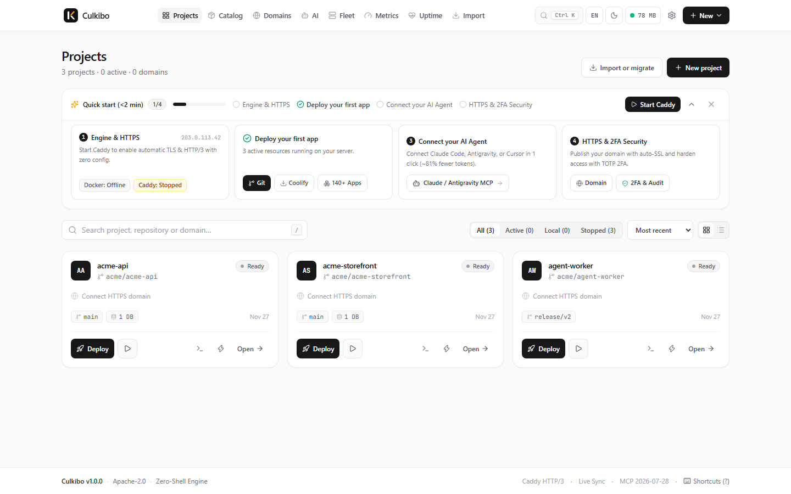
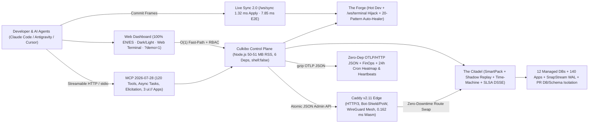

<div align="center">


# Culkibo

**The `50 MB`, Zero-Shell, AI-Native Self-Hosted PaaS (Open-Source Coolify & Dokploy Alternative)**
Deploy **140+ 1-Click Apps**, **12 Managed Databases**, **Sub-8ms Live Sync 2.0** (`1.32 ms` apply · `7.85 ms` E2E · `-96.1%` Brotli), **Zero-Dep Web Terminal**, **WireGuard Fleet Mesh**, **Caddy Edge Bot-Shield & PoW Gate**, **20-Pattern Build Auto-Healer**, **Cron Heatmap & Heartbeats**, **Shadow Replay Gate**, **Whole-Stack Time-Machine**, **Cloud FinOps**, **SmartPack**, **DirectPush (`culkibo pussh`)**, **EdgeTunnel**, **OTLP**, **Signed SLSA v1.1**, **`0.162 ms` Micro-Wasm**, and **120 MCP Tools + Async Tasks + 3 Inline MCP Apps** for **Claude Code, Antigravity, Cursor, Windsurf & Codex** — on a single `50–51 MB` Node.js control plane with **6 runtime dependencies** and **Caddy v2.11** atomic routing.

[](.github/workflows/release.yml)
[-10B981.svg)](.github/workflows/demo-pages.yml)
[](LICENSE)
[](.github/workflows/ci.yml)
[](#benchmarks-and-reproducible-results)
[](scripts/release-provenance.js)
[-0F172A.svg)](tests/shell-safety.test.js)
[](#ai-agent-native-mcp-2026-07-28-tasks-and-mcp-apps)

> **Try Culkibo in 10 Seconds — Zero Install, Zero Docker Required:**
> Launch the curated read-only **Interactive Browser Sandbox** directly on **[GitHub Pages (`?demo=1`)](https://macaqueboy.github.io/culkibo/?demo=1&lang=en&theme=dark)** *(published automatically via [`.github/workflows/demo-pages.yml`](.github/workflows/demo-pages.yml))* or locally in `<200 ms` with **`npx culkibo demo`**!

<p>
  
</p>

```bash
git clone https://github.com/macaqueboy/culkibo.git && cd culkibo
docker compose up -d --build
node bin/culkibo.js agent-init claude
```

[Visual Showcase](#visual-showcase) ·
[Why Culkibo](#why-culkibo-is-architecturally-different) ·
[Comparison Matrix](#honest-head-to-head-comparison) ·
[Benchmarks & Results](#benchmarks-and-reproducible-results) ·
[Architecture](#architecture) ·
[30-Second Quick Start](#30-second-quick-start) ·
[AI Agents & MCP Apps](#ai-agent-native-mcp-2026-07-28-tasks-and-mcp-apps) ·
[Coolify Migration](#1-click-coolify-v4-migration-and-portable-bundles) ·
[Open-Core & Roadmap](#ethical-open-core-and-community-roadmap) ·
[Contributing](#contributing-and-community)

</div>

---

Culkibo `v1.2.0` is an open-source **self-hosted PaaS** and **Coolify / Dokploy alternative** engineered for solo builders, platform teams, and AI coding agents. Instead of bolting a heavy PHP/Laravel or multi-container control stack on top of polling reverse proxies and shell scripts, Culkibo runs a single **50–51 MB RSS** daemon (`132.4 ms` cold boot, `9,693 req/s` authed Bearer+Brotli fast-path, `7,951 req/s` health) with **zero shell command construction**, atomic **Caddy v2.11** HTTP/3 ingress with **Native Edge Bot-Shield & Hashcash PoW**, **Sub-8ms Live Sync 2.0**, **Zero-Dep Container Web Terminal**, **Zero-Config WireGuard Fleet Mesh**, **24h Cron Collision Heatmap & Dead-Man's-Switch Heartbeats**, **20-Pattern Deterministic Build Auto-Healer**, **Shadow Traffic Replay Cutover Gates**, **Whole-Stack Time-Machine**, **Cloud FinOps Optimizer**, **SmartPack** + **DirectPush (`culkibo pussh`)**, **Sovereign EdgeTunnel**, **Zero-Dep OTLP/HTTP JSON**, **Signed SLSA v1.1 Ed25519 DSSE Releases + CycloneDX 1.6 SBOM**, **Atomic Single-Leader DB Migrations**, **`0.162 ms` warm p50 Micro-Wasm Edge Runtime** (`0.192 ms` p95, `64 KiB` RAM), and the industry's first **MCP `2026-07-28` (`120` tools, `-83%+` core profile, official Async Tasks, Elicitation & inline `ui://culkibo/*` MCP Apps)** control plane — verified by **44 integrated test suites**.

---

## Visual Showcase

Culkibo ships with a **Zero-Install Interactive Browser Sandbox (`?demo=1` / `npx culkibo demo`)**, **100% English & Spanish zero-dep localization** across every single view (auto-detecting browser locale, defaulting to English globally), **Obsidian Dark Mode & Crisp Light Mode**, a **Pioneer Cockpit UI** (Zero-Dep Container Web Terminal with live simulated Sandbox shell, 20-Pattern Build Auto-Healer, WireGuard Fleet Mesh Card, Caddy Edge Bot-Shield & Hashcash PoW Pill, 24h Cron Collision Heatmap & Heartbeats, SmartPack Inspector, Shadow Replay Gate, Whole-Stack Time-Machine, SLSA Ed25519 Verifier, Atomic DB Migration Pre-Flight, `<1 ms` Micro-Wasm Tester, FinOps Cloud Savings Calculator, DirectPush SSH Modal, Sovereign EdgeTunnel Manager, Native OTLP Export Drawer, and Coolify Live Volume/SQL Streamer), and an interactive **Spatial SVG Topology Canvas** with click-to-link database env injection.

### Live Sync 2.0 (`1.32 ms` Apply · `7.85 ms` E2E) + Inline MCP Apps Flow

<p align="center">
  
</p>

### Obsidian Dark Mode & Light Mode (100% Global EN / ES Dashboard)

| Obsidian Dark Mode (`1440×900`) | Crisp Light Mode (`1440×900`) |
| :---: | :---: |
|  |  |

### Spatial SVG Topology Canvas & Click-to-Link DB Injection (`Obsidian Dark`)


### AI Agent Hub — MCP `2026-07-28`, `-83%+` Token Profiles & Interactive MCP Apps (`ui://culkibo/*`)


---

## Why Culkibo Is Architecturally Different

Traditional self-hosted PaaS platforms force a painful trade-off: burn 500 MB–1.5 GB of VPS RAM just to run the panel, wait 1–4 minutes per Docker rebuild while iterating with AI coding agents, babysit Traefik reload races or OOM Compose limits, and live with recurring shell-injection CVEs. Culkibo fixes these problems at the architecture layer:

### 1. Zero-Shell Engine (`shell: false`), CVE Immunity, SLSA v1.1 DSSE & CycloneDX 1.6 SBOM
- Every subprocess (`docker`, `git`, `caddy`, `ssh`, `cron`, `exec`, `npm`) is invoked through `spawn()` / `execFile()` with tokenized `argv` arrays validated by [`safeCommand.js`](server/services/safeCommand.js) and `shell: false`. Secrets travel exclusively via ephemeral `0600` `--env-file` descriptors or `GIT_ASKPASS` — never interpolated into shell strings, CLI arguments, or `.git/config`. Statically verified on every commit by [`tests/shell-safety.test.js`](tests/shell-safety.test.js).
- **By-Design Immunity to Real-World PaaS CVEs & Failure Modes ([`docs/COMPETITOR_RADAR_CYCLE6.md`](docs/COMPETITOR_RADAR_CYCLE6.md)):** Immune to Dokploy **`CVE-2026-129433`** (backup/DB shell injection — zero shell construction + strict metacharacter rejection), **`kamal#1709`** (`syslog`/`journald` log-driver crash — automatically omits `max-size`/`max-file` on non-json/local drivers), **`kamal#1856`** (Docker `iptables` UFW bypass exposing DBs — private bridge default + WireGuard Mesh + `UFW_DOCKER_BYPASS_RISK` doctor audit), **`coolify#10791`/`dokploy#2227`** (graceful `--stop-timeout`), and **`dokploy#6028`** (per-project isolated bridge `culkibo-net-<id>`).
- **Zero-Dep SLSA Provenance v1.1 + Ed25519 DSSE ([`supplyChainAttestor.js`](server/services/supplyChainAttestor.js) · `culkibo verify` + Project Cockpit Verifier):** Signs every Citadel release and every GitHub Release as an in-toto `Statement/v1` (`slsa.dev/provenance/v1`) using standard **DSSE PAE** and built-in `node:crypto` Ed25519 keys (`0600`, `CULKIBO_DATA_DIR`-isolated). Verify offline anytime via `culkibo verify` or the 1-click **SLSA Ed25519 Verification** panel inside Project Detail.
- **Zero-Dep CycloneDX 1.6 SBOM & Signed GitHub Releases ([`release-provenance.js`](scripts/release-provenance.js)):** Run `node scripts/release-provenance.js --out-dir dist-release --sign --verify` or query `GET /api/system/sbom` (`application/vnd.cyclonedx+json`) to generate a CycloneDX 1.6 SBOM (`93` lockfile components with npm PURLs & SHA-512 hashes), `CHECKSUMS.sha256`, **`release.slsa.dsse.json`**, and **`attestation-public-key.pem`** — published and verified automatically on every `v*` GitHub Release via [`.github/workflows/release.yml`](.github/workflows/release.yml).

### 2. `50–51 MB` Idle RAM, `9,693 req/s` Control Plane, OTLP, FinOps & Cron Heartbeats
- **Measured live (independent QA):** **50–51 MB RSS** idle daemon (~68 MB full stack incl. ~18 MB Caddy estimate, `<= 60 MB` invariant), **0% idle CPU**, **132.4 ms** cold boot, **9,693 req/s** authenticated Bearer+Brotli fast-path (`p50 2.31 ms`, `p99 3.91 ms`, `Server-Timing: cp;dur=0.02`), and **7,951 req/s** health (`p50 2.68 ms`) — fitting comfortably on a **$4/mo 512 MB–1 GB VPS**.
- **Minimal supply-chain blast radius:** Exactly **6** root npm runtime dependencies ([`package.json`](package.json): `express`, `ws`, `chokidar`, `commander`, `cors`, `dotenv`) and **0** dependencies in [`telemetry-collector/`](telemetry-collector/README.md) — enforced across Node `20`, `22`, and `24` in [`.github/workflows/ci.yml`](.github/workflows/ci.yml).
- **Zero-Dep Spec-Compliant OTLP/HTTP JSON Exporter ([`otlpExporter.js`](server/services/otlpExporter.js)):** Streams gzip-compressed `/v1/traces` and `/v1/metrics` directly to **Grafana Tempo, SigNoz, Honeycomb, or any OTLP collector** using strict **lowercase hex** `traceId`/`spanId` (W3C `traceparent`), a bounded 256-span ring buffer, circuit-breaker backoff, and SSRF protection — **zero `@opentelemetry/*` packages required**.
- **24h Cron Collision Heatmap & Dead-Man's-Switch Heartbeats ([`cronManager.js`](server/services/cronManager.js)):** Projects hourly cron and DB backup windows (`GET /api/crons/timeline`) to highlight overlapping heavy-IO bursts before they spike VPS CPU, and ships built-in Healthchecks.io-style `/api/heartbeat/:token[/{start|fail}]` push monitors with constant-time token lookup and missed-ping alerting.
- **Self-Hosted vs Cloud FinOps & Right-Sizing Engine (`server/services/finopsOptimizer.js` · `culkibo finops` + Observability Card):** Flags over-provisioned containers and idle Auto-Sleep candidates, recommends right-sized Hetzner/DigitalOcean/Vultr/OVH VPS tiers, and calculates transparent annual savings against published Vercel Pro, Railway, Render & Managed Postgres pricing tiers.

### 3. Sub-8ms Live Sync 2.0, Web Terminal, 20-Pattern Auto-Healer, Shadow Replay & `0.162 ms` Micro-Wasm
When coding with Claude Code, Antigravity, Cursor, or Windsurf, waiting 2–4 minutes per push destroys flow:

```text
Traditional PaaS:  save file -> git commit -> push -> webhook -> Docker rebuild (1-4 min) -> check
Culkibo Forge:     save file -> binary Commit Frame (/ws/sync, Brotli -96.1%) -> 1.32 ms apply / 7.85 ms E2E
Culkibo Citadel:   env edit  -> Fast Restart (~1.5 s) OR BuildKit -> Auto-Healer / Shadow Replay -> Caddy cutover
```

- **Adaptive binary framing (`0x02` Brotli / `0x03` Gzip):** `-96.1%` wire reduction on 100-file TSX bursts, SHA-256 LRU deduplication, chunked transfers (`<=100 MB` with SHA-256 check), client/server **Merkle Tree** verification, conflict detection, and **in-memory time-travel patch rollback (`1.91 ms p50`)**.
- **Zero-Dep Interactive Container Web Terminal (`server/services/containerTerminalService.js`):** Streams live container shells directly over Docker Engine Unix/TCP hijack (`POST /api/projects/:id/terminal/ticket` → `/ws/terminal`) with RBAC `runtime:exec`, single-use auth ticket, and 15-minute idle cap — **zero `node-pty` native addons**, plus an interactive simulated shell right inside the `?demo=1` Browser Sandbox.
- **20-Pattern Deterministic Build Auto-Healer (`server/services/buildHealerService.js` · `culkibo heal` + MCP `culkibo_heal_build_failure`):** Diagnoses failing build and runtime logs across 20 deterministic failure classes (Node OOM `JavaScript heap out of memory`, `127.0.0.1` loopback bind bugs, lockfile drift, `kamal#1709` log-driver mismatch, Postgres `pg_wal` bloat, port collisions, missing native deps) with confidence scores and safe dry-run patch previews.
- **Shadow Traffic Replay & Automatic Cutover Gate (`server/services/shadowReplayService.js`):** Replays baseline vs candidate HTTP probes before flipping Caddy traffic — checking status codes, 5xx deltas, JSON response schema drift, and p95 latency ratios to issue an automated **`PROMOTE`** or **`BLOCK_CUTOVER`** gate verdict (zero broken production cutovers!).
- **Whole-Stack Time-Machine Checkpoints (`server/services/timeMachineService.js` · `culkibo timemachine`):** Cryptographically hashed (`SHA-256`) whole-stack snapshots capturing image tag, env keys (zero plaintext secrets stored), domains, edge rules, crons & resource limits — with structural `diff`, `dryRun` restore previews, and atomic rollback that automatically creates a pre-restore safety checkpoint.
- **Runtime-Only Fast Restart (`POST /api/projects/:id/fast-restart`):** Changing runtime environment variables recreates the container from its immutable image with bounded log rotation, graceful `--stop-timeout`, Vault resolution, healthcheck, and atomic Caddy swap — **zero unnecessary rebuilds**.
- **`0.162 ms` Warm p50 Isolated Micro-Wasm Edge Runtime ([`wasmMicroRunner.js`](server/services/wasmMicroRunner.js) + Project Cockpit Playground):** Execute sandboxed WebAssembly modules (`POST /api/projects/:id/wasm/invoke`, including 1-click `smokeTest: true`) in isolated `worker_threads` with strict memory & execution timeouts — live-measured at **`0.162 ms` warm p50**, **`0.192 ms` p95**, and **`64 KiB` RAM** (`0.613 ms` cold, zero host filesystem/network access).
- **Honest scope:** Live Sync 2.0 accelerates incremental code/asset iteration (*Path B*). Dependency or `Dockerfile` changes run full immutable Docker BuildKit builds (*Path C*) with smoke tests, shadow replay gates, and multi-release rollback.

### 4. World-First PaaS MCP Apps (`ui://culkibo/*`), Official Async Tasks & Elicitation (`MCP 2026-07-28`)
- **120 Tools, 13 Playbook Prompts & 10 Resources** over Streamable HTTP (`POST /api/mcp`) and stdio (`culkibo mcp`) with legacy SSE fallback — verified end-to-end against a real spawned stdio JSON-RPC client ([`tests/release-and-mcp-e2e.test.js`](tests/release-and-mcp-e2e.test.js)), including `culkibo_heal_build_failure`, `culkibo_fleet_mesh`, `culkibo_cron_timeline`, `culkibo_edge_shield`, `culkibo_shadow_replay`, `culkibo_time_machine`, and `culkibo_finops_report`.
- **Official MCP `2026-07-28` Async Tasks (`io.modelcontextprotocol/tasks`) & Elicitation (`elicitation/create`):** Long-running Docker builds, Coolify migrations, and DR drills run non-blocking via `tasks/list`, `tasks/get`, `tasks/result`, and `tasks/cancel` with strict cross-tenant RBAC isolation — and declare structured JSON Schema `elicitation` prompts for missing secrets or deployment approvals.
- **5 Context-Saving Profiles (`?profile=core|deploy|ops|security|all` & `CULKIBO_MCP_PROFILE`):** `?profile=core` serves the 17 essential tools (`17 / 120`) and cuts LLM tool-schema context by **`-83%+`** while `culkibo_search_tools` discovers any of the remaining 120 tools on demand.
- **Interactive Inline MCP Apps (`modelcontextprotocol/ext-apps` `2026-01-26`):** Serves 3 sandboxed interactive HTML apps (`ui://culkibo/topology`, `ui://culkibo/incident-remediator`, `ui://culkibo/coolify-migration-diff`) with locked-down `_meta.ui.csp` (`default-src 'none'`), zero external URLs, XSS-safe JSON injection, and `postMessage` JSON-RPC bridges so compliant AI hosts render live visual cards inline inside chat.

### 5. Zero-Dep Build, Registry-Less Push, WireGuard Fleet Mesh & Caddy Edge Bot-Shield
- **Culkibo SmartPack ([`smartPackBuilder.js`](server/services/smartPackBuilder.js) · `culkibo smartpack` + Project UI Inspector):** Detects **18 stacks** (`Next.js`, `Nuxt`, `SvelteKit`, `Astro`, `Vite`, `Node`, `Bun`, `Deno`, `Python uv/Poetry`, `Go`, `Rust`, `PHP/FrankenPHP`, `Elixir`, `Java`, `Static`, `Dockerfile`), emits deterministic inspectable `build-plan.json`, auto-synthesizes implicit `.dockerignore`, injects BuildKit 1.7 cache mounts + host-aware cgroup `--memory`/`--cpus` caps, and supports `zstd:chunked` OCI exports.
- **Culkibo DirectPush ([`directPushRegistry.js`](server/services/directPushRegistry.js) · `culkibo pussh` + Fleet UI Modal):** Loopback-only OCI Distribution v2 registry over Culkibo's existing zero-shell SSH tunnels — pushes **only missing SHA-256 layers** directly to remote fleet servers with **zero Docker Hub / GHCR required** and strict `400 DIGEST_INVALID` tamper rejection.
- **Zero-Config WireGuard Fleet Mesh (`server/services/fleetMeshService.js` · `culkibo mesh` + Fleet UI Card):** Generates native Node `x25519` keypairs encrypted at rest via AES-256-GCM to interconnect multi-VPS fleets over a private `10.88.0.0/24` L3 overlay (`wg0.conf` previews + safe dry-run key rotation), paired with `systemDoctor` UFW-bypass database audits (`kamal#1856`).
- **Sovereign EdgeTunnel ([`edgeTunnelService.js`](server/services/edgeTunnelService.js) · `culkibo tunnel-agent` + Domains UI Manager):** Zero-dep multiplexed binary WebSocket (`ET1`) outbound tunnel behind any home NAT/CGNAT (up to 128 concurrent streams/connection, constant-time HMAC-SHA256 auth, IMDS SSRF protection) — giving you **both** 1-click Cloudflare Tunnels AND a 100% sovereign self-hosted alternative!
- **Caddy Native Edge Bot-Shield & Hashcash PoW Gate (`server/services/edgeShieldService.js` + Caddy v2.11 Edge):** Zero-plugin Caddy v2.11 bad-scanner & AI-scraper matchers plus an Anubis-inspired SHA-256 Proof-of-Work cookie gate (`ckb_shield`), alongside per-domain TLS fault isolation, Pingora-style `streamCloseDelayMs` / `shutdown_delay` drain barriers, RFC 8297 `103 Early Hints`, native **HTTP/3 (QUIC)**, **7-provider DNS-01 Wildcard TLS** (`Cloudflare`, `Hetzner`, `DigitalOcean`, `AWS Route 53`, `Porkbun`, `Bunny`, `DuckDNS`), pure OpenBSD bcrypt Basic Auth, IP Allowlists, ForwardAuth, and CORS/HSTS.

### 6. Atomic DB Migrations, 1-Click Coolify v4 Migration & Enterprise Defense-in-Depth
- **Atomic Single-Leader Pre-Deploy DB Migrations ([`migrationRunner.js`](server/services/migrationRunner.js) + Project Cockpit Pre-Flight Planner) & Per-PR Postgres Schema Isolation:** Single-leader lease locks with dead-PID/TTL recovery prevent concurrent replica migration races, trigger optional pre-migration snapshots, abort route cutover cleanly on failure, and isolate PR previews via dedicated PostgreSQL schemas (`pr_<n>`) or `TEMPLATE`/SQLite CoW database branches with automatic teardown.
- **Coolify v4 Deep Migrator ([`docs/MIGRATION_GUIDE.md`](docs/MIGRATION_GUIDE.md)) & Portable `.zip` Bundles ([`bundleArchiver.js`](server/services/bundleArchiver.js)):** Translates Coolify v4 Magic Variables (`${SERVICE_FQDN_*}`, `${SERVICE_PASSWORD_*}`, `${COOLIFY_*}`) into domains & `${vault.*}`, converts plain & Base64 Traefik labels into Caddy v2.11 edge config, generates zero-shell Volume & SQL streaming runbooks (`POST /api/import/coolify/stream-plan`), and is battle-tested end-to-end against a full Mock Coolify v4 Estate ([`tests/coolify-e2e-replay.test.js`](tests/coolify-e2e-replay.test.js)).
- **12 Managed Databases, SnapStream & Enterprise Security Built In (Never Paywalled):** `PostgreSQL`, `pgvector`, `TimescaleDB`, `MySQL`, `MariaDB`, `Valkey`, `Redis`, `Dragonfly`, `MongoDB`, `ClickHouse`, `Qdrant`, and `Meilisearch` + **AES-256-GCM S3/R2 DR Drills** + **SnapStream** ([`sqliteStreamBackup.js`](server/services/sqliteStreamBackup.js) SQLite WAL-to-S3 PITR) + 4-role RBAC, `HttpOnly` sessions, **TOTP 2FA**, **OIDC PKCE SSO** (`groups` → RBAC + resilient JWKS stale-while-revalidate), hash-chained audit log, secret scanner (`422`), deploy freeze (`423`), webhook replay protection (`<=300s`), symlink-safe GitOps, protected sleeping-container prune guards, and dead-PID deploy-lock recovery.

---

## Honest Head-to-Head Comparison

> **Radical Transparency:** Culkibo's metrics below are **live-measured** via `node bench/run-all.bench.js` (unadjusted). Competitor footprints are **documented architecture baselines** from published stacks and minimum VPS docs (not executed on this host).

| Capability | Culkibo v1.2 | Coolify v4 | Dokploy | CapRover | Kamal 2 | Portainer CE |
| :--- | :---: | :---: | :---: | :---: | :---: | :---: |
| **Control-Plane Stack** | **Node.js (6 deps) + Caddy** | Laravel + PHP + PG + Redis + Soketi + Traefik | Next.js + PG + Redis + Traefik | Node.js + Nginx + Swarm | Local Ruby CLI + `kamal-proxy` | Go + BoltDB *(container UI)* |
| **Control-Plane RAM Footprint** | **50–51 MB RSS** *(~68 MB w/ Caddy, measured)* | ~800 MB – 1.5 GB *(2 GB VPS min)* | ~450 – 800 MB *(1–2 GB VPS)* | ~150 – 300 MB *(300–450 MB w/ Swarm)* | 0 MB panel *(+15–25 MB proxy)* | ~100 – 200 MB *(external proxy)* |
| **Zero-Shell + Supply-Chain & CVE Immunity** | ✅ **`0` shell · `CVE-2026-129433` immune · SLSA v1.1 + SBOM** | ❌ PHP shell | ❌ Child shell | ⚠️ Swarm CLI | ⚠️ SSH shell | ✅ Docker API |
| **Reverse Proxy, Bot-Shield & PoW Gate** | **Caddy v2.11 atomic API** *(HTTP/3, Bot-Shield & PoW)* | Traefik *(2,000 ms file throttle)* | Traefik / Swarm | Nginx reload | `kamal-proxy` *(<1 ms swap)* | ❌ External |
| **Live Sync 2.0 + Fast Env Restart** | ✅ **`1.32 ms` apply · `7.85 ms` E2E · zero-rebuild env** | ❌ Full rebuild | ❌ Full rebuild | ❌ Image build | ❌ Image build | ❌ |
| **Web Terminal + 20-Pattern Auto-Healer** | ✅ **Direct Docker hijack `/ws/terminal` + `culkibo heal`** | ⚠️ PTY dep | ⚠️ PTY dep | ❌ | ❌ | ✅ Exec UI |
| **Shadow Replay Gate + Whole-Stack Time-Machine** | ✅ **Auto `PROMOTE`/`BLOCK` + SHA-256 stack restore** | ❌ | ❌ | ❌ | ❌ | ❌ |
| **AI-Agent Native MCP + Tasks + MCP Apps** | ✅ **120 tools · Async Tasks · 3 `ui://` Apps · `-83%+`** | ❌ *(3rd-party)* | ❌ *(3rd-party)* | ❌ | ❌ | ❌ |
| **SmartPack + Registry-Less DirectPush** | ✅ **18 stacks · `culkibo pussh` SSH OCI v2** | ⚠️ Nixpacks | ⚠️ Nixpacks | ⚠️ Buildpacks | ❌ Registry req. | ❌ |
| **WireGuard Mesh + EdgeTunnel + `0.162 ms` Wasm** | ✅ **Native `x25519` Mesh + `ET1` + CF + Micro-Wasm** | ⚠️ CF manual | ⚠️ CF manual | ❌ | ❌ | ❌ |
| **OTLP + FinOps + Cron Heatmap & Heartbeats** | ✅ **Zero-dep OTLP · FinOps · `/api/heartbeat` · 24h map** | ❌ External | ❌ External | ❌ | ⚠️ Manual hook | ❌ |
| **1-Click App Catalog & Managed DBs** | ✅ **140 pinned apps · 12 DBs · SnapStream · PR DBs** | ✅ Extensive | ✅ Extensive | ✅ One-click | ❌ Manual | ⚠️ Templates |
| **Teams RBAC + 2FA + OIDC Groups** | ✅ **4-role RBAC + TOTP + OIDC `groups` + JWKS SWR** | ⚠️ Coarse teams | ⚠️ Basic | ❌ | ❌ | ⚠️ Paid Business |
| **Declarative GitOps + Scale-to-Zero** | ✅ **`culkibo.yaml` + Auto-Sleep** | ⚠️ External Sablier | ❌ Requested | ❌ | ✅ `deploy.yml` | ⚠️ Git stacks |
| **1-Click Coolify v4 Migration** | ✅ **Magic Vars + Traefik→Caddy + SQL/Vol Stream + `.zip`** | — | ❌ | ❌ | ❌ | ❌ |

---

## Benchmarks and Reproducible Results

Every Culkibo metric below comes from real code independently measured on `Node v24.14.0` (`win32/x64`, uncontended run) with **zero synthetic delays and zero subtracted overhead**. Reproduce the complete suite or generate a Markdown/JSON comparison report on your own machine:

```bash
node bench/run-all.bench.js
node bench/competitor-comparison.bench.js --markdown
```

### Independently Verified Live Performance Results (`v1.2.0` Record Run)

| Metric | Live Measured Result | Notes & Verification Command |
| :--- | :--- | :--- |
| **Idle Daemon RAM / CPU** | **50–51 MB RSS · 0% CPU** | ~68 MB full stack incl. ~18 MB Caddy estimate (`<= 60 MB` invariant) |
| **Cold Boot Time** (`CULKIBO_SKIP_RECONCILE=1`) | **132.4 ms** | Measured via `process.hrtime.bigint()` (`npm run bench:control`) |
| **Authenticated Fast-Path (Bearer + Brotli, 500 req / 25w)** | **9,693 req/s** *(p50 `2.31 ms` · p99 `3.91 ms`)* | HMAC-SHA256 LRU cache + WeakMap zero-copy Brotli + `Server-Timing: cp;dur=0.02` |
| **Health HTTP (`GET /api/health`, 500 req / 25w)** | **7,951 req/s** *(p50 `2.68 ms`)* | Pre-compiled O(1) fast-path route map |
| **Mixed Uncompressed / RBAC Express HTTP (500 req / 25w)** | **3,566 req/s** mixed · **2,275 req/s** RBAC | `0` failures (`bench/control-plane.bench.js` & `bench/subsystems.bench.js`) |
| **Catalog Load (`GET /api/catalog`, 140 apps)** | **warm p50 `0.68 ms`** | `129.6 KB` → `34.5 KB` Brotli (**-73.4%**) |
| **Live Sync 2.0 (Path B Incremental Sync)** | **server apply p50 `1.32 ms` · E2E p50 `7.85 ms` (sub-8ms!)** | 100-file TSX burst Brotli **-96.1%** (`25.66×`) · in-memory rollback **p50 `1.91 ms`** |
| **Isolated Micro-Wasm Edge Runtime** | **warm p50 `0.162 ms` · p95 `0.192 ms` · `64 KiB` RAM** | Cold `0.613 ms` · verified via `bench/competitor-comparison.bench.js` & [`tests/migrations-and-wasm.test.js`](tests/migrations-and-wasm.test.js) |
| **WebSocket 40-Client Fan-Out** | **51.9 ms** (`40/40` initial state delivered) | Zero drops under concurrent churn (`tests/websocket-stress.test.js`) |
| **Caddy v2.11 Atomic Route Swap** | **Synchronous zero-poll Admin API** | Verified live in Linux CI ([`.github/workflows/ci.yml`](.github/workflows/ci.yml) `live-caddy-e2e`) & `npm run bench` |
| **MCP `2026-07-28` `?profile=core` Savings** | **-83%+ schema tokens** (`17 / 120` tools) | Verified via `bench/competitor-comparison.bench.js` + external stdio E2E |
| **Supply-Chain, Shell Safety & Test Suite** | **6 root deps · 0 collector deps · 0 shell calls · 44 suites** | Verified in CI + Signed `release.slsa.dsse.json` + CycloneDX 1.6 SBOM (`93` components) |

---

## Architecture

Culkibo separates rapid developer/AI iteration (**The Forge**) from immutable production releases (**The Citadel**) on a single lightweight control plane:



---

<a id="quick-start"></a>

## 30-Second Quick Start

### Prerequisites
- **Zero-Install Sandbox:** Any modern browser (`https://macaqueboy.github.io/culkibo/?demo=1&lang=en&theme=dark`) or Node.js 20+ for `npx culkibo demo`
- **Production VPS:** Debian 12 / Ubuntu 22.04+ (512 MB+ RAM; 1 GB+ recommended for Docker builds)
- **Docker Compose:** Docker Engine 24+ & Compose v2
- **Local Dev:** Node.js **20+** (22/24 LTS recommended). Docker and Caddy are optional locally.

### Option 1 — 10-Second Zero-Install Sandbox (`demo`)

Explore SmartPack, Spatial Topology, 140+ Catalog Apps, Coolify Migration, Native OTLP, and 3 inline MCP Apps with zero configuration:

```bash
npx culkibo demo
```

Or open the hosted read-only sandbox on **[GitHub Pages (`?demo=1`)](https://macaqueboy.github.io/culkibo/?demo=1&lang=en&theme=dark)**.

### Option 2 — Docker Compose (Recommended Production Stack, ~30s)

```bash
git clone https://github.com/macaqueboy/culkibo.git
cd culkibo
docker compose up -d --build
```

Starts the Culkibo daemon on `http://127.0.0.1:3030` wired over a private internal network to **Caddy v2.11** (ports `80`, `443/tcp`, `443/udp` for HTTP/3, with `:2019` Admin API never exposed to the host). See [`docker-compose.yml`](docker-compose.yml) and [`Dockerfile.caddy`](Dockerfile.caddy) for Multi-Wildcard DNS-01 builds.

### Option 3 — 1-Line Production VPS Installer (Debian / Ubuntu)

Installs an unprivileged `culkibo` user, Node.js 22, Docker, Caddy with automatic TLS + HTTP/3, hardened `systemd` unit, and a `0600` 256-bit auth token in `data/auth.json`:

```bash
curl -fsSL https://raw.githubusercontent.com/macaqueboy/culkibo/main/scripts/install.sh | sudo bash
```

Clean uninstall: `sudo bash /opt/culkibo/scripts/uninstall.sh` (verified against real Debian 12 + `systemd` via [`scripts/test-install.sh`](scripts/test-install.sh)).

### Option 4 — CLI-First Project, Pioneer & Supply-Chain Workflow

Install and run locally from source (Windows users can also run `./start.ps1`):

```bash
npm install && npm --prefix web install && npm run web:build && npm start
```

Then run the complete project, SmartPack, DirectPush, EdgeTunnel, and offline SLSA/SBOM verification lifecycle:

```bash
node bin/culkibo.js init .                           # Auto-detect stack & generate culkibo.yaml
node bin/culkibo.js smartpack . --dockerfile --json  # Inspect 18-stack build plan & .dockerignore
node bin/culkibo.js up .                             # Provision & start project
node bin/culkibo.js sync <projectId> .               # Start Live Sync 2.0 (1.32 ms apply)
node bin/culkibo.js deploy <projectId>               # Immutable BuildKit deploy + Shadow Replay + SLSA
node bin/culkibo.js heal build.log --json            # 20-pattern deterministic build auto-healer
node bin/culkibo.js mesh status --json               # Zero-config x25519 WireGuard fleet mesh
node bin/culkibo.js timemachine list <projectId>     # Inspect/diff/restore whole-stack checkpoints
node bin/culkibo.js finops --apps 5 --dbs 2          # Cloud-vs-Self-Hosted annual savings & right-sizing
node bin/culkibo.js pussh my-app:v1 --server srv1    # DirectPush registry-less SSH OCI v2 deploy
node bin/culkibo.js tunnel-agent --url wss://hub/ws/tunnel --token "$TUNNEL_TOKEN" --target 127.0.0.1:3000
node bin/culkibo.js verify dist-release              # Verify CHECKSUMS.sha256 & SLSA v1.1 DSSE offline
npm run release:sbom -- --out-dir dist-release --sign --verify  # Signed SLSA + CycloneDX 1.6 SBOM
```

---

## AI-Agent Native (MCP `2026-07-28`, Tasks and MCP Apps)

Culkibo is built from day one for autonomous and human-in-the-loop AI coding workflows — shipping **120 tools**, **13 playbooks**, official **MCP `2026-07-28` Async Tasks (`io.modelcontextprotocol/tasks`)**, **Elicitation (`elicitation/create`)**, and the first **`modelcontextprotocol/ext-apps` (`2026-01-26`)** interactive UI resources in any self-hosted PaaS.

### 1-Click Agent Kit Generator

Generate drop-in MCP configs (defaulting to `?profile=core` for **-83%+ token savings** across `17 / 120` tools and using `${CULKIBO_TOKEN}` env placeholders — never plaintext secrets):

```bash
node bin/culkibo.js agent-init claude       # .mcp.json + CLAUDE.md ops snippet
node bin/culkibo.js agent-init antigravity  # .antigravity/mcp.json (Streamable HTTP)
node bin/culkibo.js agent-init cursor       # .cursor/mcp.json
node bin/culkibo.js agent-init windsurf     # .windsurf/mcp_config.json
node bin/culkibo.js agent-init codex        # .codex/config.toml (bearer_token_env_var)
node bin/culkibo.js agent-init vscode       # .vscode/mcp.json
```

### Streamable HTTP (`2026-07-28`) — Antigravity, Claude Code, Cursor & Windsurf

Connect to `http://localhost:3030/api/mcp?profile=core` (or `deploy`, `ops`, `security`, `all`):

```json
{
  "mcpServers": {
    "culkibo": {
      "url": "http://localhost:3030/api/mcp?profile=core",
      "headers": {
        "Authorization": "Bearer ${CULKIBO_TOKEN}"
      }
    }
  }
}
```

### Stdio Bridge (Claude Desktop / Local CLI Agents)

```json
{
  "mcpServers": {
    "culkibo": {
      "command": "node",
      "args": ["/path/to/culkibo/bin/culkibo.js", "mcp"],
      "env": {
        "CULKIBO_API_URL": "http://localhost:3030",
        "CULKIBO_TOKEN": "${CULKIBO_TOKEN}",
        "CULKIBO_MCP_PROFILE": "core"
      }
    }
  }
}
```

### Interactive MCP Apps (`ui://culkibo/*`) & Built-In Playbooks (`prompts/list`)

| Interactive MCP App (`text/html;profile=mcp-app`) | Sandboxed Inline Experience (`_meta.ui.csp`) |
| :--- | :--- |
| `ui://culkibo/topology` | Live RBAC-scoped SVG service, database, domain & fleet map with 1-click inspect/ship actions |
| `ui://culkibo/incident-remediator` | Live OOM/CrashLoop diagnostics card with two-phase `dryRun` → HMAC `confirmToken` stepper |
| `ui://culkibo/coolify-migration-diff` | Coolify v4 Parity Score, redacted `${vault.*}` Magic Vars & Traefik→Caddy edge diff viewer |

| Playbook Prompt (`prompts/get`) | Autonomous Agent Workflow |
| :--- | :--- |
| `deploy_safely` | Pre-deploy secret scan → atomic DB migration → `culkibo_ship_and_verify` → SLSA attestation |
| `migrate_from_coolify` | Read-only Coolify v4 scan → Magic Var & Traefik translation preview → zero-downtime cutover |
| `debug_production_crash` | Runs `culkibo_diagnose_incident` → correlates OOM/logs/OTLP traces → proposes confirmed fix |
| `zero_downtime_db_upgrade` | Encrypted snapshot + SHA-256 verify + DR drill → single-leader migration → cutover |
| `security_audit_stack` | Verifies hash-chained audit log, SLSA DSSE attestations, secret scan, RBAC/2FA/OIDC & TLS |
| `setup_wildcard_tls_and_tunnel` | Configures 7-provider DNS-01 wildcard TLS or zero-open-port EdgeTunnel / Cloudflare Tunnel |
| `optimize_ram_and_costs` | Inspects Auto-Sleep candidates, container limits, and right-sizing savings |
| `disaster_recovery_drill` | Validates AES-256-GCM DR backup & SnapStream integrity via non-destructive restore drill |

---

## 1-Click Coolify v4 Migration and Portable Bundles

Moving off Coolify takes minutes — and is **read-only** on your source server until you flip DNS:

1. Open Culkibo (`http://localhost:3030`), press **`Ctrl+K`** / **`⌘K`**, and run **Import from Coolify** (or upload an offline export / portable `.zip` or `.ckb.gz` bundle).
2. Enter your Coolify URL and read-only API token to inspect the live **Migration Parity Report**:
   - Automatic **Magic Variable** translation (`${SERVICE_FQDN_*}`, `${SERVICE_PASSWORD_*}`, `${COOLIFY_*}` → Culkibo domains & encrypted `${vault.*}` refs)
   - Automatic **Traefik → Caddy v2.11** rule translation (plain & Base64 labels: `stripprefix`, `redirectregex`, CORS/HSTS, `forwardauth`, `basicauth`, upstream port)
   - Full mapping for Applications, Compose Services, 8 DB Engines, Scheduled Tasks → Crons, Persistent Volumes, and the interactive **Volume & SQL Live Transfer** zero-shell runbook (`POST /api/import/coolify/stream-plan`)
3. Click **Migrate**, run the built-in post-migration smoke check (`verifyMigratedStack`), and cut over DNS with zero downtime. Verified end-to-end across a full multi-app, multi-DB Mock Coolify v4 Estate in [`tests/coolify-e2e-replay.test.js`](tests/coolify-e2e-replay.test.js).

Read the complete step-by-step runbook in [`docs/MIGRATION_GUIDE.md`](docs/MIGRATION_GUIDE.md).

---

## Testing, CI and Repository Map

Culkibo ships **44 integrated test suites** in `tests/run-all.js` (including Mock-Coolify v4 E2E Estate Replay, real external MCP stdio protocol E2E, OTLP/SLSA attestation E2E, Atomic DB Migrations + `0.162 ms` Micro-Wasm E2E, Shadow Traffic Replay Gate, Whole-Stack Time-Machine + Cloud FinOps, Zero-Dep Container Web Terminal, WireGuard Fleet Mesh, Caddy Edge Bot-Shield & PoW Gate, 20-Pattern Build Auto-Healer, and 24h Cron Heatmap & Dead-Man's-Switch Heartbeats) + standalone live-server, WebSocket churn, HTTP stress, and zero-dep telemetry collector suites — verified continuously on Linux by [`.github/workflows/ci.yml`](.github/workflows/ci.yml) (`4` jobs: Node 20/22/24 matrix + Live Caddy v2.11 + Docker BuildKit SmartPack & SBOM E2E + Playwright Desktop/Mobile visual QA), released with signed SLSA v1.1 + CycloneDX 1.6 via [`.github/workflows/release.yml`](.github/workflows/release.yml), and published as a zero-install sandbox via [`.github/workflows/demo-pages.yml`](.github/workflows/demo-pages.yml):

```bash
node tests/shell-safety.test.js                       # Static AST/source check: 0 shell calls
npm run typecheck                                     # Server TypeScript checkJs (0 errors)
npx tsc -p web/tsconfig.app.json --noEmit             # Frontend TypeScript check (0 errors)
npx --prefix web oxlint --deny-warnings               # oxlint React 19 + Compiler rules (0 warnings)
npm run web:build                                     # Vite production build + .br/.gz precompression
npm test                                              # 44 suites + live-server + WS stress + HTTP stress
node --test telemetry-collector/test/collector.test.js  # Zero-dep telemetry collector suite
npm run release:sbom -- --out-dir dist-release --sign --verify  # Signed SLSA v1.1 + CycloneDX 1.6 SBOM
```

### Repository Layout

```text
.github/workflows/ci.yml         Active 4-job Linux CI (Node 20/22/24, Live Caddy, BuildKit SmartPack/SBOM, Playwright)
.github/workflows/release.yml    Automated v* GitHub Release workflow (Signed SLSA v1.1 DSSE + CycloneDX 1.6 SBOM)
.github/workflows/demo-pages.yml Zero-Install Interactive Browser Sandbox workflow (GitHub Pages ?demo=1)
bin/culkibo.js                   CLI (demo, init, up, sync, deploy, heal, mesh, timemachine, finops, smartpack, pussh, verify, mcp...)
scripts/release-provenance.js    Zero-dep CycloneDX 1.6 SBOM, SHA-256 checksums & Ed25519 SLSA DSSE signer
server/
  index.js                       O(1) fast-path HTTP daemon, Server-Timing, Brotli cache, /ws/terminal & /ws/sync
  middleware/auth.js             Constant-time tokens, RBAC middleware, single-use WS tickets, rate limits
  routes/api.js                  REST API (deploys, terminal, heal, mesh, edge-shield, heartbeats, shadow-replay, MCP)
  services/                      57+ zero-shell services (liveSyncEngine, containerTerminalService, fleetMeshService,
                                 edgeShieldService, buildHealerService, cronManager, shadowReplayService,
                                 timeMachineService, finopsOptimizer, smartPackBuilder, directPushRegistry,
                                 edgeTunnelService, sqliteStreamBackup, otlpExporter, supplyChainAttestor,
                                 migrationRunner, wasmMicroRunner, mcpAppsRenderer, mcpServer, caddyManager,
                                 coolifyMigrator, bundleArchiver, serverFleetManager, teamManager,
                                 editionService, databaseManager, catalog/templates.js [140 apps], auditLogger...)
telemetry-collector/             Zero-dep anonymous telemetry collector (node:sqlite WAL + CF Workers/D1)
web/src/                         React 19 + Tailwind v4 dashboard (100% EN/ES, Dark/Light, ?demo=1 Sandbox, Pioneer Cockpit)
bench/                           Reproducible live benchmarks (control-plane, live-sync, route-swap, subsystems)
scripts/                         Hardened Debian/Ubuntu VPS installer, uninstaller, systemd test & SBOM signer
tests/                           44 integrated + 4 standalone verification, E2E, security, fuzz & stress suites
docs/                            MIGRATION_GUIDE.md, GITHUB_SEO_LAUNCH_KIT.md, COMPETITOR_RADAR_CYCLE6.md, EVOLUTION_LOG.md, assets/
```

---

## Privacy and Transparent Telemetry

Culkibo includes opt-out anonymous crash/health telemetry scrubbed through an **11-phase PII sanitizer** (never collects secrets, domains, IPs, repo names, or payloads). Inspect the exact JSON envelope anytime (`node bin/culkibo.js telemetry preview`) or disable it instantly via `CULKIBO_TELEMETRY=0`, `DO_NOT_TRACK=1`, CLI (`telemetry disable`), or Settings. Full specification in [`PRIVACY.md`](PRIVACY.md) and [`telemetry-collector/README.md`](telemetry-collector/README.md).

---

## Ethical Open-Core and Community Roadmap

### Our Open-Core Promise (Enforced in [`editionService.js`](server/services/editionService.js))

- **Community Edition (`Apache-2.0`, Free Forever):** **100% of self-hosted core power with ZERO artificial limits** — unlimited projects, 12 databases, 140 catalog apps, Live Sync 2.0, Zero-Dep Container Web Terminal, Zero-Config WireGuard Fleet Mesh, 24h Cron Heatmap & Dead-Man's-Switch Heartbeats, Caddy Edge Bot-Shield & Hashcash PoW Gate, 20-Pattern Build Auto-Healer, Shadow Traffic Replay Gate, Whole-Stack Time-Machine, Cloud FinOps Optimizer, SmartPack, DirectPush, Sovereign EdgeTunnel, Zero-Dep OTLP, SLSA v1.1 Attestations, CycloneDX 1.6 SBOM, Atomic DB Migrations, `0.162 ms` Micro-Wasm Edge Runtime, SnapStream, PR Preview DB/Schema Isolation, Multi-Server SSH Fleet, Multi-User Teams & 4-role RBAC, TOTP 2FA, OIDC SSO (`groups` + JWKS SWR), GitOps `culkibo.yaml`, 120-tool MCP Server + Async Tasks + 3 MCP Apps, AES-256-GCM S3 DR Backups, Uptime Monitors & Status Pages, and Auto-Sleep Scale-to-Zero. **Zero phone-home.**
- **Optional Commercial Packs (`Pro` / `Enterprise` / `Cloud`):** Verified **100% offline via Ed25519 signed keys (`CKL1.*`)** — strictly for organizational scale & compliance: Managed Multi-Region Relay, White-Label Branding, Priority Support Bundles, Enterprise SCIM 2.0 / SAML 2.0, SOC2/ISO-27001 Signed Compliance Exports, and Managed Multi-AZ Cloud Control Plane.

### Public Engineering Roadmap (Zero New Runtime Deps)

- [x] **v1.0 – v1.1 (Shipped):** `50–51 MB RSS` fast-path + `Server-Timing`, 140 pinned catalog apps, 12 DB engines, Sub-8ms Live Sync 2.0, SmartPack (18 stacks), DirectPush (`culkibo pussh`), Sovereign EdgeTunnel (`ET1`), World-First PaaS MCP Apps (`ui://culkibo/*`), SnapStream WAL-to-S3 + PR Preview DB Branching, Runtime-Only Fast Restart, OIDC `groups`→RBAC, and Offline Ed25519 Open-Core editions.
- [x] **v1.2.0 (Shipped):** Zero-Install Browser Sandbox (`?demo=1` GitHub Pages + `npx culkibo demo`), 100% EN/ES Global UI + Obsidian Dark/Light modes, Pioneer Cockpit UI (Zero-Dep Container Web Terminal, 20-Pattern Build Auto-Healer, WireGuard Fleet Mesh, Caddy Edge Bot-Shield & Hashcash PoW Gate, 24h Cron Collision Heatmap & Heartbeats, SmartPack, Shadow Replay Gate, Whole-Stack Time-Machine, Cloud FinOps Calculator, SLSA Ed25519 Verifier, Atomic DB Migration Pre-Flight, `<1 ms` Micro-Wasm Playground), Zero-Dep OTLP/HTTP JSON Exporter, Signed SLSA v1.1 Ed25519 DSSE Releases + CycloneDX 1.6 SBOM, MCP `2026-07-28` (`120` tools, `-83%+` core, Async Tasks + `elicitation/create`), `0.162 ms` warm p50 Micro-Wasm (`0.192 ms` p95, `64 KiB` RAM), `CVE-2026-129433` / `kamal#1709` / `kamal#1856` immunity, Coolify v4 3-tier env precedence + multi-server mapping, 4-job Linux CI, and **44 integrated test suites**.
- [ ] **Next (v1.3 Ecosystem & Multi-Region):** Interactive drag-to-wire Topology edges, live multi-node Coolify v4 VPS migration showcase video, official Homebrew / Docker Hub / GHCR signed multi-arch (`amd64`/`arm64`) releases, and multi-region active-active failover policies.

---

## Contributing and Community

Contributions, bug reports, catalog templates, and benchmarks are warmly welcomed!

- **Read the guide:** [`CONTRIBUTING.md`](CONTRIBUTING.md) (setup, invariants, catalog & MCP authoring)
- **Report a bug or request a feature:** [`.github/ISSUE_TEMPLATE/`](.github/ISSUE_TEMPLATE/bug_report.md) · [`.github/PULL_REQUEST_TEMPLATE.md`](.github/PULL_REQUEST_TEMPLATE.md)
- **Report a security vulnerability privately:** [`SECURITY.md`](SECURITY.md)
- **Support the project:** If Culkibo saves you RAM, deploy wait time, or migration hours, please **Star this repository** on GitHub so more self-hosters and AI-native teams discover it!

---

## License

Licensed under the **[Apache License 2.0](LICENSE)** — Copyright © 2026 Pablo (`macaqueboy`).
